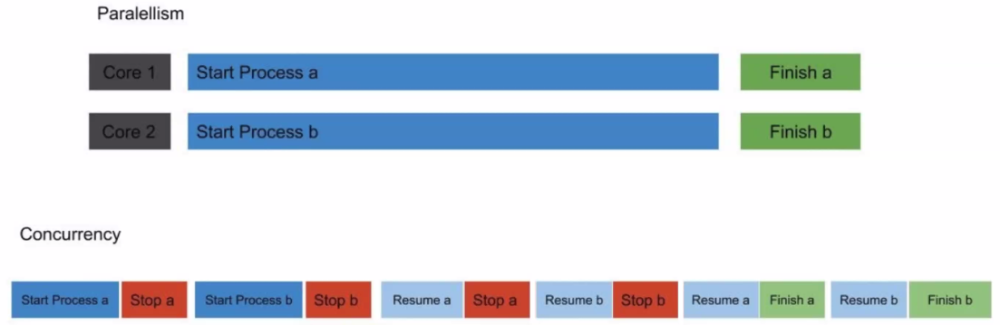
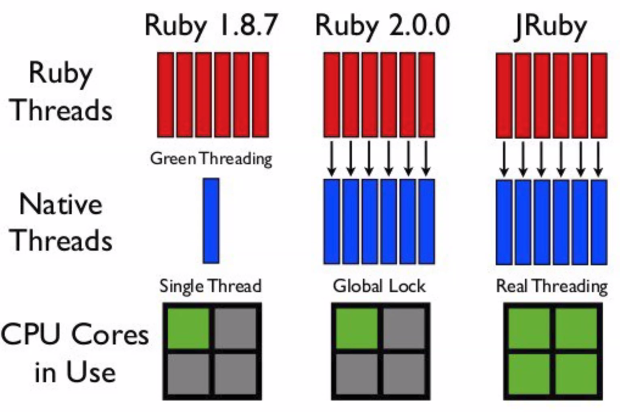

# Clase 1: Intro, concurrencia, procesos, threads y green threads

Clase introductoria a la materia. El recorrido es:

1. Qué entendemos por **arquitectura**.
2. Qué son **concurrencia** y **paralelismo**, y por qué la concurrencia trae problemas.
3. Con qué **unidades de ejecución** se maneja la concurrencia: procesos, threads y green threads.
4. **Ruby** como caso concreto: cómo cada implementación (MRI, JRuby) cambia lo que se puede hacer con esas unidades.
5. El **laboratorio con Puma**, donde se ve todo lo anterior funcionando.

---

## 1. Arquitectura de software

La arquitectura es el **diseño lógico a alto nivel** (cómo se divide el sistema en módulos o servicios y cómo se comunican) y también el **diseño físico** (en qué máquinas corre cada parte y cómo se despliega). Incluye las decisiones difíciles de revertir, como qué lenguaje o tecnología se adopta.

***"Diseñar en términos de módulos, diseño físico (hardware y despliegue)"***

No se diseña una sola vez: es un proceso de construcción que cambia con el tiempo, y solo debería cambiar **por necesidad** (un requerimiento nuevo que la arquitectura actual no soporta). Para nosotros es:

- **Iterativa**: aumentar la complejidad según la necesidad. Por ejemplo, empezar guardando en archivos, pasar a una base embebida (SQLite), después a un motor relacional, y recién después shardear.
- **Constructiva**: hay que meter las manos en el barro: medir, desplegar, programar, probar. No alcanza con diagramas.
- **Verificable**: se tiene que poder validar rápido, con métricas; si no hay feedback hasta dentro de meses, el proceso está fallando. Cuánto se exige depende del dominio.
- **Holística**: los aspectos humanos suelen pesar más que los técnicos: economía, finanzas, políticas (convenios con empresas), relaciones entre áreas.
- **Potenciada por la tecnología**: no reinventar la rueda y aprovechar lo ya probado, pero entendiendo el problema y sin armar un "supermercado de tecnologías". La tecnología no debe guiar las decisiones.
- **Enriquecida por la historia**: conocer lo que hicieron otros sistemas, sin copiarlo porque sí. Si Facebook hizo X, capaz tu solución no necesita X... ¡porque no sos Facebook!

**Cualidades que buscamos**:
- **KISS**: limitar la complejidad a la que exige el problema.
- **Mantenible** y que **resuelva el problema**.
- **No sobrediseñar** y **YAGNI** (*You Aren't Gonna Need It*): posponer soluciones a necesidades hipotéticas. Para un producto nuevo con demanda incierta, un monolito puede alcanzar.

Una de las decisiones de arquitectura más importantes de la materia es **cómo manejar varias tareas a la vez**. Para eso primero hay que separar dos conceptos que se suelen confundir.

---

## 2. Concurrencia y paralelismo

**Paralelismo no implica concurrencia y concurrencia no implica paralelismo.**



### Paralelismo
El **paralelismo** es la ejecución **simultánea** de dos o más operaciones. Es una propiedad **física**: requiere soporte de hardware (varios procesadores, núcleos). Permite que los programas corran más rápido y es una cuestión **no funcional**.

Los cómputos paralelos no necesitan comunicarse entre sí: los recursos ya están asignados, por lo que no traen tantos problemas como la concurrencia.

Niveles de paralelismo:
- **A nivel de bit**: una computadora de 64 bits es más rápida que una de 16 porque, para sumar dos números de 32 bits, la de 16 tiene que hacer varias operaciones; la de 64 lo hace de una, usando registros según su longitud.
- **A nivel de instrucción**: los procesadores usan *pipelining*, ejecución fuera de orden y ejecución especulativa (adelantan instrucciones según el *branching*) para ejecutar varias operaciones a la vez. Queda encapsulado "por atrás": el resultado se ve como si la ejecución hubiese sido secuencial.
- **A nivel de datos**: SIMD (*single instruction, multiple data*), la misma operación sobre muchos datos a la vez. No sirve para todo, pero sí para procesamiento de imágenes o entrenamiento de modelos; por eso existen las GPUs.
- **A nivel de tareas**: múltiples procesadores o threads a los que se les asignan tareas distintas, con memoria compartida o conectados por red o bus.

### Concurrencia
La **concurrencia** se da cuando existe **más de un contexto de ejecución** activo durante un mismo período. Es una propiedad **lógica**: da la sensación de que las tareas pasan a la vez. Por ejemplo, un procesador de texto valida la ortografía en segundo plano mientras escribimos.

Puede ocurrir **con o sin paralelismo**: en un solo procesador, los contextos se van alternando mediante desalojos y **cambios de contexto** (guardar el estado de una tarea y reanudar otra, lo que tiene un costo), y eso da la sensación de simultaneidad aunque no la haya.

La concurrencia es fuente de **no determinismo**: varios contextos pelean por los mismos recursos (procesador, datos, memoria) y el orden de ejecución puede variar, así que **ejecutar las mismas acciones puede dar resultados distintos**.

> **El problema es siempre la concurrencia**, venga o no del paralelismo: no se puede garantizar el orden de ejecución y, en consecuencia, tampoco el resultado. Durante la cursada vamos a ver distintos **modelos de concurrencia** que buscan evitar estos problemas.

### "Tipos" de proceso
Para elegir cómo manejar la concurrencia importa qué hace cada tarea la mayor parte del tiempo:
- **CPU bound**: usan la CPU de forma intensiva (cálculos). Solo se aceleran con más paralelismo o un procesador más rápido.
- **IO bound**: pasan la mayor parte del tiempo **esperando** entrada/salida (red, disco). Se benefician de poder hacer otra cosa mientras esperan.

---

## 3. Los problemas de la concurrencia

### Problemas clásicos
- **Condición de carrera**: hay varios caminos posibles en la ejecución concurrente y cada uno da un resultado distinto. Un mismo recurso es usado por varios contextos y el orden en que acceden altera el resultado final.
- **Starvation (inanición)**: a un proceso se le niega constantemente un recurso (por ejemplo, la CPU) porque siempre aparecen otros con mayor prioridad.

### Estado compartido y sincronización
El ejemplo típico: dos threads incrementan el mismo contador leyendo, sumando y escribiendo por separado. Ambos leen 10 y ambos escriben 11: **se pierde un incremento**. La parte del código que hay que proteger es la **sección crítica**, y siempre que haya memoria compartida hay que sincronizar.

- **Mutex**: deja entrar a un thread por vez a la sección crítica. Para el contador tiene que abarcar la lectura, la suma **y** la escritura.
- **Semáforo**: controla cuántos permisos se usan a la vez (por ejemplo, máximo 5 consultas concurrentes a una base).
- **Variable de condición**: permite esperar hasta que cambie una condición del estado compartido (un consumidor espera a que haya elementos en una cola).
- **Operación atómica**: hace indivisible una actualización puntual, como incrementar un contador.

La coordinación también cuesta: un mutex muy disputado **serializa** el trabajo, y si dos threads toman los mismos locks en orden inverso quedan en **deadlock** (interbloqueo): uno tiene A y espera B, el otro tiene B y espera A. Tomar los locks siempre en el mismo orden evita ese patrón.

Estos problemas aparecen de distinta forma según **qué unidad de ejecución** usemos para tener varias tareas a la vez. Vamos de la más pesada a la más liviana.

---

## 4. Unidades de ejecución: OS Processes → OS Threads → Green Threads



### OS Processes
Un **proceso** es un programa corriendo, con **su propia memoria** (su espacio de direcciones). Lo gestiona el kernel, que lo puede desalojar en cualquier momento.

- ✅ **Aislamiento**: si se cae, no afecta a los otros, y no comparte memoria, así que no hay carreras sobre datos en memoria.
- ❌ Es **caro** de crear y de cambiar.
- Para comunicarse con otros procesos usa mensajes, pipes, sockets o memoria compartida configurada explícitamente.

### OS Threads
Un **thread del SO** vive **dentro de un proceso** y comparte la memoria con sus hermanos (cada uno tiene su propia pila y estado de ejecución). También lo gestiona el kernel, que lo puede **correr en paralelo real** en otro núcleo y lo puede desalojar en cualquier momento.

- ✅ Más barato que un proceso, en overhead y memoria, y compartir datos es directo.
- ❌ Crearlo y cambiar entre threads sigue costando algo, y como comparten memoria, el acceso a datos mutables necesita **sincronización** (sección 3).

Cosas a tener claras del multi-threading:
- Con un único core (o con un lock que solo deja usar un core), los threads dan concurrencia, pero el código tiene que ser *thread-safe*.
- Levantar varios threads **no garantiza** que corran en paralelo, aunque haya varios cores: qué thread corre en qué core lo decide el **scheduler del SO**, no la aplicación.
- **El código multihilo es concurrente, no paralelo.** Que además sea paralelo depende del entorno (núcleos disponibles y planificador). No podés forzar la paralelización, pero al hacerlo concurrente le das al sistema la posibilidad de paralelizarlo.

Es el **modelo tradicional**: en la **JVM**, `new Thread()` mapea 1:1 a un thread del SO. (Desde Java 21 existen los **virtual threads** de Project Loom, que son livianos y gestionados por la JVM: se parecen más a los green threads.)

| Modelo | Qué comparte | Cómo se coordina |
| --- | --- | --- |
| **Varios procesos** | Cada proceso tiene su propio espacio de direcciones | Mensajes, pipes, sockets o memoria compartida explícita |
| **Varios threads de un proceso** | El espacio de direcciones y los recursos del proceso | Acceden a los mismos objetos: hace falta sincronización |
| **Varios procesos con varios threads** | Cada proceso su espacio; sus threads comparten los datos de ese proceso | Mecanismos entre procesos + sincronización dentro de cada uno |

Los procesos dan **aislamiento**; los threads facilitan **compartir datos**.

### Green Threads
Un **green thread** es como un thread, pero **el kernel ni se entera de que existe**: lo maneja el runtime del lenguaje en espacio de usuario (Go, Erlang, Ruby viejo). Varios green threads corren sobre uno o más threads del SO.

- ✅ Súper baratos de crear y de cambiar: se pueden tener miles.
- ❌ Si el runtime no lo maneja bien, uno bloqueado (por ejemplo, en una I/O bloqueante) puede trabar a todos los que comparten su thread del SO.

### Resumen de las tres

| | OS Process | OS Thread | Green Thread |
|---|---|---|---|
| Lo gestiona | El kernel | El kernel | El runtime del lenguaje |
| Memoria | Propia | Compartida con el proceso | Compartida con el proceso |
| Costo de crear/cambiar | Alto | Medio | Muy bajo |
| Paralelismo real | Sí | Sí | Solo si el runtime los reparte en varios threads del SO |
| Desalojo | Apropiativo (kernel) | Apropiativo (kernel) | Cooperativo o apropiativo (runtime) |

Los dos tipos de **desalojo** de la última fila:
- **Apropiativo** (*preemptive*): te desalojan aunque no quieras. Es lo que hace el kernel con procesos y threads. En los green threads, el runtime (como las goroutines de Go en versiones recientes o los procesos de Erlang) mete chequeos en puntos del código para forzar la cesión.
- **Cooperativo** (los green threads clásicos, o el `async`/`await` de Python que vemos en la próxima clase): nadie te desaloja. Vos cedés el lugar con un `yield`, un `await` o una operación de I/O. Si nunca cedés, bloqueás a todos los demás.

### Bonus: executors, pools y bulkhead
Crear un thread por cada tarea es caro y, sin control, te quedás sin memoria. Un **executor** es una capa encima de los threads: le dejás tareas en una bandeja y él las reparte entre un **pool** acotado de threads que ya están vivos y se reutilizan (el "encargado de turnos"). Cuando todos están ocupados, las tareas esperan en una cola o reciben una respuesta de sobrecarga. Con virtual threads (Java 21+) a veces conviene un thread por tarea, porque ya no hay tanto costo que amortizar.

> **Bulkhead pattern** (de los compartimentos estancos de un barco): separar los pools **por tipo de tarea o dependencia**, para que si una se satura no tumbe a las demás. Por ejemplo, un pool para llamar a una API externa lenta y otro para consultar la base: si la API se cuelga, solo se agota su pool.

Hasta acá, todo es independiente del lenguaje. Pero el **lenguaje y su implementación** pueden limitar qué de esto se puede usar. Antes de ver el caso de Ruby, un repaso de cómo se ejecuta un lenguaje.

---

## 5. Repaso: lenguajes compilados, interpretados y máquinas virtuales

- **Compilado** (C, C++): el compilador traduce el código fuente a código máquina de una arquitectura concreta. Pasos: fuente (`.c`) → compilación (análisis léxico, sintáctico y semántico) → objeto (`.o`/`.obj`) → **link** con las bibliotecas → ejecutable. Bajo overhead en ejecución, pero poco portable: hay que recompilar para cada SO/arquitectura.
- **Interpretado**: un intérprete lee y ejecuta el código en tiempo de ejecución. A veces se traduce primero a **bytecode**, que ejecuta una **máquina virtual** (Ruby, Python, Java). Es portable (alcanza con tener la VM), pero tiene más overhead en ejecución.
- **Java y la JVM**: Java se compila a bytecode (`.class`), independiente de la arquitectura. La JVM carga las clases a medida que las necesita (*class loading*) y las traduce a código máquina con el **intérprete** (instrucción por instrucción) o con el **JIT** (*Just In Time*), que detecta las secciones que se ejecutan seguido y las compila a código máquina optimizado.
- **Máquina virtual**: programa que emula una computadora dentro de otra; abstrae el hardware y el SO. Por eso muchos lenguajes, no solo Java, pueden correr sobre la JVM: alcanza con compilarlos a su bytecode. **Así funciona JRuby.**

---

## 6. Ruby: implementaciones y el GIL

Cada lenguaje puede tener varios intérpretes o compiladores; en Ruby se los llama **implementaciones**. Ruby es el **lenguaje**; la versión del lenguaje (2.7, 3.2) no está atada a una implementación, y cada una decide qué versión soporta (por ejemplo, JRuby 9.3 implementa Ruby 2.6.8).

Lo importante para la materia: **cada implementación maneja threads, concurrencia y paralelismo de forma distinta, y eso repercute en la arquitectura**. Agregarle cores al servidor no hace que el código corra más rápido si la implementación no los puede aprovechar.

| Implementación | Escrita en | Características |
|---|---|---|
| **MRI** (CRuby) | C | La oficial. Tiene GIL |
| **JRuby** | Java | Corre sobre la JVM, interopera con Java y aprovecha su JIT |
| **Rubinius** | C++ y Ruby | Inspirada en la VM de Smalltalk, GC más moderno |
| **TruffleRuby** | Java (sobre GraalVM) | Muy optimizada para performance, usa el Graal JIT |
| **Artichoke** | Rust | Experimental |

En la materia solo vemos **MRI** y **JRuby**.

### MRI y el GIL
**MRI (Matz Ruby Interpreter)** tiene un **GIL** (*Global Interpreter Lock*, también GVL o *Global Lock*): un **mutex** que asegura que solo **un thread a la vez** ejecute código Ruby, y que bloquea a los que no tienen permiso.

- Existe porque la VM de Ruby no fue pensada para múltiples cores. Es difícil de sacar porque garantiza cuestiones de memoria dentro de la VM.
- Hay **un GIL por instancia/proceso** de MRI: si se levantan varios procesos, cada uno tiene el suyo. **Esto es lo que va a aprovechar Puma.**
- Un thread que quiere ejecutar código Ruby tiene que conseguir el lock; mientras otro es "dueño", espera. Hay cambio de contexto entre threads, pero nunca dos ejecutando a la vez.
- Por eso MRI da **concurrencia pero no paralelismo** de código Ruby.
- **No garantiza thread-safety**: el cambio de contexto puede caer mientras un thread está en una sección crítica, y otro thread entrar en ella. El GIL evita el paralelismo, no las condiciones de carrera.

```
          multithreading
   Thread 1  Thread 2  Thread 3  Thread 4
        \       |        |       /
   ┌─────────────────────────────────┐
   │   Global Interpreter Lock  🔒   │
   │ (threads wait to acquire GIL)   │
   └─────────────────────────────────┘
          │ one thread at a time
   CPU Core 1  CPU Core 2  CPU Core 3  CPU Core 4
```

**¿Cuándo suelta el GIL un thread de MRI?**
- En syscalls como `sleep()`.
- En operaciones de I/O.
- Si cede explícitamente con `Thread.pass`.
- Si ejecutó más de ~10000 instrucciones de bytecode. Como no es eficiente chequear el contador después de cada instrucción, MRI lo revisa en **checkpoints**: llamadas a métodos y sus retornos, bloques, algunos loops, extensiones de C y algunos eventos internos.

Consecuencias:
- **CPU bound en MRI**: con 1 o 20 threads el tiempo es prácticamente el mismo (o algo peor por el overhead del scheduler), porque nunca calculan dos a la vez.
- **IO bound en MRI**: un thread bloqueado por I/O suelta el GIL, así que varios threads pueden estar esperando I/O al mismo tiempo. *"Los threads pueden ejecutar en paralelo, siempre y cuando no estén ejecutando código Ruby."*
- Para ver qué thread tiene el GIL se puede imprimir `Thread.current.object_id` (aunque el `puts` mismo altera el flujo) o usar [gvl-tracing](https://github.com/ivoanjo/gvl-tracing) con <https://ui.perfetto.dev>.

### JRuby
**JRuby** es una implementación 100% Java: convierte el código Ruby a bytecode de Java y lo corre en la JVM (sección 5), y puede usar las bibliotecas de Java. **No tiene GIL**: cada thread de JRuby es un thread nativo del SO (los OS threads de la sección 4), así que hay **paralelismo real** en varios cores. A cambio, sincronizar queda completamente en nuestras manos.

### Threads de Ruby vs. cores usados

| | Ruby 1.8.7 (MRI) | Ruby 2.0.0 (MRI) | JRuby (JVM) |
|---|---|---|---|
| Ruby threads → native threads | Green threads → 1 hilo nativo | 1 a 1 con hilos nativos, pero con Global Lock | 1 a 1 con hilos nativos (*real threading*) |
| Cores usados | 1 | 1 (limitado por el GIL) | Todos |

Cómo leer cada columna, con lo que ya vimos:
- **Ruby 1.8.7**: los threads de Ruby eran **green threads** que el runtime multiplexaba sobre **un solo thread del SO**. El SO veía un único hilo, así que era imposible usar más de un core. Y como el kernel no conocía a los green threads, una I/O bloqueante podía trabar a todos.
- **Ruby 2.0.0** (en realidad, desde 1.9): cada thread de Ruby es un **thread del SO** (1 a 1), por eso `htop` los muestra a todos y el SO podría repartirlos entre cores. Pero el **GIL** deja ejecutar código Ruby a uno solo por vez, así que para CPU se sigue usando **un core**. Lo que sí se gana es que la I/O ya no traba a todos: el thread que espera suelta el GIL y otro sigue.
- **JRuby**: también 1 a 1 con threads nativos, pero **sin GIL**: los threads ejecutan código Ruby en paralelo y se usan **todos los cores**.

> El salto de 1.8.7 a 2.0.0 no dio más cores para calcular: dio que la I/O no bloquee a todos. En MRI, **el paralelismo de CPU se consigue con varios procesos** (cada uno con su GIL), y eso es justamente lo que hace Puma (sección 8).

Antes de ver Puma, unos ejemplos de lo que significa que "el GIL no garantiza thread-safety".

---

## 7. Ejemplos de condiciones de carrera en Ruby

Repositorio de la clase: [iasc-concurrencia-ruby-clase1](https://github.com/arquitecturas-concurrentes/iasc-concurrencia-ruby-clase1). Todos lanzan 100 threads que incrementan un contador compartido 100.000 veces (resultado esperado: 10.000.000).

```ruby
@likes = 0
100.times.map do
  Thread.new do
    100_000.times do
      @likes += 1          # variable compartida, operación NO atómica
    end                    # posible cambio de contexto al terminar cada vuelta
  end
end.each(&:join)
puts @likes
```

La clave para entender los resultados de MRI son los **checkpoints** de la sección 6: el cambio de contexto solo cae en ciertos puntos, y el resultado depende de si alguno de esos puntos queda **dentro** de la sección crítica.

| Ejemplo | Qué cambia | MRI | JRuby |
|---|---|---|---|
| 1. `publicacion_simple` | `@likes += 1` | Da bien: el checkpoint está al final del loop, no en medio del `+=` | Da cualquier cosa: threads en paralelo |
| 2. `publicacion_descompuesta` | El `+=` separado en leer / sumar / escribir | Sigue dando bien: ninguna de esas líneas es checkpoint | Mal |
| 2.1 | Un `sleep(0.1)` entre leer y escribir (5 threads × 30) | Da 30 en vez de 150: el `sleep` es una syscall que fuerza el cambio de contexto en medio de la sección crítica | Mal |
| 3. `publicacion_extraida` | Leer y escribir en métodos separados | Da cualquier cosa: llamadas y retornos de métodos son checkpoints | Mal |
| 4. `publicacion_tramposa` | `@likes = nuevo_valor unless false` | En Ruby viejo (2.3.3) el `unless` desalojaba y daba mal; en versiones nuevas da bien (`if true` nunca desaloja) | Mal |
| 5. `publicacion_sincronizada` | `Mutex#synchronize` en el getter y en el setter **por separado** | **Mal sincronizado**: el cambio de contexto puede caer entre el get y el set | Mal |
| 5 bien sincronizado | Un solo `@lock.synchronize` que abarca leer + escribir | Bien: el thread es dueño del mutex durante toda la sección crítica | Bien |
| 6. `lista_no_sincronizada` | `comentarios.push` en un array compartido | Da bien | La JVM detecta el acceso concurrente y tira `ConcurrencyError`: obliga a sincronizar |
| 7. `mapa_no_sincronizado` | `java.util.HashMap` con un pool de 20 threads | — (no existe `HashMap`) | Corre, pero da resultados inconsistentes |

Moraleja: que MRI "dé bien" es casualidad de dónde caen los checkpoints; **el GIL no hace el código thread-safe**. Y en JRuby, sin GIL, las carreras aparecen enseguida: la única solución correcta es un mutex que abarque **toda** la sección crítica (sección 3).

---

## 8. Puma y laboratorio

### Qué es Puma
Puma es un **application server** HTTP para aplicaciones Ruby/**Rack**: hace de intermediario entre el web server (que acepta las requests HTTP) y la aplicación. Toma las requests, las parsea a una estructura que la app entienda, se las pasa y devuelve la respuesta. Rack es la biblioteca de Ruby que recibe esas requests parseadas, las procesa y devuelve la respuesta.

Hace falta porque, por el GIL, MRI solo no puede procesar requests en paralelo. Puma combina **multi-procesamiento** y **multi-threading**, es decir, las dos primeras unidades de la sección 4:

- **Modo single**: un solo proceso (un worker).
- **Modo cluster**: un proceso padre hace `fork()` para crear varios **workers** (copias del proceso, cada una con su VM y **su propio GIL**); todos escuchan el mismo socket. Cada worker crea sus propios **threads**.

Qué aporta cada cosa:
- **Con MRI**: los **workers** dan **paralelismo** (son procesos aislados, cada uno con su GIL, y el SO los puede poner en cores distintos). Los **threads** de un worker solo dan **concurrencia**, útil para I/O: mientras uno espera, otro ejecuta. Para CPU-bound, varios threads en un worker no ganan nada.
- **Con JRuby**: los threads ya son paralelos, así que los workers no hacen falta (además, JRuby no soporta `fork`).

### Laboratorio
Se levanta con:

```sh
bundle exec puma -t 4:8 -w 2     # -t mín:máx threads por worker, -w cantidad de workers (procesos)
```

Lo que se observó:
- Puma **siempre crea unos 7 threads** aunque se lo levante con 1: son threads propios del servidor. Solo usa para atender requests la cantidad configurada.
- **MRI, 1 proceso y 1 thread**: en las rutas CPU se usa ese único thread; da igual tener uno o varios clientes, se atiende de a uno.
- **MRI, 2 procesos y 1 thread**: en CPU, cada proceso usa **su core al 100%**, porque cada uno tiene su GIL. Con 10 requests, cada worker toma una y la siguiente entra cuando termina la anterior.
- **MRI con I/O**: mientras espera (por ejemplo, una consulta a red) el thread suelta el GIL y otro sigue. Se ve un uso pequeño de CPU igual: es el trabajo de pedirle la I/O al SO y de hacer el cambio de contexto.
- **JRuby**: una sola VM, sin workers, solo threads del SO. Con 10 requests y 4 threads atiende 4, después otras 4 y después las 2 restantes (si duran lo mismo). En I/O, el thread se bloquea esperando, pero los demás siguen.
- MRI con varios workers terminó siendo **más performante** que JRuby en el labo, porque la JVM agrega overhead.

**Tabla resumen** (t = threads por worker, w = workers/procesos; el paralelismo real siempre queda acotado por la cantidad de núcleos):

| t · w | MRI (con GIL) – IO | MRI (con GIL) – CPU | JRuby (sin GIL) – IO | JRuby (sin GIL) – CPU |
|---|---|---|---|---|
| **1 · 1** | **FIFO / secuencial.** Una sola unidad de ejecución; la CPU queda ociosa en cada espera. | **FIFO / secuencial.** Un pedido a la vez, en orden de llegada. | **FIFO / secuencial.** Sin GIL, pero con un solo thread no hay con quién intercalar. | **FIFO / secuencial.** El intérprete no cambia nada. |
| **n · 1** | **n concurrente.** El thread bloqueado en IO libera el GIL; las esperas se solapan. | **n concurrente.** Se intercalan, pero el GIL deja calcular a uno solo: sin ganancia. | **n concurrente.** Podría ser paralelo, pero en IO lo que rinde es solapar esperas. | **n paralelo.** Threads nativos de la JVM calculan en núcleos distintos. |
| **1 · n** | **n concurrente.** Cada proceso tiene su GIL, pero la carga es casi toda espera. | **n paralelo.** n GIL independientes: única vía de cómputo paralelo en MRI. | No aplica: JRuby no soporta fork. | No aplica. |
| **n · m** | **m × n concurrente.** Importa cuántos esperan a la vez. Secundario: m paralelos. | **m paralelo.** Importa cuántos calculan a la vez: uno por GIL. Secundario: n × m concurrentes. | No aplica. | No aplica. |

---

## 9. Lo que queda abierto: asincronía, bloqueante y no bloqueante

Con threads y procesos, cada tarea que espera I/O **ocupa una unidad de ejecución entera** mientras espera. Si la mayor parte del trabajo es esperar (IO bound), eso desperdicia memoria y cambios de contexto. Tres conceptos para la próxima clase:

- **Bloqueante**: la llamada retiene al thread hasta que llegan los datos. Ese thread no puede hacer nada más mientras espera. Si es el único que atiende un event loop, todas sus otras tareas quedan demoradas.
- **No bloqueante**: la llamada devuelve el control sin esperar. Un socket no bloqueante indica que hay que reintentar más tarde, y un selector avisa cuándo está listo.
- **Asincronía**: una tarea inicia una operación y deja registrada su **continuación** para más tarde. Cuando la I/O termina, la continuación vuelve a estar lista y se ejecuta cuando le dan turno. Un solo thread puede atender muchas continuaciones, así que la asincronía **no requiere paralelismo**.

> Suspender una tarea conserva su continuación y libera el thread; bloquear un thread impide que haga cualquier otra cosa mientras espera.

¿Se puede atender muchísima I/O con **un solo thread**, sin locks y sin un thread por pedido? Esa es la idea del **event loop** y de las **corrutinas**, que se ven en la clase siguiente.
