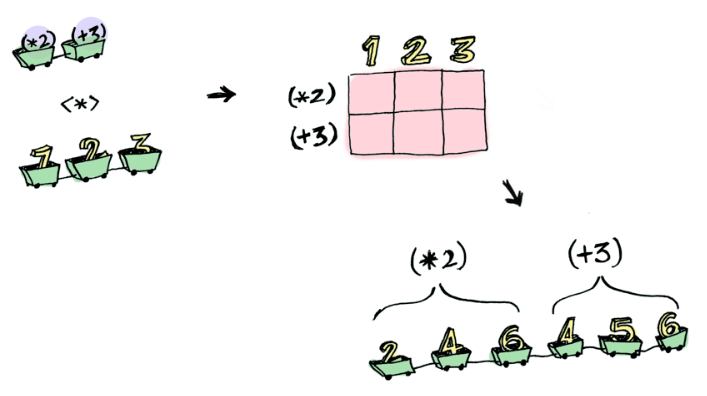
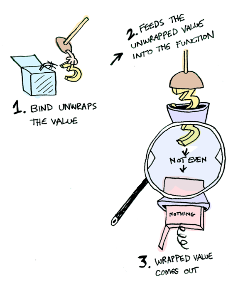
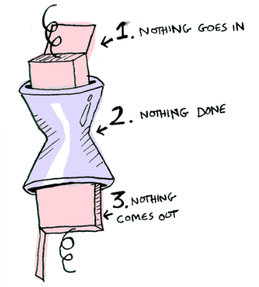
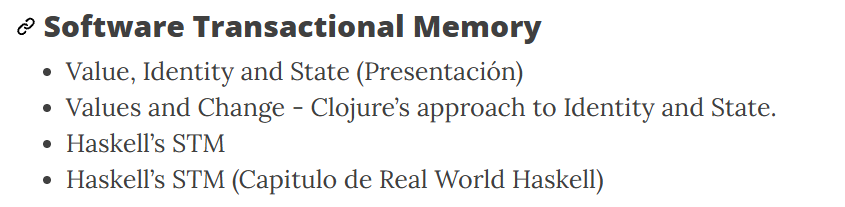

# Clase 3: Haskell, efectos y STM

En las clases anteriores vimos que los problemas de concurrencia nacen del **estado mutable compartido**: dos tareas que leen y escriben el mismo dato pueden pisarse. Los threads lo resuelven con locks (y sus deadlocks); las corrutinas, cediendo el control solo en puntos explícitos.

Esta clase toma otro camino: un lenguaje **funcional puro**, donde por defecto **no hay estado mutable**, y por lo tanto no hay nada que pisar. Cuando hace falta estado, Haskell obliga a que quede **explícito en los tipos**. El recorrido es:

1. El paradigma funcional y Haskell.
2. Las estructuras como contenedor y como computación.
3. Functor, Applicative y Monad: cómo trabajar con valores "envueltos".
4. IO: cómo un lenguaje puro tiene efectos.
5. IORef y forkIO: estado mutable y concurrencia, y el problema que vuelve a aparecer.
6. STM: memoria transaccional, el modelo de concurrencia de la clase.

La sintaxis, los operadores y las funciones de listas están en [Haskell: referencia del lenguaje](../Recursos/Haskell%20-%20referencia%20del%20lenguaje.md).

---

## 1. El paradigma funcional

Características más frecuentemente asociadas al paradigma:

- **Pureza**: las funciones, como en matemática, no tienen efectos colaterales: reciben, operan y devuelven valores. El resultado depende solo de los argumentos.
- **Evaluación diferida**: ciertas partes del código no se evalúan salvo que sea necesario.
- **Funciones de orden superior**: las funciones son valores, así que se pueden pasar por parámetro y devolver.
- **Pattern matching**: los valores se pueden descomponer estructuralmente (deconstrucción, el proceso inverso a construirlos), y eso sirve como control de flujo: según con qué patrón encaje un valor, se hace una cosa u otra.
- **Expresiones lambda**: funciones escritas de forma literal, sin nombre (`\x -> x + 1`).
- **Inmutabilidad**: las variables son etiquetas que, una vez unificadas con un valor, no cambian.

Por eso el paradigma funcional es muy útil para concurrencia y paralelismo: si nada cambia, varias tareas pueden leer lo mismo sin coordinarse.

**Haskell** es un lenguaje **puro**: toda operación es como una función matemática. Hasta los efectos (imprimir, leer) se modelan como **valores** de tipo `IO`, y un programa ejecutable es una función que devuelve `IO`. Además:
- Tiene **tipado estático** (el tipo de cada expresión se conoce al compilar) con **inferencia de tipos**.
- Tiene **tipos genéricos**: `head :: [a] -> a` funciona para listas de cualquier tipo `a`.
- Tiene **typeclasses**: interfaces que definen un comportamiento que cada tipo implementa. Por ejemplo, `(+) :: Num a => a -> a -> a` dice que `+` funciona para cualquier tipo `a` que sea miembro de `Num`; `Ord` define el ordenamiento y `Show` la conversión a texto.

---

## 2. Estructuras como contenedor y como computación

Cada estructura funcional tiene una **doble naturaleza**:
- Como **contenedor**: una caja que guarda valores.
- Como **computación**: una operación que, al ejecutarla, produce valores.

| Estructura | Definición | Como contenedor | Como computación (una función que la devuelve) |
|---|---|---|---|
| `List` | `data List a = Nil \| Cons a (List a)` | Una secuencia ordenada de valores, con repetidos | **No determinística**: puede dar varios resultados (`hermanos "Jon"` = `["Robb", "Sansa", "Arya", "Bran"]`) |
| `Maybe` | `data Maybe a = Nothing \| Just a` | Una caja con cero o un elemento | **Puede fallar**: `findUser 3` puede dar `Nothing` |
| `Either` | `data Either a b = Left a \| Right b` | Una caja con dos compartimentos, de los que se usa uno | **Éxito o error**: por convención `Right` es el éxito y `Left` el error. A diferencia de una excepción, el error queda declarado en la firma |

Esto es lo que motiva lo que sigue. Si una función devuelve `Maybe`, ¿cómo le aplico una función normal al resultado sin preguntar cada vez si es `Nothing`? Si devuelve `List`, ¿cómo la aplico a todos los elementos sin escribir un loop? Si devuelve `Either`, ¿cómo propago el error sin un `if` en cada paso? La respuesta son **Functor, Applicative y Monad**: patrones para operar con valores que viven dentro de un **contexto**.

---

## 3. Functor, Applicative y Monad

Un valor puede estar dentro de un **contexto**, como una caja: `Just 2` es un `2` dentro del contexto `Maybe`. Aplicarle una función da resultados distintos **según el contexto** (si hay valor o no). No se le puede aplicar `(+3)` directamente a `Just 2`: hace falta algo que sepa abrir la caja.

### Functor: aplicar una función a un valor envuelto

Un `Functor` es una typeclass que define cómo funciona `fmap` para un tipo:

```haskell
class Functor f where
    fmap :: (a -> b) -> f a -> f b
```

`fmap` toma una función normal (`(+3)`), un valor envuelto (`Just 2`) y devuelve un valor envuelto con la función aplicada (`Just 5`). Para `Maybe`:

```haskell
instance Functor Maybe where
    fmap func (Just val) = Just (func val)
    fmap func Nothing    = Nothing        -- aplicarle una función a nada da nada

> fmap (+3) (Just 2)
Just 5
> fmap (+3) Nothing
Nothing
```

En otros lenguajes, sin `Maybe`, se escribe un `if` cada vez:

```ruby
post = Post.find_by_id(1)
if post
  return post.title
else
  return nil
end
```

En Haskell alcanza con `fmap getPostTitle (findPost 1)`, o con la forma infija **`<$>`**: `getPostTitle <$> findPost 1`. Si `findPost` encuentra el post, da el título; si no, da `Nothing`.

Las **listas** son functores (su `fmap` es `map`) y las **funciones** también: `fmap` entre dos funciones es su composición.

```haskell
> let foo = fmap (+3) (+2)
> foo 10
15
```

### Currificación
`Int -> Int -> Int` se lee `Int -> (Int -> Int)`: toda función recibe **un** argumento y devuelve otra función que espera el siguiente. Aplicar `(+)` a un solo argumento da una función **parcialmente aplicada**, como `(+ 5)`. Esto es lo que hace necesario el siguiente paso.

### Applicative: aplicar una función envuelta a un valor envuelto

Si hago `(+) <$> Just 5`, el resultado es `Just (+5)`: una **función dentro de la caja**. `fmap` ya no alcanza para aplicársela a `Just 3`, porque espera una función suelta. Un **Applicative** agrega dos operaciones:

- **`<*>`** (*apply*): `f (a -> b) -> f a -> f b`. Aplica una función envuelta a un valor envuelto.
- **`pure`**: `a -> f a`. Mete un valor suelto en el contexto (*lifting*). Para `Maybe`, `pure 4` es `Just 4`.

```haskell
> Just (+3) <*> Just 2
Just 5
> (+) <$> Just 5 <*> Just 3        -- primero da Just (+5), después le aplica el 3
Just 8
> [(*2), (+3)] <*> [1, 2, 3]       -- cada función con cada valor
[2,4,6,4,5,6]
```



Si falta cualquiera de los valores, el resultado es `Nothing`, sin chequear cada paso. Applicative sirve cuando los pasos que producen los argumentos son **independientes** entre sí.

### Monad: aplicar una función que devuelve un valor envuelto

Resumiendo: un Functor aplica una función a un valor envuelto; un Applicative, una función envuelta a un valor envuelto. Una **Monad** aplica **una función que devuelve un valor envuelto** a un valor envuelto, con **`>>=`** (*bind*):

```haskell
class Monad m where
    (>>=) :: m a -> (a -> m b) -> m b
```

Por ejemplo, `half` devuelve un `Maybe`, así que no se le puede pasar un `Just 4` directamente:

```haskell
half x = if even x
           then Just (x `div` 2)
           else Nothing

> Just 4 >>= half
Just 2
> Just 3 >>= half
Nothing
> Nothing >>= half       -- si el paso anterior falló, half ni se ejecuta
Nothing

instance Monad Maybe where
    Nothing  >>= func = Nothing
    Just val >>= func = func val
```





Monad sirve cuando **el paso siguiente depende del valor** obtenido en el anterior. La notación **`do`** escribe una cadena de `>>=` como un bloque (`n <- valor` toma el valor de la caja para usarlo en las líneas siguientes).

La gracia de todo esto: **nos abstraemos de los resultados intermedios**. No chequeamos errores en cada paso; aplicamos las operaciones en orden y al final vemos si algo falló.

### Jerarquía y leyes
- Todo **Applicative** es un **Functor** (necesita `fmap`) y toda **Monad** es un **Applicative** (necesita `pure` y `<*>`). `Maybe` es las tres cosas.
- No hace falta una mónada para meter un valor en la caja: `pure` lo hace.

Las **leyes** dicen qué expresiones tienen que dar el mismo resultado; sirven para reordenar o simplificar código sin cambiar su comportamiento (`v`, `w`: valores en contexto; `u`: función en contexto; `f`, `g`: funciones puras; `k`, `h`: funciones que devuelven un valor monádico):

| Clase | Ley | Igualdad |
| --- | --- | --- |
| Functor | Identidad | `fmap id v == v` |
| Functor | Composición | `fmap (f . g) v == fmap f (fmap g v)` |
| Applicative | Identidad | `pure id <*> v == v` |
| Applicative | Composición | `pure (.) <*> u <*> v <*> w == u <*> (v <*> w)` |
| Applicative | Homomorfismo | `pure f <*> pure x == pure (f x)` |
| Applicative | Intercambio | `u <*> pure x == pure (\f -> f x) <*> u` |
| Monad | Identidad izquierda | `pure x >>= k == k x` |
| Monad | Identidad derecha | `v >>= pure == v` |
| Monad | Asociatividad | `(v >>= k) >>= h == v >>= (\a -> k a >>= h)` |

Con esto ya tenemos la herramienta para entender cómo Haskell maneja los efectos: **IO es una mónada**, y STM también.

---

## 4. Efectos de lado: IO

Si Haskell es puro, ¿cómo imprime algo por pantalla?

```haskell
import System.IO

main :: IO ()
main = do
  hPutStr stdout "Hola mundo!"
```

Imprimir es un **efecto de lado**: cualquier cosa que lee o escribe un estado mutable (acá, el handle `stdout`). Haskell no lo prohíbe: lo **encierra en un tipo**.

```haskell
hPutStr  :: Handle -> String -> IO ()
hGetLine :: Handle -> IO String
```

- `IO String` es una caja `IO` que, al ejecutarse, produce un `String`.
- `IO ()` produce `()`, un tipo con un único valor que se usa cuando el resultado no interesa (típico de las funciones que solo tienen efectos).
- En general, un valor de tipo `IO a` es una **acción**: la descripción de un efecto que el runtime ejecuta. `hPutStr stdout "hola"` no imprime al evaluarse: es una acción que **cuando se ejecuta** imprime.

Para hacer varias acciones hay que **componerlas**, pasándole a cada una el resultado de la anterior. Se usan los mismos operadores de la mónada (`>>` descarta el resultado, `>>=` lo pasa) o la notación `do`:

```haskell
main = getLine >>= (\a -> hPutStr stdout a)

main = do                 -- lo mismo
    a <- getLine
    hPutStr stdout a
```

Y para devolver un valor dentro de `IO` está `return :: a -> IO a`, que no es una palabra reservada sino una función: es el `pure` de esta mónada. **IO es una mónada**: tiene `return` y `>>=`.

---

## 5. Estado mutable y concurrencia

### IORef: una variable mutable
Además de I/O, a veces queremos una **variable mutable**. Como `IO` ya encapsula efectos, se puede extender con **`IORef`**: una referencia a una posición de memoria mutable (un puntero).

```haskell
newIORef   :: a -> IO (IORef a)
readIORef  :: IORef a -> IO a
writeIORef :: IORef a -> a -> IO ()

incRef :: IORef Int -> IO ()
incRef var = do
    val <- readIORef var
    writeIORef var (val + 1)
```

Con un solo thread esto funciona perfecto.

### forkIO: varios threads

```haskell
forkIO :: IO a -> IO ThreadId
```

`forkIO` crea un nuevo thread que ejecuta la acción concurrentemente:

```haskell
import System.IO
import Control.Concurrent

main :: IO ()
main = do
    forkIO (hPutStr stdout "Hola")
    hPutStr stdout " mundo\n"
```

Esto es **no determinístico**: los dos threads usan `stdout` y no se puede saber cuál escribe primero (hay una **condición de carrera** sobre ese recurso). Si en vez de `stdout` fuera un `IORef`, un thread podría pisar el valor mientras el otro lo usa: el `incRef` de arriba lee, suma y escribe en pasos separados, así que dos threads pueden leer el mismo valor y perder un incremento. **Se pierde la atomicidad** de más de una operación: `IORef` no es seguro entre threads.

### MVar: una caja que bloquea
Una **`MVar`** es una variable mutable que puede estar **vacía o llena**: `takeMVar` saca el valor y **bloquea** si está vacía; `putMVar` lo pone y bloquea si ya está llena. Sirve para pasar un resultado entre threads y como lock.

```haskell
fibThread :: Int -> MVar Int -> IO ()
fibThread n mvar = putMVar mvar (fib n)

main :: IO ()
main = do
  putStrLn "Calculando fibonacci..."
  fibResult <- newEmptyMVar
  forkIO (fibThread 30 fibResult)      -- el cálculo corre en otro thread
  a <- takeMVar fibResult              -- se bloquea hasta que el otro thread ponga el resultado
  putStrLn ("fib result: " ++ show a)
```

Se parece a una promesa, pero **bloquea** hasta tener el valor. Los threads de `forkIO` son livianos y los planifica el runtime de GHC.

Con `IORef` y `MVar` volvemos al modelo tradicional de threads con locks, que en Haskell está mejorado pero sufre los mismos problemas que en cualquier lenguaje:
- Condiciones de carrera por locks olvidados.
- Deadlocks por locks tomados en orden inconsistente.
- Corrupción del estado si hay excepciones no capturadas en medio de una sección crítica.
- Notificaciones omitidas: un thread que se queda esperando un aviso que nunca llega.

Para eso existe STM.

---

## 6. STM: Software Transactional Memory

### La idea
**STM** (memoria transaccional) es otro **modelo de concurrencia**, distinto de los threads con locks y de las corrutinas. Ejecuta un bloque de operaciones sobre estado compartido como una **transacción**: **todo o nada**, como la A de ACID en las bases de datos.

Es un mecanismo de **lock optimista**: en vez de pedir permiso **antes** de entrar a la sección crítica (como un mutex, que es pesimista: "siempre está dispuesto a lo peor"), ejecuta suponiendo que no va a haber conflicto y **verifica al final** si el trabajo sigue siendo válido. Es especialmente útil para operaciones chicas y cortas sobre estado compartido, donde un mutex agrega más complejidad de la que resuelve.

### TVar, STM y `atomically`
Las variables compartidas pasan a ser **`TVar`** (variables transaccionales, parecidas a un `IORef`), y las operaciones sobre ellas devuelven **`STM a`** en vez de `IO a`. `STM` es una acción más restringida que `IO`: adentro solo se pueden leer y escribir `TVar`s.

```haskell
readTVar   :: TVar a -> STM a
writeTVar  :: TVar a -> a -> STM ()
atomically :: STM a -> IO a

type Counter = TVar Int

incTVar :: Counter -> STM ()
incTVar counter = do
    val <- readTVar counter
    writeTVar counter (val + 1)
```

**`atomically`** convierte una transacción `STM` en una acción `IO` ejecutable, y marca la **frontera** de la transacción: todo lo que está adentro se ve como una sola operación. Dos `atomically` separados permiten que otro thread vea el estado entre medio.

`atomically` otorga:
- **Atomicidad**: los cambios se hacen visibles a los demás threads recién al salir del bloque, todos juntos. Nunca se ve un estado intermedio, y si hay varias lecturas y escrituras adentro, nadie modificó esos datos entre medio.
- **Aislamiento**: mientras dura la transacción, sus cambios quedan en un **log local** y ella no ve los cambios de otros threads.

### Cómo funciona por dentro
1. **Lectura**: el runtime anota en el log privado de la transacción qué `TVar` leyó y qué valor vio.
2. **Escritura tentativa**: `writeTVar` no pisa la `TVar`: registra el nuevo valor en el log. Los demás siguen viendo el valor confirmado.
3. **Validación y commit**: al salir del bloque, el runtime verifica que nadie haya modificado lo que la transacción leyó.
   - Si nadie lo tocó, **publica todos los cambios juntos** (commit).
   - Si otro thread modificó algo que leyó, **descarta el log** y **re-ejecuta el bloque desde el principio**, con los valores actualizados. Esto es posible porque los cambios todavía estaban solo en memoria.

**STM no bloquea las `TVar`s** durante la transacción: los otros threads pueden seguir leyéndolas y escribiéndolas, y el conflicto se detecta recién al confirmar. (GHC puede usar locks muy breves sobre las `TVar`s en el momento del commit, pero el código de la aplicación nunca toma locks.)



| Paso | Transacción A | Transacción B |
| --- | --- | --- |
| 1 | Lee el contador en 10 | Lee el contador en 10 |
| 2 | Confirma el incremento a 11 | Tiene un 11 tentativo |
| 3 | Termina | Detecta que su lectura quedó vieja y **reintenta** |
| 4 | | Lee 11 y confirma 12 |

Si los conflictos son frecuentes, el trabajo descartado sale caro: conviene que las transacciones sean **cortas**.

### IO y STM no se mezclan
`IO` y `STM` son acciones de distinto tipo, así que **no se pueden combinar en el mismo bloque `do`**: no compila.

```haskell
exec :: Counter -> IO ()
exec cont = do
    hPutStr stdout "Incrementando el contador en 1..."
    incTVar cont                    -- ERROR: es STM, y este bloque es IO

exec cont = do
    hPutStr stdout "Incrementando el contador en 1..."
    atomically (incTVar cont)       -- OK: atomically lo convierte en IO

main = do
    cont <- atomically (newTVar 3)
    exec cont
```

La restricción tiene sentido: como una transacción **se puede re-ejecutar**, un efecto de `IO` adentro (imprimir, mandar una petición) quedaría fuera del control de STM y se repetiría. Por eso un `hPutStr` dentro de un `atomically` falla en compilación: los efectos de `IO` van **afuera** de la transacción.

### `retry`, `check` y `orElse`
Además del reintento automático por conflicto, una transacción puede **reintentar a propósito** cuando todavía no se cumple una condición:

```haskell
retry :: STM a

check :: Bool -> STM ()
check True  = return ()
check False = retry
```

`retry` aborta la transacción y STM la **suspende** hasta que cambie alguna de las `TVar`s que leyó; ahí la vuelve a ejecutar. Así se espera una condición sin hacer *busy waiting*. Por ejemplo, un semáforo:

```haskell
type Semaphore = TVar Bool

p :: Semaphore -> STM ()          -- tomar
p sem = do
    libre <- readTVar sem
    if libre then writeTVar sem False
             else retry           -- ocupado: esperar a que alguien lo libere

v :: Semaphore -> STM ()          -- liberar
v sem = writeTVar sem True
```

Con la misma idea, un recurso con `n` unidades se toma con `check (pedido <= n)` y se libera sumándolas de vuelta. Y **`orElse :: STM a -> STM a -> STM a`** combina dos transacciones: si la primera hace `retry`, en vez de esperar prueba la segunda.

Un ejemplo que junta todo, una transferencia:

```haskell
transferir :: TVar Int -> TVar Int -> Int -> STM ()
transferir origen destino monto = do
  saldo <- readTVar origen
  check (saldo >= monto)          -- si no alcanza, espera a que cambie el saldo
  writeTVar origen (saldo - monto)
  modifyTVar' destino (+ monto)

main :: IO ()
main = do
  origen  <- newTVarIO 100
  destino <- newTVarIO 20
  atomically (transferir origen destino 30)
  saldos <- atomically ((,) <$> readTVar origen <*> readTVar destino)
  print saldos                    -- (70,50): débito y crédito se confirman juntos
```

Otro thread que lea los dos saldos dentro de una transacción ve el estado anterior o el posterior, **nunca el débito sin el crédito**.

### Cuándo usar STM
Para coordinar **estado mutable compartido** cuando varias operaciones tienen que verse como una sola: transferir saldo entre dos cuentas, reservar varios recursos juntos, esperar a que haya datos en una cola. Si los datos son inmutables o cada tarea tiene su propio estado, no hace falta. Como una falla en medio de la transacción no deja nada a medias, simplifica mucho el manejo de errores.

### Ejercicio: los filósofos que cenan


Cinco filósofos alrededor de una mesa, con un tenedor entre cada par; para comer, cada uno necesita los **dos** tenedores que tiene al lado. Con locks, si todos toman primero el izquierdo, quedan en deadlock.

Con STM, cada tenedor es una **`TMVar`**: la versión transaccional de `MVar`, que puede estar vacía o llena. `takeTMVar` hace `retry` si está vacía. Tomar los dos tenedores dentro de un mismo `atomically` hace que un filósofo agarre **ambos o ninguno**: no hay deadlock porque nadie se queda con uno solo esperando el otro. [Código del ejercicio](https://github.com/arquitecturas-concurrentes/iasc-stm-haskell-2019/tree/master/01_semaphores_and_philosophers).

---

## Resumen: cómo se llega a STM

| # | Paso | Qué aporta | Problema / restricción |
|---|---|---|---|
| 1 | Haskell es puro | Las funciones no tienen efectos: el resultado depende solo de los argumentos | Un programa real necesita imprimir, leer y guardar estado |
| 2 | IO: los efectos como valores | Los efectos se meten en una caja `IO` y el runtime los ejecuta. IO es una mónada | Todavía no hay variables que cambien de valor |
| 3 | IORef: estado mutable dentro de IO | Puntero a una posición de memoria mutable | Con un solo thread alcanza, pero no hay concurrencia |
| 4 | forkIO: varios threads | Ejecutar varias cosas de manera concurrente | No determinismo; threads que pisan el mismo IORef. Se pierde la atomicidad |
| 5 | STM: transacciones sobre TVars | Las variables compartidas pasan a ser `TVar` y se modifican dentro de `atomically`: todo o nada | Dentro de la transacción no hay IO, porque el bloque puede re-ejecutarse |

Con esto ya vimos tres modelos de concurrencia: threads (con locks), corrutinas / event loop y STM. El siguiente es el **modelo de actores**.
