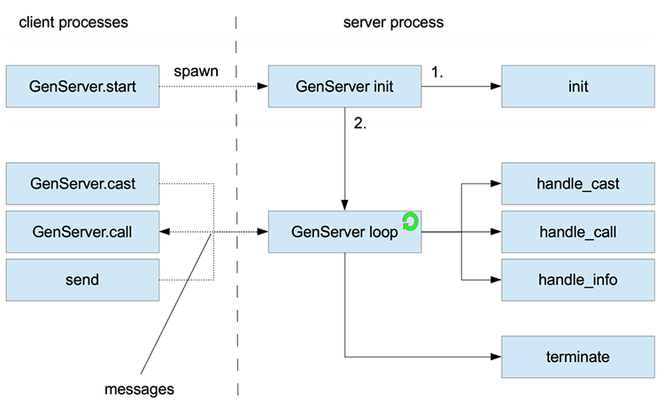

# Intro a actores

En esta clase vamos a estar viendo el modelo de actores, en el que la unidad de computación más primitiva es un actor, que es una computación que recibe un mensaje y hace un procesamiento en base a eso, también puede recibir mensajes, y enviar. Ademas los actores son en realidad un contexto de ejecución y están completamente aislados uno de otros y nunca van a compartir memorias u otros recursos.

## El modelo de actores
La forma tradicional de dar concurrencia es con **hilos sobre memoria compartida**: aparecen condiciones de carrera (el incremento no es atómico), se resuelven con **locks**, y los locks traen **deadlocks**. Lenguajes como Erlang y Scala (Akka) toman otro camino: el modelo de actores.

Es un enfoque distinto para la concurrencia, que busca evitar los problemas de hilos y locks. Es un modelo con reglas sobre cómo modelar los componentes, su comportamiento y su interacción.

Un **actor** es una entidad con un **buzón de mensajes (mailbox)** y un **comportamiento**. Los mensajes que recibe se guardan temporalmente en el buzón, y al procesar uno el actor puede:
- enviar mensajes a otros actores,
- crear nuevos actores,
- asumir un nuevo comportamiento para el próximo mensaje.

Reglas del modelo:
- **Toda la comunicación es asíncrona**: el remitente no espera a que el mensaje sea recibido. No hay garantías de orden, pero los mensajes eventualmente se entregan.
- **No hay estado compartido**: para conocer el estado de otro actor hay que pedírselo por mensaje. Cada actor controla el acceso a su estado (encapsulamiento), lo que evita condiciones de carrera.
- Cada actor tiene un **ID único** (su identidad) y no puede ser modificado directamente por otro actor.
- Cada actor se ejecuta concurrentemente con los demás, como un pequeño proceso independiente.

### Actores vs. objetos
- **Parecidos**: identidad, envío y recepción de mensajes, comportamiento según el mensaje (como invocar un método).
| Aspecto | Actor | Objeto típico |
| --- | --- | --- |
| Entrada | Recibe un mensaje que puede quedar en el buzón | Recibe una llamada directa a un método |
| Ejecución | El comportamiento corre en el flujo del actor | El método corre en el hilo del que llama |
| Estado | El actor decide cuándo y cómo cambia | Varios hilos pueden invocar el mismo objeto si comparten la referencia |
| Falla | La muerte del actor se observa con mensajes o señales | La excepción se propaga por la pila de llamadas |

Para distinguirlos: fijate **quién ejecuta el comportamiento** y **si el pedido puede quedar pendiente en un buzón**.

- **Diferencias**: en el modelo de objetos, muchos objetos corren en una misma unidad de procesamiento y **comparten recursos** (memoria). Los actores son en sí mismos un **contexto de ejecución**, completamente aislados. Además los actores no tienen métodos: en Elixir existen los **módulos** (algo parecido a clases), con funciones que se le pueden pasar al actor para que ejecute.

## Erlang

[Erlang](https://www.youtube.com/watch?v=xrIjfIjssLE) es un lenguaje de programación concurrente, originalmente diseñado por Ericsson. Fue diseñado para ser distribuido y tolerante a fallos, para su uso en aplicaciones de comunicaciones en tiempo real de alta disponibilidad (ininterrumpidas). Es un lenguaje funcional puro. También tiene construcciones de lenguaje integradas para distribución y concurrencia. Ademas tiene un sistema de tipos dinámico.

# Erlang & Elixir
Erlang, funcional originalmente, corre sobre su propia máquina virtual, la **BEAM** (Elixir y Erlang compilan al mismo bytecode). **Resilencia**, pensado para funcionar de forma distribuida, de forma nativa. La VM fue pensado junto a lenguaje para resolver un problema distribuido, de ruteo de llamadas telefónicas. 

Elixir puede tocar código Earlang. Vamos a hablar de **procesos**, no de actores, es análogo a lo que es un proceso del SO, pero no mapea 1:1 con uno.

Los procesos tienen: pid, stack/heap, pcb, mailbox, su garbage collector.

- **Mailbox**: mensajes guardados
- **Stack**: variables locales
- **Heap**: guarda el estado y las estructuras más complejas (listas, tuplas)
- **PID**: el identificador del proceso (se usa para `Process.alive?`, `Process.info`, etc.)
- **Process control block (PCB)**: mantiene el estado general del proceso. Es mucho más chico que el PCB de un proceso del SO.

Erlang se usa en aplicaciones de comunicación en tiempo real de alta disponibilidad, como WhatsApp o Discord.

Es un sistema con procesos que se comunican de manera asincrónica entre sí, donde no hay variables compartidas, cada uno tiene su entorno de ejecución. 

Existen distintos tipos de garbage collector: el de python busca referencias, el de java frena la ejecución para buscar sin referencia y eliminarlos. El problema ahí es que tenés que frenar la ejecución, eso no pasa en elixir. 

Estos sistemas tienen que están funcionando **todo** el tiempo, por eso, usan copiado de semi espacios, dos espacios. Cuando se quiere hacer una limpieza, From-space (Espacio de origen): El área de memoria actual que contiene tanto los datos que el proceso está usando activamente como la "basura" (datos obsoletos que ya no se referencian). To-space (Espacio de destino): Un área de memoria completamente nueva y limpia reservada para mover los datos sobrevivientes.

El collector comienza revisando el stack, copia los datos vivos del from al to, deja una marca de movimiento y descarta el viejo. 

Los procesos se comunican entre nodos de forma transparente. A una instancia de la VM la llamaremos nodo. En elixir se pueden comunicar entre sí sin necesidad de tener un protocolo. Esto es la **transparencia de ubicación**: hablar con un proceso de otro nodo es igual que con uno local; el nodo serializa el mensaje y los PIDs funcionan igual.

### El scheduler de la BEAM
- Decide qué proceso ejecutar en cada momento (parecido a las bibliotecas de green threads).
- Es **apropiativo**: cuando un proceso ejecutó demasiado (se le acabaron las **reducciones**, una medida de ciclos de trabajo) o entra en un `receive` sin mensajes, se lo detiene y vuelve a la cola de planificación.
- Soporta **multiprocesamiento simétrico (SMP)**: hay un scheduler por core, así que puede correr procesos en paralelo en varias CPUs. Un proceso individual nunca corre en paralelo en varios procesadores, pero varios procesos sí corren al mismo tiempo.
- Cada proceso tiene su propio garbage collector: limpiar uno no frena a los demás.

### El mailbox
- Existe para que el proceso no se detenga ante la llegada de un mensaje: el envío es **asincrónico** y nunca se sabe exactamente cuándo se recibe. Si fuera sincrónico, el actor quedaría bloqueado esperando una respuesta que podría no llegar.
- Funciona como una **cola** (productor-consumidor) y el proceso atiende **un mensaje por vez**. Para procesar 3 mensajes concurrentemente se necesitan 3 actores.
- Cuando un proceso no tiene más nada que hacer, **muere**. Para mantenerlo vivo se le pasa a `spawn` una función que sea un loop recursivo (ver la sección Estado).
- Si falla, también muere: hay que recrearlo y manejar la recuperación (eso lo resuelve OTP con supervisores).
- Un proceso que sigue esperando en `receive` con el buzón vacío **no muere**: espera el próximo mensaje.
- **Orden**: entre un mismo par emisor → receptor se conserva el orden de los mensajes. Entre emisores distintos (A y B mandándole a C), cualquiera puede llegar primero.
- **Recepción selectiva**: `receive` toma el **primer mensaje que matchea**, no el primero del buzón. Si el buzón tiene `[:aviso, {:valor, ref, 10}]` y se espera `{:valor, ^ref, n}`, procesa el segundo y deja `:aviso` en el buzón. El timeout de `after` no vacía el buzón.
- **`send` no confirma nada**: devuelve el mensaje enviado, pero eso no significa que el destinatario lo haya procesado ni que haya cambiado su estado. Si necesito saberlo, el protocolo tiene que incluir una respuesta.

### Pedido y respuesta con `make_ref`
Para esperar la respuesta a **un** pedido concreto (y no confundirla con otras pendientes) se usa una referencia única:

```elixir
ref = make_ref()
send(c, {:leer, self(), ref})
receive do
  {:valor, ^ref, n} -> n          # el ^ fija el valor de ref: solo matchea MI respuesta
after
  1_000 -> :timeout
end
```

La respuesta es un segundo mensaje, con su propio recorrido. Esto es lo que `GenServer.call` hace por nosotros.

### Cuellos de botella y carreras en actores
- **Cuello de botella**: un actor ejecuta un mensaje por vez. Si recibe 100 pedidos por segundo y procesa 60, el buzón crece unos 40 por segundo. Un callback lento (una consulta externa) también retrasa a todos los que están atrás. Se ve con `Process.info(pid, :message_queue_len)`. Soluciones: delegar el trabajo pesado a un pool acotado, repartir claves independientes entre varios actores, mantener corto el tramo que modifica estado y limitar los pedidos admitidos.
- **Carreras**: aunque los mensajes se procesen de a uno, **un protocolo de varios mensajes puede intercalarse**. Si A y B primero leen el contador (10) y después le piden a C que guarde 11, el resultado es 11. Solución: mandarle a C la **operación completa** (`:incrementar`) para que lea y actualice en un solo paso. Si una operación tiene que cambiar **dos actores distintos**, hace falta coordinarlos y definir qué pasa si uno falla.

```elixir
iex(1)> pid = spawn fn -> 1 + 2 end
#PID<O.106.0>
iex(2)> Process.alive?(pid)
false // Tiene sentido porque vive, suma y muere

iex(3)> send self(), {:hello, "world"}
{:hello, "world"} // Se manda un mensaje a sí mismo, a self

iex(4)> receive do // Receive al proceso de la consola, la consola lo recive
    iex(4)> {:hello, "world"} -> msg
    iex(4)> {:world, _msg}: "won't match"
end

// Ahora que tiene el receive puede recibir mensajes entonces ese mensaje que le había enviado anteriormente ahora puede ser recibido
```

El `receive` es sincrónico, el `send` es asincrónico. Al hacer receive en el proceso B este se bloquea hasta que A le mande un mensaje u otro, espera activa hasta que haya un mensaje en el mailbox.

Cuando hay un error, mata el proceso y ejecuta otro, porque por encima hay un supervisor mirando. El monitor hace un observer, mira al otro proceso. 

## Elixir

Elixir es un lenguaje de programación funcional, concurrente, de propósito general que se ejecuta sobre la máquina virtual de Erlang (BEAM). Elixir está escrito sobre Erlang y comparte las mismas abstracciones para desarrollar aplicaciones distribuidas y tolerantes a fallos.

### Procesos

En Elixir, todo el código se ejecuta dentro de los procesos. Los procesos están aislados entre sí, se ejecutan "simultáneamente" y se comunican mediante el paso de mensajes.

Los procesos de Elixir no deben confundirse con los procesos del sistema operativo. Los procesos en Elixir son extremadamente ligeros en términos de memoria y CPU (incluso en comparación con los hilos que se utilizan en muchos otros lenguajes de programación). Debido a esto, no es raro tener decenas o incluso cientos de miles de procesos ejecutándose simultáneamente.

### Spawn

La función spawn/1 crea un proceso que ejecuta la función que le es enviada por parámetro, retorna el PID del proceso creado y este deja de existir al completar la ejecución de su tarea.

```elixir
iex> pid = spawn fn -> 1 + 2 end
#PID<0.44.0>
iex> Process.alive?(pid)
false
```

### Send y Receive

Podemos enviar mensajes a los procesos con la funcion send/2 y recivirlos con receive/1

```elixir
iex> send self(), {:hello, "world"}
{:hello, "world"}
iex> receive do
...>   {:hello, msg} -> msg
...>   {:world, _msg} -> "won't match"
...> end
"world"
```

Cuando un mensaje es enviado a un proceso, este es guardado en un "mailbox". El receive/1 revisa el mailbox del proceso buscando mensajes que matcheen con alguno de los patrones definidos. `:hello` es un **átomo** y sirve para matchear el mensaje.

- `receive` es **bloqueante**: si hay mensajes pero ninguno matchea, los deja en el mailbox y sigue esperando.
- Para no acumular mensajes que no matchean se agrega una cláusula default (`_ -> ...`) que los descarte.
- Si el mailbox está vacío, la cláusula default no evita el bloqueo: para eso se usa **`after`** con un timeout.

```elixir
iex> receive do
...>   {:hello, msg} -> msg
...>   _otro -> :descartado
...> after
...>   1_000 -> "no llegó nada en 1 segundo"
...> end
"no llegó nada en 1 segundo"
```

```elixir
iex> parent = self()
#PID<0.41.0>
iex> spawn fn -> send(parent, {:hello, self()}) end
#PID<0.48.0>
iex> receive do
...>   {:hello, pid} -> "Got hello from #{inspect pid}"
...> end
"Got hello from #PID<0.48.0>"
```

### Links

La mayoria de las veces que spawneamos un proceso en Elixir, creamos un proceso linkeado. Antes de entrar en spawn_link/1, veamos que pasa cuando con los procesos creados con spawn/1 fallan.

```elixir
iex> spawn fn -> raise "ups" end
#PID<0.58.0>

[error] Process #PID<0.58.00> raised an exception
** (RuntimeError) ups
    (stdlib) erl_eval.erl:668: :erl_eval.do_apply/6

```

Lanzo un error, pero el proceso padre sigue ejecutandose. Esto ocurre porque los procesos son aislados. Si queremos que el error se propague, tenemos que linkearlos. Esto se puede hacer con spawn_link/1

```elixir
iex> self()
#PID<0.41.0>
iex> spawn_link fn -> raise "ups" end

** (EXIT from #PID<0.41.0>) evaluator process exited with reason: an exception was raised:
    ** (RuntimeError) ups
        (stdlib) erl_eval.erl:668: :erl_eval.do_apply/6

[error] Process #PID<0.289.0> raised an exception
** (RuntimeError) ups
    (stdlib) erl_eval.erl:668: :erl_eval.do_apply/6

```

Como los procesos están linkeados, ahora vemos que el proceso padre, en este caso la consola, recibió una señal EXIT de otro proceso causando que esta termine su ejecución.

Los procesos y los links juegan un rol importante para poder crear sistemas tolerantes a fallas. Los procesos en Elixir son "aislados", es decir que por defecto no comparten estado. Por esto, una falla en un proceso nunca va romper otro proceso. Sin embargo, los links nos permiten establecer una relación entre procesos en el caso de una falla.

- El link es un vínculo **bidireccional y sin jerarquía**: si falla uno, falla el otro. También se puede linkear después de crear con `Process.link/1` y desvincular con `Process.unlink/1`.
- La señal **EXIT** no pasa por el mailbox: mata directamente al proceso linkeado.
- **Monitor** (`Process.monitor(pid)`): relación **unidireccional**. Si el monitoreado muere, el monitor recibe `{:DOWN, ...}` en su mailbox, **pero no muere**.
- **`trap_exit`**: flag de proceso. Si es `true`, la muerte de un proceso linkeado no lo mata, sino que se convierte en un mensaje `{:EXIT, pid, motivo}`. Así funcionan los **supervisores**: se linkean a sus hijos con `trap_exit` y deciden si reiniciarlos.

| Mecanismo | Qué pasa si falla C |
| --- | --- |
| **Sin vínculo** | A sigue. Si esperaba una respuesta, necesita un timeout o algo que le avise |
| **Link** | Bidireccional: la salida anormal de C termina a A (salvo que A tenga `trap_exit`) |
| **Monitor** | Unidireccional: A recibe `{:DOWN, ref, :process, pid, motivo}` y sigue |
| **Supervisor** | Detecta la salida del hijo y decide si arrancar un reemplazo |

**Errores esperados vs. inesperados**: un rechazo esperado (saldo insuficiente) se devuelve como `{:error, :saldo_insuficiente}` y el actor sigue vivo. Ante un fallo inesperado, se deja que el proceso muera y que decida quien lo supervisa.

**Excepciones en Elixir**:
- **`raise`**: excepción que se maneja con `try/rescue`. Si nadie la maneja, termina el proceso.
- **`throw`**: salida no local de una función; se maneja con `try/catch`.
- **`exit`**: produce una salida. Algunas se pueden capturar, pero `Process.exit(pid, :kill)` termina al proceso **aunque tenga `trap_exit`**.

Un `rescue` en A solo maneja excepciones que ocurren **en A**. Para reaccionar a la muerte de C, A tiene que monitorearlo. Atrapar una salida no revive al proceso anterior.

### Estado

Hasta ahora nombramos algo del estado, pero no mucho. Supongamos que estamos creando una aplicación que requiere de estado, por ejemplo, para guardar la configuración del sistema y administrarla dinamicamente en memoria. Donde ponemos ese estado?... Podemos escribir un proceso que esta siempre a la escucha (loopee indefinidamente), mantenga el estado.

```elixir
defmodule KV do
  def start_link do
    Task.start_link(fn -> loop(%{}) end)
  end

  # El parámetro map es el estado
  defp loop(map) do # Loopear es escuchar el mailbox
    receive do
      {:get, key, caller} ->
        send caller, Map.get(map, key)
        loop(map)
      {:put, key, value} ->
        loop(Map.put(map, key, value))
    end
  end
end
```

_Nota: Podemos decir que este proceso KV es un actor._

```elixir
iex> {:ok, pid} = KV.start_link
{:ok, #PID<0.132.0>}
iex> send pid, {:put, :hello, :world}
{:put, :hello, :world}
iex> send pid, {:get, :hello, self()}
{:get, :hello, #PID<0.41.0>}
iex> flush()
:world
:ok
```

_Nota: Esto es solo a modo de ejemplo, normalmente cuando hablamos guardar o mantener un estado vamos a estar pensando en un tipo particular de actor llamado Agent._

Cualquier proceso que conozca el PID del KV va a poder enviarle mensajes. Es posible registrar el PID del proceso bajo un nombre, permitiendo comunicarse con el proceso a través de ese nombre sin necesidad de saber el PID exacto.

 Esto se mapea al pid, no al bicho que muere y vuelve a revivir, una vez que el proceso muere ese nombre queda apuntando a eso. 

```elixir
iex> Process.register(pid, :kv)
true
iex> send :kv, {:get, :hello, self()}
{:get, :hello, #PID<0.41.0>}
iex> flush()
:world
:ok
```

La VM tiene muchos mecanismos para poder recuperarse antes fallos. 

### OTP

OTP es un conjunto de middlewares, librerias y herramientas escritas en Erlang que ademas de muchas otras cosas más, encapsulan todo lo visto anteriormente para no estar re inventando la ruedo todo el tiempo.

Vamos a usar el modulo GenServer para modelar nuestro actor, definiendo un link con el mismo, registrando lo bajo un nombre, un estado inicial y funciones que interactúan con el mailbox según corresponda.

Imaginemos un Post de una red social, sobre la que vamos a ver la cantidad de likes. 

```elixir
defmodule Post do
  use GenServer # No es un server, es un proceso que escucha msjs.

  def start_link(state) do
    ## "__" al principio porque representa el módulo actual, osea "Post", es una macro incorporada de Elixir.
    GenServer.start_link(__MODULE__, state, name: __MODULE__)
  end

  def init(cantidad_inicial_likes) do
    {:ok, cantidad_inicial_likes}
  end

  def handle_cast(:like, cantidad_likes) do
    nuevo_estado = cantidad_likes + 1
    {:noreply, nuevo_estado} # Convención tupla de no respuesta
  end

  def handle_call(:get, _from, state) do
    {:reply, state, state}
  end
end

#{:ok, pid_del_actor} = Post.start_link(0)
#post = pid_del_actor
#GenServer.call(Post, :get)
#GenServer.cast(Post, :like)
#for _ <- 1..1000, do: GenServer.cast(Post, :like)
#Process.info(post)
```

**start_link** nos spawnea un actor linkeado, registrado bajo el nombre del modulo, en este caso Post.

**init** es la función que llama start_link para inicializar el estado del actor.

**handle_cast** es una función que maneja los mensajes de una forma asincronica, es un "fire and forget"

**handle_call** esta función implementa una llamada sincronica, en la que se bloquea el actor hasta que reciba la respuesta o se cumpla un timeout. Hace un receive y un send, quien hace el send se queda bloqueado (5 segundos)

El caller, quien envia el mensaje se queda esperando durante 5 segundos, después no lo espera más. Ojo: que venza el timeout del `call` **no garantiza que el servidor no haya aplicado el pedido**. Pudo procesarlo y responder tarde, o procesarlo después. Si la operación tiene efectos, reintentarla requiere detectar duplicados (idempotencia).

Un GenServer es un proceso que corre un loop, maneja un mensaje por iteración y siempre devuelve un **estado** (el que queda después de responder). Como en Elixir los datos son inmutables y no hay estado compartido, el estado se conserva pasándolo al siguiente ciclo del loop; el GenServer nos evita escribir ese `receive` recursivo a mano.

| Callback | Tipo de mensaje | Devuelve | ¿Bloquea al cliente? |
|---|---|---|---|
| `handle_call` | Sincrónico (`GenServer.call`) | `{:reply, respuesta, nuevo_estado}` | Sí, hasta la respuesta o el timeout |
| `handle_cast` | Asincrónico (`GenServer.cast`), devuelve `:ok` de inmediato | `{:noreply, nuevo_estado}` | No ("fire and forget") |
| `handle_info` | Cualquier otro mensaje: un `send` directo, `Process.send_after`, un `:DOWN` de un monitor | `{:noreply, nuevo_estado}` | — |

**Ciclo de vida**:
- **Arranque**: `start_link` ejecuta `init`, que define el estado inicial y devuelve `{:ok, estado_inicial}`.
- **Loop**: procesa los mensajes de a uno; cada callback devuelve el nuevo estado.
- **Finalización**: desde adentro, cualquier callback puede devolver `{:stop, motivo, estado}`; desde afuera, `GenServer.stop(pid)`. Antes de terminar se ejecuta `terminate` (por ejemplo, para liberar recursos).



## Más absracciones de OTP

OTP (*Open Telecom Platform*) trae varios módulos: **GenServer, Application, Registry, Agent, Supervisor** y **Task**.

- **Application**: modela el punto de entrada de la aplicación (inicializa una aplicación Erlang/OTP y levanta el supervisor raíz).
- **Registry**: almacena pares clave/valor de forma descentralizada; es como una "agenda telefónica" de procesos. Cada entrada se asocia al PID que la registró, y si ese proceso muere sus entradas se borran solas. Se usa para *dispatching*, registro de nombres y pub/sub. Para un store a nivel de instancia existe **ETS**.
- **Agent**: proceso que guarda un estado (no necesariamente clave/valor); se usa casi exclusivamente para eso.
- Tanto Agent como Registry guardan **solo en memoria**, no persisten en disco.

### Task
Es una abstracción muy simple de un proceso:
- No recibe mensajes personalizados (por eso no se le da nombre).
- No tiene estado.
- Puede iniciarse en cualquier nodo.

Los Tasks se usan para procesos batch.

```elixir
defmodule IASC.WriteHaiku do
  use Task

  @file_opts [:append, {:encoding, :utf8}]
  @file_name "haiku.txt"

  def start_link_run(arg) do
    Task.start_link(__MODULE__, :run, [arg])
  end

  def start_run(arg) do
    Task.start(__MODULE__, :run, [arg])
  end

  def start_link_read() do
    Task.start_link(__MODULE__, :read_haiku, [])
  end

  @doc """
    Escribe en el archivo
  """
  def write_haiku(content) do
    File.write(@file_name, "#{content}\n", @file_opts)
  end

  def read_haiku do
    case File.read(@file_name) do
      {:error, error_desc} -> IO.puts "Error leyendo #{@file_name}: #{error_desc}"
      {:ok, contenido} -> IO.puts("Contenido de #{@file_name}: #{contenido}")
    end
  end

  @doc """
  Chequea si el archivo existe y lo crea si no lo esta
  """
  def check_and_create do
    unless File.exists? @file_name do
      File.write(@file_name, "", [:write, {:encoding, :utf8}])
    end
  end

  def run(content) do
    check_and_create()
    write_haiku(content)
  end
end

# {:ok, pid} = IASC.WriteHaiku.start_link_read()
#haiku= "Arbol sereno\nque en el bosque protege\na tantos seres"
#{:ok, pid} = IASC.WriteHaiku.start_link_run(haiku)
``` 

## Agents

La concurrencia se maneja en el mailbox, esto hace que uno entre priemro o uno después y los va a procesar secuencialmente. 

- Solo entiende `get` y `update` (y variantes): no recibe mensajes personalizados. Si hace falta lógica o un protocolo propio, se usa un GenServer.
- Las funciones que se le pasan se ejecutan **en el proceso del Agent**: una función lenta retrasa a todos los demás pedidos.
- `Agent.get` seguido de `Agent.update` por separado **puede perder un incremento** (A y B leen 10 y guardan 11), porque la serialización es por pedido. Para leer y modificar en un solo paso: `Agent.update(pid, &(&1 + 1))` o `Agent.get_and_update(pid, fn n -> {n + 1, n + 1} end)` (el primer valor se devuelve al cliente, el segundo queda como estado).
```elixir
defmodule KV.Agent do
  use Agent

  def start do
    Agent.start(fn -> %{} end)
  end

  def start_link do
    Agent.start_link(fn -> %{} end)
  end

  # agent es el pid del Agent -> KV.Agent
  # Agent.get(agent, fn content -> Map.get(content, key) end)
  def get(agent, key) do
    Agent.get(agent, &Map.get(&1, key))
  end

  # fn map -> Map.put(map, key, value) end
  def put(agent, key, value) do
    Agent.update(agent, &Map.put(&1, key, value))
  end
end


# iex(5)> {:ok, pid} = KV.Agent.start_link
# {:ok, #PID<0.166.0>}
# iex(9)> KV.Agent.put(pid, :hello, 1)
# :ok
# iex(10)> KV.Agent.get(pid, :hello)
# 1
``` 
