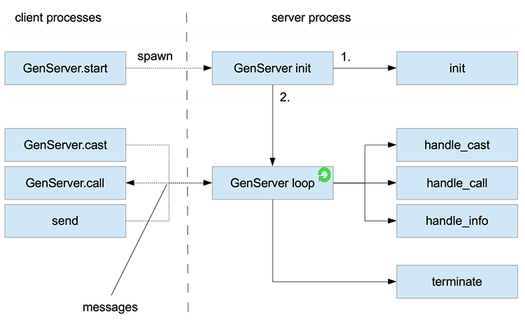

# Manejo de errores: links, monitores y supervisores

La clase pasada vimos lo básico de Elixir, el modelo de actores y OTP (`GenServer`, `Agent`, `Task`). Hoy nos enfocamos en **la parte más importante** de este paradigma, esta VM y este lenguaje: **el manejo de errores**.

Es bastante diferente a lo que estamos acostumbrados en otros lenguajes. En lugar de llenar el código de `try/catch`, en Elixir la idea es:

1. Dejar que los procesos **fallen** (*let it crash*).
2. Que el error se **propague** mediante **señales** entre procesos vinculados (*links*).
3. Que haya otro proceso, un **supervisor**, que se dé cuenta y **lo vuelva a levantar** automáticamente.

Todos los ejemplos están en el repo [iasc-elixir-supervisor-example](../../iasc-elixir-supervisor-example/).

---

## Antes de empezar: sintaxis de Elixir que vamos a usar

La clase pasada usamos varias de estas cosas sin detenernos en ellas. Como hoy aparecen todo el tiempo, las repasamos rápido.

### Tipos básicos

```elixir
:ok, :error, :crash        # ÁTOMOS: constantes cuyo valor es su propio nombre (como los símbolos de Ruby)
Stack1, Crashy             # los nombres de módulo con mayúscula también son átomos
true, false, nil           # también son átomos
{:ok, pid}                 # TUPLA: grupo fijo de valores, entre llaves
[1, 2, 3]                  # LISTA: entre corchetes
%{saldo: 0, id: 1}         # MAPA: clave => valor, entre %{}
"Cuenta #{id}"             # STRING con interpolación: #{...} inserta un valor
```

Por convención, las funciones devuelven tuplas que empiezan con un átomo que indica el resultado: `{:ok, valor}` si salió bien, `{:error, motivo}` si no. Los callbacks de GenServer también devuelven tuplas (`{:reply, ...}`, `{:noreply, ...}`, `{:stop, ...}`) que **OTP lee para saber qué hacer**.

### Pattern matching

En Elixir, `=` no es solo asignación: es **"hacé coincidir"** la forma de la izquierda con el valor de la derecha.

```elixir
{:ok, pid} = GenServer.start(Crashy, [])   # si devuelve {:ok, algo}, pid queda con ese "algo"
                                           # si devuelve {:error, ...}, falla (MatchError)

[head | tail] = [1, 2, 3]                  # head = 1, tail = [2, 3]
[head | tail] = []                         # falla: una lista vacía no tiene cabeza
```

`[head | tail]` separa una lista en su **primer elemento** y **el resto**. También sirve para armar una lista: `[nuevo | lista]` agrega `nuevo` adelante. Es lo que usa el `Stack`.

### Varias cláusulas de una misma función

Una función puede tener **varias definiciones** (cláusulas) con distintos patrones. Elixir prueba **en orden** y ejecuta la primera que coincide:

```elixir
def handle_call(:pop, _from, [head | tail]), do: {:reply, head, tail}  # si la lista tiene elementos
def handle_call(:pop, _from, []),            do: {:reply, nil, []}     # si está vacía
```

Si **ninguna** coincide, el proceso explota con un `FunctionClauseError`. Así es como falla el `Stack` cuando hacemos `pop` con la lista vacía.

Las variables que empiezan con `_` (como `_from`) indican "acá viene un valor que no voy a usar". `_` solo matchea cualquier cosa.

### Guardas (`when`)

Agregan una condición extra a un patrón:

```elixir
def start_link(account_id) when is_integer(account_id) do ... end   # solo si es un entero
```

### `case`

Hace pattern matching de un valor contra varias opciones:

```elixir
case Registry.lookup(MiRegistro, 2) do
  [{pid, _}] -> pid    # si encontró algo
  [] -> nil            # si no
end
```

### Formas de definir funciones

```elixir
def nombre(x) do       # función pública, forma larga
  x + 1
end

def nombre(x), do: x + 1   # lo mismo, forma corta (una sola expresión)
defp privada(x), do: x     # defp = función privada (solo se usa dentro del módulo)
```

### Otras cosas que aparecen

- `@registry AccountMainRegistry`: **atributo de módulo**. Funciona como una constante dentro del módulo; ya lo vimos con `@file_name` en el ejemplo del haiku.
- `@impl true`: marca que la función siguiente es un **callback** (por ejemplo, de GenServer). Es solo documentación y chequeo; no cambia el comportamiento.
- `require Logger` + `Logger.info("...")` / `Logger.warning("...")`: imprimen mensajes de log en la consola.
- `inspect(valor)`: convierte cualquier valor a un string legible, para imprimirlo. `IO.inspect(valor)` lo imprime directamente.
- `for x <- 1..3, do: algo(x)`: recorre del 1 al 3 y ejecuta `algo` para cada uno (es una *comprehension*).
- `#Reference<...>`: un valor **único** que genera la VM. Lo vamos a ver con los monitores.

---

## 0. Preparación: Mix y Observer

### Mix

Todos los proyectos de Elixir se arman con **Mix**, que es la herramienta para crear proyectos, compilar y manejar dependencias. La configuración del proyecto está en `mix.exs`:

```elixir
def application do
  [
    extra_applications: [:logger, :eex, :wx, :observer, :runtime_tools],
    mod: {SupEjemplo.Application, []}   # punto de entrada de la aplicación (lo vemos al final)
  ]
end
```

Para usar el **Observer** hay que agregar `:wx` y `:observer` (y conviene `:runtime_tools`) en `extra_applications`.

Para levantar el proyecto con una consola interactiva:

```bash
iex -S mix
```

> Si el Observer no abre desde la terminal integrada de VS Code, probá desde una terminal común del sistema.

### Observer

El **Observer** es una herramienta gráfica que viene con Erlang/OTP. Se abre desde la consola con:

```elixir
:observer.start()
```

Muestra:
- **Uso de memoria, CPU, schedulers**, etc. de la VM.
- La lista de **procesos** vivos, con su estado, mailbox, links y monitores.
- En la pestaña **Applications**: el **árbol de supervisión** de cada aplicación (qué supervisor supervisa a quién). Es la forma más clara de *ver* lo que explicamos en esta clase.
- Permite trabajar con **varios nodos** (lo veremos en distribución).

Es muy recomendable tenerlo configurado para el TP: ayuda a entender dónde están los procesos, en qué estado y quién está vinculado con quién.

---

## 1. Repaso de GenServer con `Crashy`

`GenServer` es la parte de OTP que nos permite crear procesos de **vida larga**: en vez de ejecutar una función y morir (como con `spawn`), el proceso queda **escuchando su mailbox** en un loop, procesa cada mensaje y vuelve a escuchar. GenServer nos resuelve ese loop y además nos da una **convención de callbacks** (`init`, `handle_call`, `handle_cast`, `handle_info`, `terminate`).



- **Del lado del cliente** (quien quiere hablar con el proceso): `GenServer.start`, `GenServer.cast`, `GenServer.call` y `send`.
- **Del lado del servidor** (el proceso GenServer): primero `init`, luego el loop que despacha cada mensaje al callback que corresponde y, al final, `terminate`.

Veamos [crashy.ex](../../iasc-elixir-supervisor-example/lib/crashy.ex), un GenServer hecho para fallar a propósito:

```elixir
defmodule Crashy do
  require Logger
  use GenServer

  # --- Formas de crearlo ---
  def start(state),             do: GenServer.start(__MODULE__, state, name: __MODULE__)
  def start(state, name),       do: GenServer.start(__MODULE__, state, name: name)
  def start_link(state),        do: GenServer.start_link(__MODULE__, state, name: __MODULE__)
  def start_link(state, name),  do: GenServer.start_link(__MODULE__, state, name: name)

  # --- Callbacks ---
  def init(state), do: {:ok, state}

  def handle_cast(:crash, state) do
    _res = 1 / 0          # división por cero -> explota
    {:noreply, state}
  end

  def handle_info({:blah, pid}, state) do
    Logger.info("Recibi un mensaje de #{inspect(pid)}.")
    {:noreply, state}
  end

  def terminate(reason, _state) do
    Logger.info("#{inspect(reason)} in terminate")
  end

  # --- Funciones de uso (helpers) ---
  def break(pid), do: GenServer.cast(pid, :crash)
  def blah(pid),  do: send(pid, {:blah, self()})
end
```

### `start` vs `start_link`

- `GenServer.start`: crea el proceso **sin vincularlo** con quien lo crea.
- `GenServer.start_link`: crea el proceso **y lo vincula (link)** con quien lo crea. Más abajo vemos qué significa esto.

### Aridad: `start_link/1` y `start_link/2` son funciones distintas

En Elixir una función se identifica por **su nombre y su cantidad de argumentos (aridad)**, no por los tipos. `start_link/1` y `start_link/2` son **dos funciones diferentes**. Por eso se escriben así: `nombre/aridad`.

> Recordatorio: los **módulos no son clases**. Son solo una forma de **agrupar funciones**. `__MODULE__` es una macro que se reemplaza por el nombre del módulo actual (acá, `Crashy`).

### Registro con nombre

Con `name: __MODULE__` el proceso queda registrado con el nombre `Crashy`, así que solo puede haber **una instancia** con ese nombre (tipo *singleton*). Si queremos varias, usamos la versión que recibe un `name`.

### `handle_cast`, `handle_call` y `handle_info`

| Cómo le llega el mensaje | Callback que lo atiende | ¿Responde? |
|---|---|---|
| `GenServer.call(pid, msg)` | `handle_call(msg, from, state)` | Sí (sincrónico, el que llama se bloquea hasta 5 s) |
| `GenServer.cast(pid, msg)` | `handle_cast(msg, state)` | No (asincrónico, *fire and forget*) |
| `send(pid, msg)` (mensaje "crudo") | `handle_info(msg, state)` | No |

Aunque por detrás un `cast` también termina haciendo un `send`, GenServer **distingue** los dos casos: lo que llega por `cast` va a `handle_cast`, y lo que llega por `send` directo (o mensajes del sistema, como los avisos de monitores o las señales atrapadas) va a **`handle_info`**. `handle_info` se suele usar para logging y para estos mensajes "especiales" (los avisos de monitores y las señales atrapadas los vemos más abajo).

### Funciones de uso (helpers)

En vez de obligar a quien usa `Crashy` a saber que tiene que hacer `GenServer.cast(pid, :crash)`, armamos funciones con nombres descriptivos: `Crashy.break(pid)`. Así nos **abstraemos** de si por dentro es un cast, un call o un send.

### `terminate`: el hook final

`terminate(reason, state)` **no es una función de uso**, es un **callback**: un *hook* que GenServer llama cuando el proceso está terminando, para que hagamos algo antes de morir (loguear, persistir el estado, liberar recursos). Es parecido a un "destructor", pero a esta altura **el proceso ya va a morir sí o sí**: no hay forma de evitarlo desde ahí.

> **Ojo (aclaración de la documentación):** `terminate` se llama cuando un callback devuelve `{:stop, ...}` o lanza una excepción. Pero si el proceso muere por una **señal externa** (por ejemplo, porque murió un proceso linkeado o porque el supervisor lo apaga), `terminate` **solo se ejecuta si el proceso está atrapando salidas** (`trap_exit`, ver más abajo). Con `Process.exit(pid, :kill)` no se ejecuta nunca. Por eso `DynamicStack` hace `Process.flag(:trap_exit, true)` en su `init`.

---

## 2. Anatomía de un PID

Un PID se ve como `#PID<0.153.0>`: tiene **tres números**.

- **Primero: el nodo.** `0` significa "un proceso de **este** nodo". Si es otro número, es un proceso de **otro** nodo. Ese número es local a cada nodo: el mismo proceso remoto puede verse con números distintos desde nodos diferentes.
- **Segundo: el identificador del proceso** dentro de ese nodo. Por eso el primer número hace falta: dos nodos distintos pueden tener cada uno un proceso `133`.
- **Tercero:** de uso interno o reservado. Casi siempre es `0`.

**¿Qué es un nodo?** Una **instancia de la máquina virtual (BEAM)**. Podemos tener varias corriendo, cada una con su nombre/IP/puerto. Mientras no estén conectadas, son independientes. Cuando las conectamos forman un **cluster** y empieza la **distribución** (tema de la próxima clase teórica). La VM se encarga de rutear el mensaje cuando le hacemos `send` a un PID de otro nodo.

### Reconstruir un PID en la consola

Si no guardamos el PID en una variable pero sabemos sus números, en `iex` podemos reconstruirlo con la función `pid/3` (**con comas**, porque es una función de tres argumentos):

```elixir
iex> pid = pid(0, 153, 0)
#PID<0.153.0>
```

Esto solo **arma la referencia**. No garantiza que ese proceso exista o esté vivo.

---

## 3. Links

### Repaso

La clase pasada vimos que con `spawn` los procesos son **aislados**: si uno explota, al otro no le pasa nada. Con `spawn_link` quedan **vinculados**: si uno falla, el otro también.

```elixir
# Sin link: el proceso muere solo; la consola sigue viva
iex> pid = spawn(fn -> receive do :crash -> raise "boom" end end)
iex> Process.alive?(pid)
true            # está vivo porque está bloqueado en el receive esperando un mensaje
iex> send(pid, :crash)
[error] Process #PID<0.153.0> raised an exception ** (RuntimeError) boom
iex> Process.alive?(pid)
false

# Con link: muere el proceso y TAMBIÉN la consola (iex la reinicia sola)
iex> pid = spawn_link(fn -> receive do :crash -> raise "boom" end end)
iex> send(pid, :crash)
** (EXIT from #PID<0.110.0>) shell process exited with reason: ...
```

También podemos crear el proceso con `spawn` y **linkearlo después** con `Process.link/1`. `spawn_link` no es más que hacer las dos cosas juntas, de forma atómica:

```elixir
iex> pid = spawn(fn -> receive do :crash -> raise "boom" end end)
iex> Process.link(pid)          # linkea el proceso actual (self()) con pid
iex> Process.info(pid, :links)  # para ver con quién está linkeado
{:links, [#PID<0.110.0>]}
iex> send(pid, :crash)          # se caen los dos
```

Y con `Process.unlink(pid)` se puede deshacer el vínculo.

### ¿Qué es realmente un link?

Un link es un **vínculo bidireccional entre dos procesos**, pero **no sirve para comunicarse** (para eso están los mensajes). Sirve para **propagar señales de salida (exit signals)**: cuando un proceso termina, la VM le avisa a todos los procesos linkeados con él.

```
   A <────── link ──────> B
   B muere por un error  ──>  A recibe una señal de salida  ──>  A muere también
```

### ¿Si un proceso linkeado termina *bien*, se cae el otro?

**No.** Si hago `spawn_link(fn -> 1 + 2 end)`, el proceso termina su función y muere **de forma normal**, y el proceso linkeado **no se cae**. Los links están pensados para **fallos abruptos**, no para terminaciones normales.

### ¿Cuándo linkear y cuándo no?

Es una decisión de **diseño**:
- Si dos procesos **dependen fuertemente** uno del otro, y no tiene sentido que uno siga vivo si el otro murió, se **linkean**.
- Si un proceso crea a otro pero no lo necesita para funcionar (o no se hablan), **no hace falta linkearlos**. Es común caer en la costumbre de hacer siempre `start_link` y a veces no es lo que queremos.

---

## 4. Señales de salida y razones de terminación

Como en un sistema operativo, los procesos de la BEAM reciben **señales**. No hay que confundirlas con los **mensajes**:

- Un **mensaje** (`send`, `cast`, `call`) se guarda en el **mailbox** y espera hasta que el proceso lo lea con un `receive` (o hasta que GenServer lo despache a un callback).
- Una **señal** la maneja **la VM directamente**, sin pasar por el mailbox. Por eso puede matar a un proceso aunque esté ocupado o bloqueado en un `receive`.

La que nos importa hoy es la **señal de salida (exit signal)**. Se envía cuando un proceso termina, o cuando alguien la manda a propósito, y viaja con una **razón (reason)** que explica por qué terminó. Incluso cuando un proceso termina su función sin problemas, se genera una señal de salida con razón `:normal`. Según la razón, cambia lo que pasa:

| Razón | Significado | Efecto en un proceso linkeado (que no atrapa salidas) |
|---|---|---|
| `:normal` | Terminó bien, "murió por causas naturales" | **Nada**, sigue vivo |
| `:shutdown` o `{:shutdown, algo}` | Apagado ordenado (lo usan los supervisores) | Muere |
| `:kill` | Matar a la fuerza, **no se puede atrapar** | Muere (le llega como `:killed`) |
| Cualquier otra cosa (una excepción, `:error`, `:boom`...) | **Fallo** | Muere |

> En clase se hizo la analogía con las señales de Unix (SIGTERM/SIGKILL). En la BEAM no se llaman así: es **una sola señal de salida**, y lo que cambia es la **razón**. Los detalles están en la documentación de [`Process`](https://hexdocs.pm/elixir/Process.html) y [`GenServer`](https://hexdocs.pm/elixir/GenServer.html).

### Formas de terminar un GenServer

**1. Desde afuera, con `GenServer.stop/2` (forma recomendada para pararlo "normalmente"):**

```elixir
GenServer.stop(pid, :normal)   # le pide al proceso que pare; corre terminate y muere con razón :normal
```

**2. Desde adentro, devolviendo `{:stop, razón, estado}` en un callback:**

Así como un callback puede devolver `{:noreply, estado}` o `{:reply, respuesta, estado}`, también puede devolver **`{:stop, razón, estado}`**. Esa tupla **la lee GenServer (OTP)** y entiende "terminá el proceso con esta razón". Si en su lugar devolviéramos `{:noreply, state}`, el proceso seguiría vivo.

```elixir
def handle_info(:parar, state) do
  Logger.info("Recibi un mensaje de parar.")
  {:stop, :normal, state}     # termina normalmente: llama a terminate(:normal, state)
end
```

```
[info] Recibi un mensaje de parar.
[info] :normal in terminate
```

> **Lo que NO hay que hacer:** llamar a `GenServer.stop(self(), ...)` desde un callback del propio proceso, como hace `Crashy` a propósito en su `handle_info(:parar, ...)`. `GenServer.stop` le manda un pedido al proceso y **espera** a que lo procese, pero el proceso está ocupado justamente en ese callback, así que se estaría esperando a sí mismo. Elixir lo detecta y tira un error (`calling_self`). Para terminarse a sí mismo se devuelve `{:stop, ...}`.

**3. Mandándole una señal con `Process.exit/2`:**

```elixir
Process.exit(pid, :normal)    # señal normal (si se la mandás a OTRO proceso que no atrapa salidas, la ignora)
Process.exit(pid, :shutdown)  # lo apaga
Process.exit(pid, :kill)      # lo mata sí o sí, no se puede atrapar
```

Funciona incluso si el proceso está **bloqueado en un `receive`**, porque una señal no espera a que el proceso lea su mailbox. Un mensaje normal, en cambio, no se procesaría hasta que el `receive` lo acepte. Es una forma "bruta" y se usa en casos puntuales.

**4. "Simulando" la señal con un mensaje (no recomendado):** en clase también se mostró `send(pid, {:EXIT, self(), :normal})`. Eso **no es una señal**: es un mensaje común con la misma forma que tienen las señales atrapadas (ver la sección siguiente). Llega al `handle_info` del proceso, que decide qué hacer. `Crashy` intenta atraparlo para devolver `{:stop, razón, state}`, pero tiene un bug que explicamos en la sección siguiente. Funciona, pero es una forma poco limpia de parar un proceso.

Para terminar normalmente, lo recomendado es `GenServer.stop(pid, :normal)` desde afuera o `{:stop, :normal, state}` desde adentro.

---

## 5. Atrapar salidas: `trap_exit`

Todo proceso tiene **flags** que se pueden activar o desactivar. Uno de ellos es **`:trap_exit`**:

```elixir
Process.flag(:trap_exit, true)   # siempre se aplica al proceso que lo ejecuta (self())
```

Con `trap_exit` en `true`, las señales de salida que le llegan al proceso **no lo matan**: se convierten en un **mensaje común** en su mailbox, con la forma:

```elixir
{:EXIT, pid_que_murio, razon}
```

En un GenServer, ese mensaje llega a `handle_info`. Es literalmente una "trampa": la señal cae ahí y queda absorbida.

> Excepción: `:kill` **no se puede atrapar**.

### Ejemplo sin trap ([link_example.ex](../../iasc-elixir-supervisor-example/lib/traps/link_example.ex))

```elixir
iex> {:ok, pid_1} = GenServer.start(Link, 0)
iex> {:ok, pid_2} = GenServer.start(Link, 0)
iex> send(pid_1, {:link, pid_2})      # pid_1 hace Process.link(pid_2)
iex> GenServer.stop(pid_2, :reasons)  # razón anormal
# pid_2 muere y, por el link, pid_1 también
```

### Ejemplo con trap ([trap_link.ex](../../iasc-elixir-supervisor-example/lib/traps/trap_link.ex))

`TrapLink` hace `Process.flag(:trap_exit, true)` en su `init`:

```elixir
iex> {:ok, pid_1} = GenServer.start(TrapLink, 0)
iex> {:ok, pid_2} = GenServer.start(TrapLink, 0)
iex> send(pid_1, {:link, pid_2})
iex> GenServer.stop(pid_2, :abnormal)
# pid_2 muere, pero pid_1 SIGUE VIVO: le llegó el mensaje
# {:handle_info, {:EXIT, #PID<...>, :abnormal}, 0}
iex> Process.alive?(pid_1)
true
```

En [external_exit.ex](../../iasc-elixir-supervisor-example/lib/traps/external_exit.ex) se puede activar la trampa en caliente (`ExternalExit.set_trap(pid)`) y probar `Process.exit(pid, :shutdown)` antes y después. En [genserver_stop.ex](../../iasc-elixir-supervisor-example/lib/traps/genserver_stop.ex) se ve cómo `GenServer.stop` espera a que termine `terminate`.

### ¿Cuándo usarlo?

**Casi nunca de forma directa.** Si linkeaste dos procesos es por algo. Si después atrapás las salidas para que el link no tenga efecto, o no deberían estar linkeados o es un caso muy particular (por ejemplo, no querés que el link actúe durante un tiempo). Ninguno de los dos profesores se cruzó con un caso real para usarlo.

**Pero es la base de los supervisores**: un supervisor es justamente un proceso que **está linkeado con sus hijos y atrapa sus salidas** para decidir qué hacer.

> Nota sobre el código del repo: `Crashy` tiene `def handle_info({"EXIT", pid, reason}, state)` con `"EXIT"` como **string**. El mensaje real usa el **átomo** `:EXIT`, así que ese patrón nunca va a coincidir. Como ninguna otra cláusula de `handle_info` acepta ese mensaje, cuando llega un `{:EXIT, ...}` el proceso explota con un `FunctionClauseError`. Lo correcto sería `{:EXIT, pid, reason}`.

---

## 6. Monitores

Un **monitor** es otra forma de enterarse de que un proceso murió, pero **unidireccional** y **sin propagar la muerte**.

```elixir
# Crear y monitorear en un solo paso
iex> {pid, ref} = spawn_monitor(fn -> receive do :crash -> raise "boom" end end)

# O monitorear un proceso que ya existe
iex> ref = Process.monitor(pid)
#Reference<0.3021007040.111149059.36924>

iex> Process.info(self(), :monitors)
{:monitors, [process: #PID<0.118.0>]}
```

Cuando el proceso monitoreado muere (por la razón que sea), el **monitor no muere**: le llega un **mensaje** al mailbox con esta forma:

```elixir
{:DOWN, ref, :process, pid, razon}
#  │     │       │       │     └─ por qué murió (el "choclo" del error, o :normal)
#  │     │       │       └─ el PID que murió
#  │     │       └─ tipo de cosa monitoreada (un proceso)
#  │     └─ la referencia que devolvió Process.monitor
#  └─ siempre :DOWN
```

Ejemplo con `Crashy`:

```elixir
iex> {:ok, pid} = Crashy.start([], Crashy)
iex> Process.monitor(pid)
iex> Crashy.break(pid)
[error] GenServer Crashy terminating ** (ArithmeticError) bad argument in arithmetic expression
iex> flush()
{:DOWN, #Reference<...>, :process, #PID<0.158.0>, {:badarith, [...]}}
```

`flush()` es un helper de la consola: **vacía el mailbox** del proceso de la consola e imprime los mensajes. Si quien monitorea es un GenServer, el `{:DOWN, ...}` le llega a su **`handle_info`**.

Con ese mensaje puedo hacer lo que quiera: loguearlo, tomar una decisión de negocio, etc. Pero **el monitor no levanta al proceso de nuevo**.

### `Process.info`

`Process.info(pid)` devuelve muchísima información del proceso. Lo más útil: `:status`, `:links`, `:monitors`, `:trap_exit`, `:message_queue_len`. Se puede pedir solo una clave: `Process.info(pid, :links)`.

### Link vs Monitor

| | **Link** | **Monitor** |
|---|---|---|
| Dirección | Bidireccional | Unidireccional (A observa a B) |
| Si el otro muere por error... | Muero yo también (salvo `trap_exit`) | Me llega un mensaje `{:DOWN, ...}` |
| Si el otro termina con `:normal` | No pasa nada | Me llega `{:DOWN, ..., :normal}` |
| Se crea con | `spawn_link`, `Process.link` | `spawn_monitor`, `Process.monitor` |
| Uso típico | Procesos que dependen entre sí; supervisores | Enterarme de que algo murió y reaccionar |

---

## 7. Filosofía *let it crash*

¿Por qué querríamos **dejar** que las cosas fallen?

Supongamos que queremos que `Crashy` esté siempre levantado. Sin ayuda, tendríamos que fijarnos todo el tiempo si se cayó y relanzarlo a mano. Con el tiempo nos vamos a olvidar, o nos vamos a dar cuenta de que se cayó hace dos días.

Elixir propone **no defenderse de todo con `try/catch`**. Se puede usar en casos contados, pero la idea general es:
- **Dejar que el proceso falle** y que el error se **propague** por los links.
- Tener una abstracción que lo **detecte y lo vuelva a levantar automáticamente**: el **supervisor**.

Eso es lo que pasaba con la consola de `iex`: cuando se moría por un proceso linkeado, **algo** la volvía a levantar (con otro PID). Ese algo es un supervisor.

El mecanismo parece primitivo, pero es muy potente y es uno de los motivos por los que este ecosistema es **resiliente**: el sistema **sigue funcionando** aunque algunas partes fallen. Puede haber **pérdida de información** (el estado en memoria del proceso que murió), pero el servicio no se interrumpe. Además de este mecanismo a nivel de procesos, hay otros a nivel de nodos.

---

## 8. Supervisores

Un **supervisor** es un tipo especial de proceso de OTP cuyo único trabajo es **supervisar a otros procesos (sus hijos)**: los **crea** al arrancar y los **vuelve a crear** cuando fallan. Se encarga de **todo el ciclo de vida** de sus hijos, así que ya no hace falta crearlos a mano desde la consola.

### Monitor ≠ Supervisor

- El **monitor** solo **observa**: "che, se cayó tal proceso", y nada más.
- El **supervisor** **actúa**: le **delegamos** la responsabilidad de que, cuando un hijo se cae, lo vuelva a levantar **automáticamente**, sin intervención nuestra.

### ¿Cómo funciona por detrás?

Una primera idea sería "el supervisor usa un monitor y vuelve a hacer spawn". En realidad funciona así:

1. El supervisor **está linkeado con cada uno de sus hijos**.
2. El supervisor tiene **`trap_exit` activado**, entonces cuando un hijo muere, la señal de salida **no lo mata**: le llega como mensaje `{:EXIT, pid, razón}`.
3. Con ese mensaje aplica **su lógica**: mira la política de reinicio del hijo (`restart`), la estrategia (`strategy`) y el límite de reinicios, y decide si lo levanta de nuevo y cómo.

Consecuencias importantes:
- **Si el supervisor muere, mueren todos sus hijos**, porque están linkeados y los hijos no atrapan salidas.
- **El supervisor NO linkea a los hijos entre sí.** Solo se linkea él con cada uno. Si queremos que dos hijos estén linkeados entre ellos, lo tenemos que hacer nosotros (por ejemplo, con un mensaje que haga `Process.link`, como en el ejemplo de traps).

### El hijo: `Stack`

[stack.ex](../../iasc-elixir-supervisor-example/lib/stack.ex) es un GenServer común y corriente que envuelve una lista: tiene `start_link/2`, `init`, `push` (cast), `pop` (call), un `crash` que falla a propósito, un mensaje `{:quit, razón}` que lo para con `{:stop, ...}`, `terminate` y helpers. **No tiene nada referido a supervisión.** La supervisión se define en otro lado.

```elixir
def start_link(intial_state, name) do
  GenServer.start_link(__MODULE__, intial_state, name: name)
end

def handle_call(:pop, _from, [head | tail]), do: {:reply, head, tail}  # no hay cláusula para []
def handle_cast({:push, head}, stack),       do: {:noreply, [head | stack]}
```

> Detalle del repo: el `init` de `Stack` devuelve `{:ok, {intial_state}}`, es decir, guarda la lista **envuelta en una tupla**. Por eso, si consultás el estado con `Stack.stack_status(Stack1)`, vas a ver `{[]}` en vez de `[]`. Para el ejemplo no cambia nada: el stack igual explota al hacer `pop` cuando está "vacío".

### Supervisor estático: `StackSupervisor`

[stackSupervisor.ex](../../iasc-elixir-supervisor-example/lib/stackSupervisor.ex):

```elixir
defmodule StackSupervisor do
  use Supervisor

  def start_link(init_arg) do
    # registrado con el nombre del módulo: queremos UN solo StackSupervisor
    Supervisor.start_link(__MODULE__, init_arg, name: __MODULE__)
  end

  def init(_init_arg) do        # el argumento inicial acá no se usa
    children = [
      %{id: StackAgent, start: {StackAgent, :start_link, [%{}]},         restart: :permanent},
      %{id: Stack,      start: {Stack,      :start_link, [[], Stack1]},  restart: :permanent},
      %{id: Stack2,     start: {Stack,      :start_link, [[], Stack2]},  restart: :transient},
      %{id: Stack3,     start: {Stack,      :start_link, [[], Stack3]},  restart: :transient},
      %{id: Stack4,     start: {Stack,      :start_link, [[], Stack4]},  restart: :transient},
      %{id: Stack5,     start: {Stack,      :start_link, [[], Stack5]},  restart: :transient},
    ]

    Supervisor.init(children, strategy: :one_for_one, max_restarts: 5, max_seconds: 5)
  end
end
```

En el `init` de un supervisor **siempre** hay que llamar a `Supervisor.init(children, opciones)`, con:
- **`children`**: la lista de procesos a supervisar, cada uno descripto por su **child spec**.
- **opciones**: qué hace el supervisor frente a fallos (`strategy`, `max_restarts`, `max_seconds`).

Le decimos **estático** porque los hijos son **los que están escritos en el código**. Si queremos un `Stack6`, hay que **modificar el código, recompilar y bajar la instancia** (y perder lo que había en memoria). Es una limitación que tenían las versiones viejas de Elixir. Más abajo vemos el **supervisor dinámico**, que la resuelve.

### Child spec: cómo describir a un hijo

Cada hijo es un mapa con estas claves:

```elixir
%{
  id: Stack2,                                  # identificador
  start: {Stack, :start_link, [[], Stack2]},   # cómo arrancarlo: {Módulo, función, [argumentos]}
  restart: :transient,                         # qué hacer si termina (ver abajo)
  type: :worker                                # :worker (hoja) o :supervisor (rama). Por defecto :worker
}
```

**`id`**: es un identificador **interno del supervisor**. **No es el PID ni el nombre registrado.** Puede ser cualquier término (incluso `:pepito`), aunque conviene que sea representativo. Lo usa el supervisor para saber de qué entrada se trata cuando un hijo muere, y aparece en:

```elixir
Supervisor.which_children(StackSupervisor)
# [{Stack5, #PID<0.170.0>, :worker, [Stack]}, {Stack4, ...}, ...]
```

**`start`**: una tupla `{Módulo, función, argumentos}`. El supervisor va a llamar literalmente a `Stack.start_link([], Stack2)`. Por eso:
- **La lista de argumentos tiene que coincidir con la aridad de la función.** `Stack.start_link/2` espera 2 argumentos (`intial_state` y `name`), así que la lista tiene 2 elementos. Si no existe la función con esa aridad, el **supervisor falla al inicializarse**.
- Un supervisor puede tener hijos de **módulos distintos** ("naranjas, manzanas y peras"). Acá conviven un `Agent` (`StackAgent`) y varios `Stack`.

> **¿Puedo usar `start` en vez de `start_link` en el child spec?** En clase se dijo que el supervisor se linkea con el hijo igual. La [documentación](https://hexdocs.pm/elixir/Supervisor.html#module-child-specification) dice lo contrario: **la función de `start` tiene que crear el proceso y linkearlo al supervisor**, porque el link es justamente lo que le permite al supervisor enterarse de que el hijo murió. Con `GenServer.start` el hijo arranca, pero el supervisor no recibe su señal de salida y no lo reinicia. Usá siempre **`start_link`**.

### `restart`: ¿qué hago con **este** hijo cuando termina?

Se define **por hijo**:

| Valor | Termina con error | Termina normal (`:normal`, `:shutdown`) | Uso típico |
|---|---|---|---|
| `:permanent` | Lo reinicia | **Lo reinicia igual** | Procesos que tienen que estar **siempre** vivos (ej: un `Agent` que guarda estado) |
| `:transient` | Lo reinicia | No lo reinicia | Lo que uno espera normalmente: reiniciar **solo si falló** |
| `:temporary` | **Nunca** lo reinicia | Nunca lo reinicia | Procesos que el supervisor solo arranca al inicio ("soy vago, que lo arranque otro"), o tareas que corren una vez y terminan |

> **Valor por defecto:** en clase (y en un comentario del repo) se dijo que es `:transient`. Según la [documentación](https://hexdocs.pm/elixir/Supervisor.html#module-restart-values-restart), si no se especifica `restart`, el valor por defecto es **`:permanent`**. Si querés `:transient`, ponelo explícitamente.

### `shutdown`: ¿cómo lo detengo?

El child spec también puede llevar la clave `shutdown`, que indica cómo terminar al hijo cuando el supervisor lo tiene que apagar:

| Valor | Comportamiento |
|---|---|
| `:brutal_kill` | Lo mata inmediatamente (no se ejecuta `terminate`) |
| Entero (ms) | Le da ese tiempo para terminar ordenadamente (`terminate`); si no termina, lo mata. Por defecto, `5000` para workers |
| `:infinity` | Espera indefinidamente. Es lo habitual (y el default) cuando el hijo es **otro supervisor**, para darle tiempo a apagar todo su subárbol |

### `strategy`: ¿qué hago con **los demás** hijos?

Se define **para todo el supervisor**:

**`:one_for_one`** (el más común): solo se reinicia el hijo que falló.

```
Hijos:  [A] [B] [C] [D]      B falla  ──>  se reinicia solo B
```

**`:one_for_all`**: si uno falla, se reinician **todos** los hijos. Es "violento", pero tiene sentido cuando los hijos no tienen sentido unos sin otros. Por ejemplo, si hacen una interacción compleja de ida y vuelta (un *handshake*) y, si se cae uno, todos tienen que empezar de cero.

```
Hijos:  [A] [B] [C] [D]      B falla  ──>  se reinician A, B, C y D
```

**`:rest_for_one`**: se reinicia el que falló **y todos los que se definieron después de él** (la lista de children está **ordenada**). Sirve para dependencias en cascada, tipo línea de producción: A llama a B, B a C, etc.

```
Hijos:  [A] [B] [C] [D]      B falla  ──>  se reinician B, C y D (A no se toca)
```

Existía también `:simple_one_for_one`, que está **deprecada**: fue reemplazada por los supervisores dinámicos (`DynamicSupervisor`).

### ¿Cómo se combinan `restart` y `strategy`?

1. Cuando un hijo termina, el supervisor mira **su `restart`** para decidir si hay que reiniciarlo.
   - Si **no** corresponde (es `:temporary`, o es `:transient` y terminó normal), no hace nada más: ese hijo queda muerto y **los demás no se tocan**, sin importar la estrategia.
2. Si **sí** corresponde, aplica la **estrategia**:
   - `:one_for_one`: reinicia solo ese.
   - `:one_for_all` / `:rest_for_one`: **termina** a los hermanos que correspondan y los **vuelve a arrancar** a todos (en orden).
   - Los hermanos `:temporary` que caigan por este motivo **no se vuelven a arrancar**. *"Temporary es como que estás al horno"*: una vez que muere, no vuelve.

Ejemplo: con `:one_for_all`, si falla un `Stack`, **también se reinicia el `StackAgent`** y se pierde todo lo que tenía guardado. Por eso a veces conviene separar los procesos en **supervisores distintos**, por ejemplo los Agents bajo un supervisor y los workers bajo otro.

### `max_restarts` y `max_seconds`: el umbral de tolerancia

```elixir
Supervisor.init(children, strategy: :one_for_one, max_restarts: 5, max_seconds: 5)
```

"Se permiten **como máximo 5 reinicios en 5 segundos**." Por defecto son 3 reinicios en 5 segundos.

- Si hay fallos aislados (por ejemplo, 3 en 5 segundos, y un minuto después otros 3), **todo sigue funcionando**: se reinician y listo.
- Si se **supera** el límite, se asume que hay algo roto de fondo (un bug, datos corruptos...) y reiniciar no sirve. Entonces **el supervisor se rinde y muere**, y con él **todos sus hijos** (están linkeados). El problema **escala** al supervisor de arriba (ver árbol de supervisión).
- La intensidad cuenta **reinicios de procesos**, no errores de negocio: un GenServer que responde tres veces `{:error, :sin_stock}` sigue vivo con el mismo PID y no consume ningún reinicio. Los reintentos de una operación (por ejemplo, reintentar una descarga) son parte del protocolo de la aplicación, no del supervisor.
- Si un trabajo es de ejecución única, reiniciarlo puede **repetir sus efectos**: elegir el `restart` pensando qué significa volver a correrlo.

### Probándolo en la consola

```elixir
iex> Stack.push(Stack1, :hola)
:ok
iex> Stack.pop(Stack1)
:hola
iex> Stack.pop(Stack1)   # stack vacío: ningún handle_call matchea con [] -> el proceso explota
** (exit) exited in: GenServer.call(Stack1, :pop, 5000)
iex> Stack.pop(Stack1)   # el supervisor ya lo levantó de nuevo (con otro PID)
```

> La solución al bug sería agregar un caso para la lista vacía, como hace `DynamicStack`:
> ```elixir
> def handle_call(:pop, _from, []), do: {:reply, nil, []}
> ```

---

## 9. ¿Y el estado? Se pierde

Pregunta clave: si `Stack1` tenía 3 elementos, se cae y el supervisor lo reinicia, **¿con qué estado vuelve?**

**Con el estado inicial que figura en el child spec** (`[]`). **Se pierde todo.**

El supervisor **no maneja el estado** de sus hijos: solo maneja su **inicialización y reinicialización**, y siempre con los argumentos que le dijimos. Eso es todo lo que hace.

¿Por qué no guarda el estado? Además de que tendría que sincronizarse con el hijo todo el tiempo:
- **El estado puede ser la causa del fallo.** Si el proceso explotó por un dato corrupto en su estado y lo reiniciamos con ese mismo estado, va a volver a explotar.
- También puede haber un **bug de lógica** (no de compilación) que haga fallar las cosas.

Reiniciar desde un estado "limpio" y conocido es lo más seguro.

### Si quiero conservar estado

Hay que guardarlo **en otro lado que no falle**:

- Un **`Agent`** dedicado solo a guardar estado, supervisado como **`:permanent`**. Es lo que sugiere [stack_agent.ex](../../iasc-elixir-supervisor-example/lib/stack_agent.ex), y en `Stack` están comentadas las líneas que lo usarían: en `init` busca el estado guardado y en cada `push`/`pop` lo actualiza. El Agent tiene que ser un **contenedor de datos** (guardar y obtener), **sin lógica de negocio**, para que no tenga motivos para fallar.

  ```elixir
  defmodule StackAgent do
    use Agent
    def start_link(initial_state), do: Agent.start_link(fn -> initial_state end, name: __MODULE__)
    def fetch_status(key),          do: Agent.get(StackAgent, &Map.get(&1, key))
    def update_status(key, value),  do: Agent.update(StackAgent, &Map.put(&1, key, value))
  end
  ```

- **ETS** (*Erlang Term Storage*): tablas clave-valor en memoria a nivel de nodo, con mecanismos más avanzados.
- **Mnesia**: base de datos distribuida que viene con Erlang.
- Una **base de datos** común, para lo que haya que **persistir en disco** a lo largo del tiempo.

**¿Agent o base de datos?** El Agent está **en memoria**: sirve para metadatos o datos que todavía no hace falta persistir. La base de datos es para lo que tiene que sobrevivir en disco. Depende de la **criticidad** del dato.

> **Para el TP no se puede usar base de datos**: hay que usar Agents (u otros mecanismos de la VM), justamente para enfrentarse a los problemas de **estado en un sistema distribuido**.

---

## 10. Supervisor dinámico: `DynamicSupervisor`

Con el supervisor estático, para agregar un `Stack` nuevo hay que tocar el código, recompilar y bajar el nodo. El **`DynamicSupervisor`** permite crear hijos supervisados **a pedido, en tiempo de ejecución**, y se pueden crear **N** sin saber de antemano cuántos van a ser. Entre sus hijos no hay un orden, lo que le permite manejar millones de procesos con estructuras optimizadas y apagarlos de forma concurrente.

[stackDynamicSupervisor.ex](../../iasc-elixir-supervisor-example/lib/stackDynamicSupervisor.ex):

```elixir
defmodule StackDynamicSupervisor do
  use DynamicSupervisor

  def start_link(init_arg) do
    DynamicSupervisor.start_link(__MODULE__, init_arg, name: __MODULE__)
  end

  def init(_init_arg) do
    # ¡Sin lista de children! Solo las opciones
    DynamicSupervisor.init(strategy: :one_for_one, max_restarts: 5, max_seconds: 5)
  end

  # Nombre libre (podría llamarse pepito). Lo importante es lo que hace adentro.
  def start_child(child_name, state, restart_type) do
    spec = {DynamicStack, {child_name, state, restart_type}}
    DynamicSupervisor.start_child(__MODULE__, spec)
  end
end
```

Diferencias con el estático:
- En el `init` **no hay lista de children**, porque todavía no se sabe cuáles van a existir. Solo van las opciones. El `DynamicSupervisor` solo admite la estrategia `:one_for_one`.
- Los hijos se agregan con **`DynamicSupervisor.start_child(supervisor, child_spec)`**. Podemos envolver eso en las funciones que queramos, con el nombre que queramos, y tener varias formas distintas de crear hijos.

### `child_spec/1`: la "plantilla" vive en el hijo

Cuando le pasamos al supervisor una tupla `{DynamicStack, argumento}`, por **convención** va a llamar a `DynamicStack.child_spec(argumento)`. Esa función (siempre de **aridad 1**) tiene que devolver el child spec. El argumento puede ser una tupla con todo lo que necesitemos.

[dynamicStack.ex](../../iasc-elixir-supervisor-example/lib/dynamicStack.ex):

```elixir
defmodule DynamicStack do
  use GenServer

  def start_link(state, name) do
    GenServer.start_link(__MODULE__, state, name: name)
  end

  # Por convención se llama child_spec y recibe UN argumento
  def child_spec({name, state, restart_type}) do
    %{
      id: name,
      start: {__MODULE__, :start_link, [state, name]},  # 2 args -> start_link/2
      type: :worker,                                     # hoja, no supervisor
      restart: restart_type
    }
  end

  def init(stack) do
    Process.flag(:trap_exit, true)   # para que terminate se ejecute al ser apagado por el supervisor
    {:ok, stack}
  end

  def handle_call(:pop, _from, [head | tail]), do: {:reply, head, tail}
  def handle_call(:pop, _from, []),            do: {:reply, nil, []}
  def handle_cast({:push, head}, tail),        do: {:noreply, [head | tail]}
  # ...
end
```

Es **exactamente el mismo child spec** que en el supervisor estático (`id`, `start`, `restart`, `type`), solo que ahora **lo arma el propio módulo supervisado** y se genera cada vez que se pide un hijo nuevo. Lo que hay que respetar:
- La tupla que se le pasa a `child_spec/1` tiene que tener la forma que esa función espera (cantidad de elementos que se quiera).
- La lista de argumentos de `start` tiene que coincidir con la aridad de `start_link`.

Si no hace falta pasar el `restart_type` porque siempre queremos el mismo, se puede sacar de la tupla y fijarlo en el `child_spec`.

### En la consola

```elixir
iex> StackDynamicSupervisor.start_child(DynamicStackUno, [:hello], :transient)
{:ok, #PID<0.180.0>}
iex> StackDynamicSupervisor.start_child(DynamicStackDos, [:hello], :permanent)
{:ok, #PID<0.182.0>}
iex> StackDynamicSupervisor.start_child(DynamicStackUno, [:hello], :transient)
{:error, {:already_started, #PID<0.180.0>}}     # ese nombre ya está registrado

iex> DynamicStack.pop(DynamicStackUno)
:hello
iex> DynamicStack.pop(DynamicStackUno)
nil
```

En el Observer se ve que el `StackDynamicSupervisor` está **linkeado con cada uno** de los stacks que fuimos creando. Si miramos el estado del supervisor, ahí están los `restart` de cada hijo (`:transient`, `:permanent`, `:temporary`...). **Quien guarda y aplica esa configuración es siempre el supervisor**, no el supervisado.

### Estático vs dinámico

| | `Supervisor` (estático) | `DynamicSupervisor` |
|---|---|---|
| Hijos | Definidos en el código, en `init` | Se agregan a pedido con `start_child` |
| Cuándo arrancan | Todos juntos, al iniciar el supervisor (en orden) | Cuando se piden |
| Child spec | Escrito en el supervisor | Generado por `child_spec/1` del hijo |
| Estrategias | `:one_for_one`, `:one_for_all`, `:rest_for_one` | Solo `:one_for_one` |
| Agregar uno nuevo | Recompilar | En caliente |

Se pueden **combinar**: algunos procesos fijos (estáticos) y otros creados al vuelo (dinámicos).

---

## 11. Árbol de supervisión y `Application`

Si cualquier supervisor (estático o dinámico) se cae, **se caen todos sus hijos**. Entonces: **¿quién supervisa a los supervisores?**

**Otro supervisor.** Se arma un **árbol**:
- Las **ramas** son supervisores (`type: :supervisor`).
- Las **hojas** son workers (`type: :worker`).

Si se corta una rama, se caen todas sus hojas. Si queremos que esa rama vuelva, tiene que haber un supervisor arriba que la levante.

- **Supervisor raíz**: se inicia con la aplicación (callback `start` de `Application`). Suele ser estático.
- **Supervisores intermedios**: agrupan procesos relacionados para aislar fallas, cada uno con su estrategia (por ejemplo `:one_for_all` para procesos interdependientes y `:one_for_one` para independientes).
- **Escalamiento de fallas**: si un supervisor supera su intensidad de reinicio, muere y su padre lo reinicia con todo su subárbol. Si el problema persiste, sube nivel por nivel hasta la raíz; **si la raíz muere, termina la aplicación**.

```
            SupervisorDeSupervisores  (one_for_one)
              ├── StackSupervisor  (one_for_one, estático)
              │     ├── StackAgent  (permanent)
              │     ├── Stack1      (permanent)
              │     ├── Stack2..5   (transient)
              └── StackDynamicSupervisor  (one_for_one, dinámico)
                    ├── DynamicStackUno
                    ├── DynamicStackDos
                    └── ...  (a pedido)
```

### El punto de entrada: `Application`

En `mix.exs` estaba `mod: {SupEjemplo.Application, []}`. Una **Application** de OTP define **dónde arranca** nuestra aplicación: cuando hacemos `iex -S mix`, se ejecuta su función `start/2`, que levanta la raíz del árbol. En el Observer aparecen los procesos `application_master`, que se encargan de esto y quedan vivos.

[sup_ejemplo.ex](../../iasc-elixir-supervisor-example/lib/sup_ejemplo.ex):

```elixir
defmodule SupEjemplo.Application do
  use Application

  def start(_type, _args) do
    children = [
      StackSupervisor,   # forma corta
      %{id: StackDynamicSupervisor, start: {StackDynamicSupervisor, :start_link, [[]]}},  # forma explícita
    ]

    opts = [strategy: :one_for_one, name: Sup_ejemplo.SupervisorDeSupervisores,
            max_seconds: 5, max_restarts: 3]
    Supervisor.start_link(children, opts)
  end
end
```

> En el repo, `start` empieza con `import Supervisor.Spec, warn: false`. Es una API vieja (obsoleta) que acá no se usa: se puede ignorar.

Fijate que **no hace falta crear un módulo** para el supervisor de supervisores: alcanza con llamar a `Supervisor.start_link(children, opciones)` directamente.

**Las dos formas de declarar un hijo:**
- `StackSupervisor` (solo el módulo) equivale a `{StackSupervisor, []}`: Elixir llama a `StackSupervisor.child_spec([])`, que `use Supervisor` genera automáticamente, y este arranca con `StackSupervisor.start_link([])`. Es cómodo, pero menos explícito.
- El mapa `%{id: ..., start: ...}` deja todo a la vista. Al profe le gusta más esta forma.

### Recomendaciones de diseño

- Los **supervisores de supervisores** suelen ser **estáticos**, porque la jerarquía es fija y finita. Los **dinámicos** se usan más para las **hojas**, los procesos que se crean al vuelo.
- En general alcanza con **uno o dos niveles** de supervisión.
- Para el supervisor raíz, conviene **`:one_for_one`**: si un sub-árbol está "rancio" y se cae, no tiene por qué arrastrar a los otros.
- Pensar siempre: ¿qué representan los procesos? ¿Cómo se comunican? ¿Quién depende de quién? De eso sale cómo agruparlos, qué estrategia usar y qué `restart` darle a cada uno. **Son decisiones de diseño.**

---

## 12. `Registry`: la guía telefónica de procesos

> Este ejemplo (cuentas) se mostró en clase pero **no está en el repo de supervisores**. El código de abajo es una reconstrucción con la API estándar de [`Registry`](https://hexdocs.pm/elixir/Registry.html).

### El problema

Hasta ahora, para encontrar un proceso teníamos dos opciones:
- Guardar su **PID**. Pero **cuando el supervisor lo reinicia, el PID cambia**, y el que teníamos queda apuntando a un proceso muerto.
- **Registrarlo con un nombre fijo** (`name: Stack1`). Pero son átomos escritos en el código, y no queremos crear un átomo por cada cuenta, usuario, etc.

### La solución

Un **`Registry`** es un proceso que funciona como una **guía telefónica**: guarda **clave → PID**. Lo importante:
- Cuando un proceso registrado **muere**, su entrada se **borra automáticamente**.
- Cuando el supervisor lo **reinicia** y el proceso se vuelve a registrar con la misma clave, la entrada queda con el **PID nuevo**.

Así siempre tenemos una **referencia limpia**: le pedimos "la cuenta 2" y nos da el PID actual, nunca uno caído.

- El Registry de OTP es **local al nodo**: aunque dos nodos estén conectados, no encuentra los procesos registrados en el otro (para eso está `Horde.Registry`).
- Puede usar **claves únicas** (`keys: :unique`, un proceso por clave, para nombrar trabajadores con `{:via, Registry, {MiRegistry, clave}}`) o **claves duplicadas** (`keys: :duplicate`, varios procesos con la misma clave, por ejemplo para pub/sub o notificaciones).
- Registry **localiza**, pero **no supervisa ni guarda el estado**. Durante un reinicio puede haber una ventana en la que la clave no tiene proceso.

### Armado del árbol

```elixir
defmodule Bank.Application do
  use Application

  def start(_type, _args) do
    children = [
      # Registry "pelado": no hace falta crear un módulo propio
      {Registry, keys: :unique, name: AccountMainRegistry},   # :unique = una clave, un proceso
      AccountDynamicSupervisor
    ]

    Supervisor.start_link(children, strategy: :one_for_one, name: RegistrySupervisor)
  end
end
```

Le ponemos un **nombre** al Registry para poder referenciarlo después.

`AccountDynamicSupervisor` es un `DynamicSupervisor` igual al `StackDynamicSupervisor` que ya vimos:

```elixir
defmodule AccountDynamicSupervisor do
  use DynamicSupervisor

  def start_link(init_arg), do: DynamicSupervisor.start_link(__MODULE__, init_arg, name: __MODULE__)
  def init(_init_arg),      do: DynamicSupervisor.init(strategy: :one_for_one)
end
```

### El proceso registrado: `{:via, Registry, ...}`

```elixir
defmodule Account do
  use GenServer

  @registry AccountMainRegistry   # atributo de módulo: una "constante" para no repetir el átomo

  # child_spec: el id se arma con el account_id porque tiene que ser único
  def child_spec(account_id) do
    %{id: "account_#{account_id}", start: {__MODULE__, :start_link, [account_id]}, restart: :transient}
  end

  # `when is_integer(...)` es una GUARDA: esta función solo matchea si account_id es entero
  def start_link(account_id) when is_integer(account_id) do
    GenServer.start_link(__MODULE__, account_id, name: via_tuple(account_id))
  end

  # Registrarse "vía" el Registry: {:via, Registry, {registro, clave, valor}}
  defp via_tuple(account_id), do: {:via, Registry, {@registry, account_id, "Cuenta #{account_id}"}}

  # Buscar el PID actual de una cuenta
  def where_is(account_id) do
    case Registry.lookup(@registry, account_id) do
      [{pid, _descripcion}] -> pid    # pattern matching: me quedo con el PID
      [] -> nil                       # no existe
    end
  end

  def init(account_id), do: {:ok, %{id: account_id, saldo: 0}}
  # ...
end
```

- **`name: {:via, Registry, {registro, clave, valor}}`**: en vez de un nombre fijo, le decimos al GenServer "registrate **a través de** este Registry, con esta clave". `:via` es la convención.
  - La **clave** (`account_id`) es lo que vamos a usar para buscarlo.
  - El **valor** es un dato extra opcional, tipo descripción (`"Cuenta 1"`).
  - El **PID no lo pasamos nosotros**: lo pone el Registry, porque es el del proceso que se está creando.
- **`Registry.lookup(registro, clave)`** devuelve `[{pid, valor}]` si existe, o `[]` si no.
- `defp via_tuple(id), do: ...` es la forma corta de definir una función de una sola línea.

Fijate que como **la clave del Registry es el id de cuenta**, ya no hace falta ponerle un nombre-átomo a cada proceso. Para el `id` del child spec, que también tiene que ser único, usamos ese mismo valor. Es un truco útil para el TP: *si tenés un valor único, usalo para armar el id.*

### Probándolo

```elixir
iex> for id <- 1..3, do: DynamicSupervisor.start_child(AccountDynamicSupervisor, {Account, id})
iex> Account.where_is(2)
#PID<0.195.0>

# Matarlo "mal" (:kill): es un fallo -> el supervisor lo reinicia (transient)
iex> Process.exit(Account.where_is(2), :kill)
iex> Account.where_is(2)
#PID<0.399.0>        # ¡otro PID! El Registry ya lo tiene actualizado (pero con el estado inicial)

# Cerrarlo "bien" (:normal): terminación normal -> transient NO lo reinicia
iex> GenServer.stop(Account.where_is(1), :normal)
iex> Account.where_is(1)
nil                  # ya no existe
```

`GenServer.stop(pid, :normal)` es un cierre **graceful** (ordenado, "por las buenas"): el supervisor no reinicia el proceso porque es `:transient`. `Process.exit(pid, :kill)` es **no graceful**: el link lo informa como fallo y se dispara la **recuperación** del supervisor.

> Si después de cerrar la cuenta 1 intentamos operar con ella, `where_is(1)` devuelve `nil` y terminamos haciendo `send(nil, ...)`, que falla. Hay que contemplar ese caso, por ejemplo con un `if` o un `case`.

### Funciones auxiliares sobre el Registry

Con las primitivas del Registry podemos armar las abstracciones que necesitemos:

```elixir
# Listar las cuentas existentes.
# Registry.select recibe un "patrón" (match spec) con una sintaxis rara heredada de Erlang.
# Este se lee así: de cada entrada {clave, pid, valor}, quedate con la clave ($1) e ignorá el resto (:_)
def accounts, do: Registry.select(@registry, [{{:"$1", :_, :_}, [], [:"$1"]}])
#=> [2, 3, 5]

# ¿Existe la cuenta?
def exists?(account_id), do: where_is(account_id) != nil

# Buscarla o crearla si no existe
def find_or_create(account_id) do
  case where_is(account_id) do
    nil ->
      {:ok, pid} = DynamicSupervisor.start_child(AccountDynamicSupervisor, {Account, account_id})
      pid
    pid ->
      pid
  end
end
```

Así, **cada abstracción hace una sola cosa**:
- El **supervisor** mantiene los procesos **vivos**.
- El **Registry** permite **encontrarlos por clave**, aunque cambie su PID.
- El **Agent**, ETS o una base de datos **guardan el estado** que no queremos perder.

---

## 13. Laboratorio: Buscador de Imágenes

La aplicación lee un archivo de enlaces y descarga las imágenes. La versión inicial descarga de forma **bloqueante y secuencial**, y un error en una descarga puede cortar todo el trabajo. El objetivo es separar trabajos, aislar fallas y decidir qué parte del árbol se recupera. [Consigna](https://github.com/arquitecturas-concurrentes/iasc-elixir-image-finder).

| Capa | Responsabilidad |
| --- | --- |
| Supervisor raíz | Inicia los coordinadores y supervisores que necesita toda la aplicación |
| Lector por archivo | Lee y entrega enlaces a medida que los encuentra (un archivo grande se procesa como flujo) |
| Coordinador | Controla cuántas descargas hay en curso, guarda el progreso y decide qué reintentar |
| Trabajador de descarga | Recibe una URL, descarga y devuelve éxito o error. Su caída no debería frenar a las demás |

- Para descargas que terminan al producir un resultado sirve `Task.Supervisor`. `Task.Supervisor.async_stream_nolink` acota la concurrencia y devuelve el resultado de las tareas que fallan **sin linkear** su salida al consumidor.
- Para un proceso duradero por archivo o dominio: `DynamicSupervisor` + Registry con una clave.
- **Reintentos ≠ supervisión**: el supervisor regula reinicios de procesos; el coordinador regula intentos de descarga (por ejemplo, máximo 3 por enlace).
- Carga por dominio: una descarga en curso por dominio y un límite total; si un dominio supera el umbral de errores, se excluye y se registra por qué.
- Para verificar: comparar los PID de `Supervisor.which_children/1` antes y después de forzar un fallo (lo que debía sobrevivir conserva su PID), y mirar en el Observer el árbol y el largo de los buzones.
- Si el proceso falla después de escribir el archivo pero antes de confirmar el resultado, el reintento puede volver a escribirlo: hace falta una regla (por ejemplo, un nombre determinístico) para que repetir sea seguro.

## Resumen

| Concepto | Qué hace | Cómo se usa |
|---|---|---|
| **Link** | Vínculo bidireccional: si uno muere por error, el otro también | `spawn_link`, `Process.link`, `start_link` |
| **Señal de salida** | Aviso de que un proceso terminó, con una razón (`:normal`, `:shutdown`, `:kill`, error) | `Process.exit/2`, `GenServer.stop/2`, `{:stop, razón, estado}` |
| **trap_exit** | Convierte las señales de salida en mensajes `{:EXIT, pid, razón}` | `Process.flag(:trap_exit, true)` |
| **Monitor** | Observa a otro proceso; si muere, recibo `{:DOWN, ref, :process, pid, razón}` | `Process.monitor`, `spawn_monitor` |
| **Supervisor** | Crea a sus hijos y los reinicia cuando fallan (link + trap_exit) | `use Supervisor`, `Supervisor.init(children, strategy: ...)` |
| **restart** | Por hijo: `:permanent`, `:transient` o `:temporary` | En el child spec |
| **strategy** | Por supervisor: `:one_for_one`, `:one_for_all` o `:rest_for_one` | En las opciones de `init` |
| **max_restarts / max_seconds** | Umbral de tolerancia; si se supera, el supervisor muere | En las opciones de `init` |
| **DynamicSupervisor** | Hijos creados a pedido | `DynamicSupervisor.start_child` + `child_spec/1` |
| **Application** | Punto de entrada; levanta la raíz del árbol | `mod:` en `mix.exs`, `start/2` |
| **Registry** | Guía telefónica clave → PID, que se actualiza sola | `{:via, Registry, {reg, clave, valor}}`, `Registry.lookup` |

**Ideas para llevarse:**
1. En Elixir **dejamos que las cosas fallen** y usamos supervisores para recuperarnos.
2. El supervisor **no restaura el estado**: reinicia con el estado inicial. Lo que importa conservar hay que guardarlo en otro lado (Agent, ETS, base de datos).
3. Cómo linkear, qué estrategia usar y cómo armar el árbol son **decisiones de diseño**, que dependen de cómo se relacionan los procesos.
4. La documentación de Elixir ([`Supervisor`](https://hexdocs.pm/elixir/Supervisor.html), [`DynamicSupervisor`](https://hexdocs.pm/elixir/DynamicSupervisor.html), [`GenServer`](https://hexdocs.pm/elixir/GenServer.html), [`Process`](https://hexdocs.pm/elixir/Process.html), [`Registry`](https://hexdocs.pm/elixir/Registry.html)) es muy completa. Revisala con la versión que tengas instalada (1.17 o superior está bien).

---

## Machete de consola

```elixir
iex -S mix                                   # levantar el proyecto
:observer.start()                            # abrir el Observer
pid(0, 153, 0)                               # reconstruir un PID
Process.alive?(pid)                          # ¿está vivo?
Process.info(pid, :links)                    # links del proceso
Process.info(self(), :monitors)              # a quién estoy monitoreando
Process.link(pid) / Process.unlink(pid)
Process.monitor(pid)                         # -> ref; luego llega {:DOWN, ...}
Process.flag(:trap_exit, true)
Process.exit(pid, :kill)                     # matar a la fuerza
GenServer.stop(pid, :normal)                 # parar normalmente
flush()                                      # vaciar e imprimir el mailbox de la consola
Supervisor.which_children(StackSupervisor)   # hijos de un supervisor y su estado
Supervisor.count_children(StackSupervisor)
StackDynamicSupervisor.start_child(DynamicStackUno, [:hello], :transient)
Registry.lookup(AccountMainRegistry, 2)      # -> [{pid, valor}] o []
```
