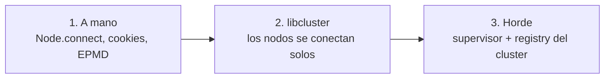
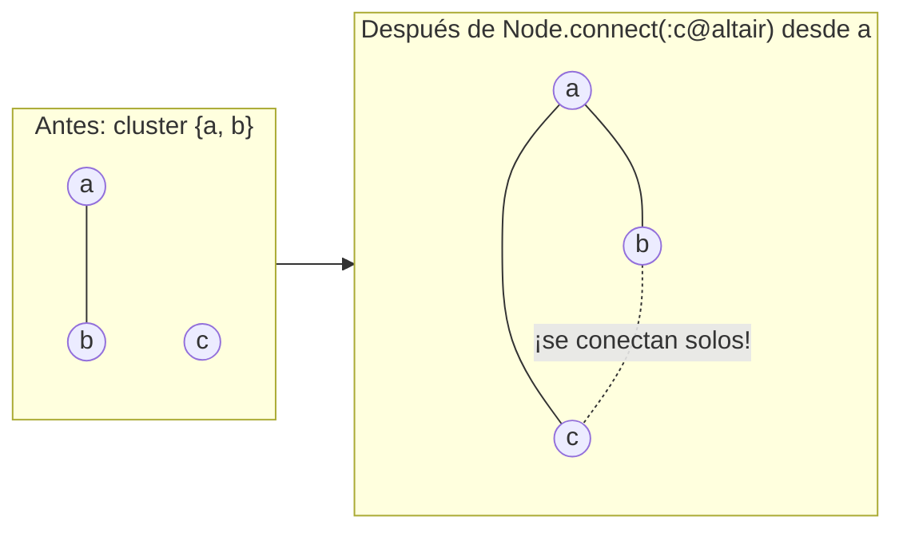
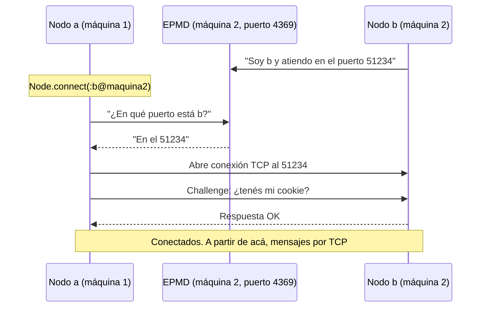
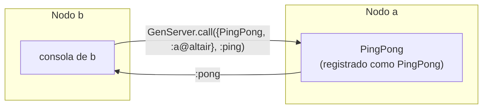
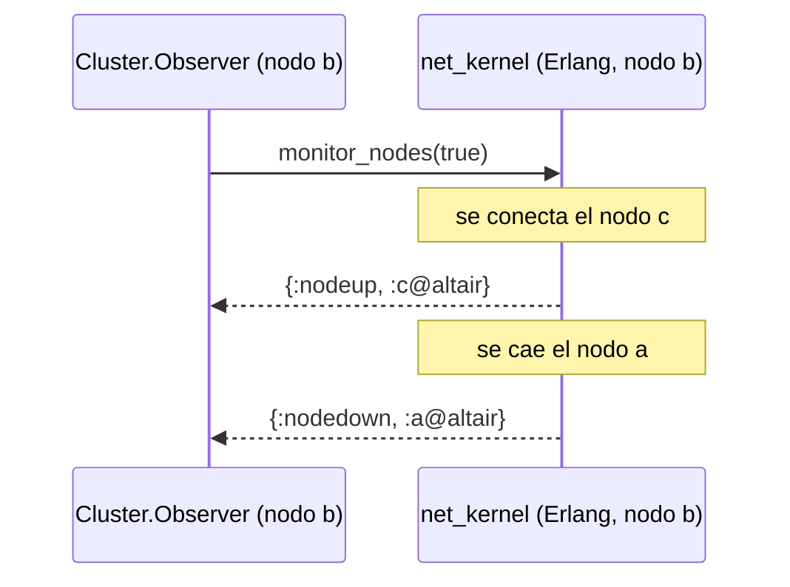
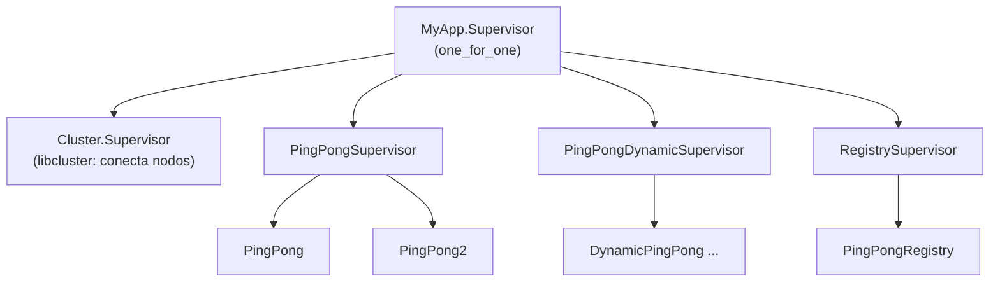
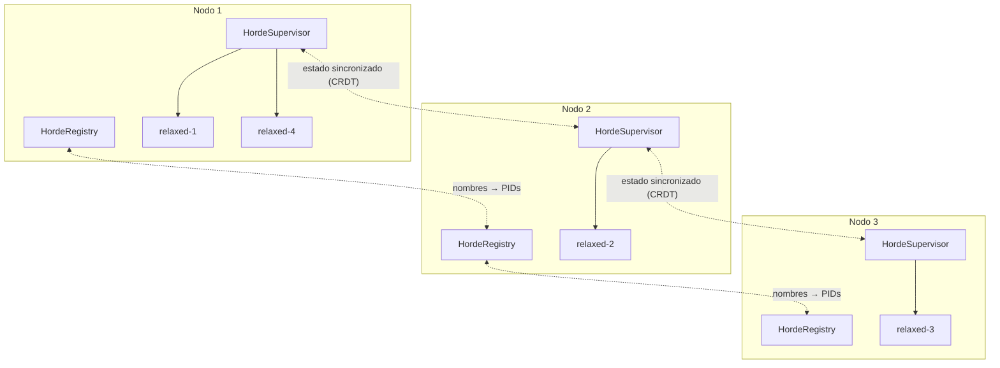
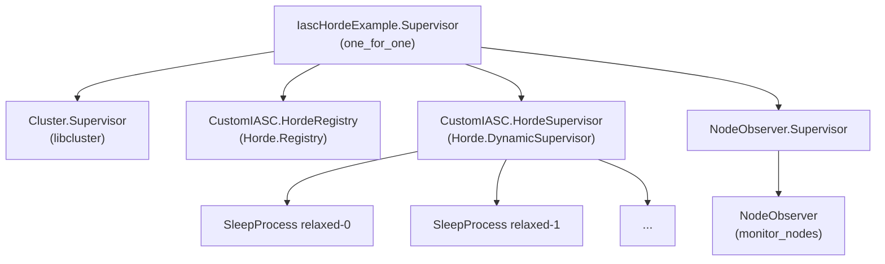
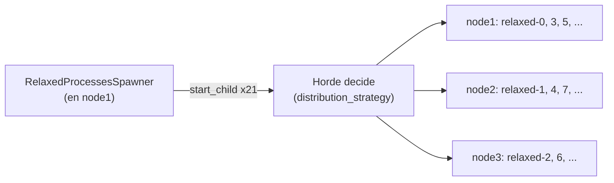
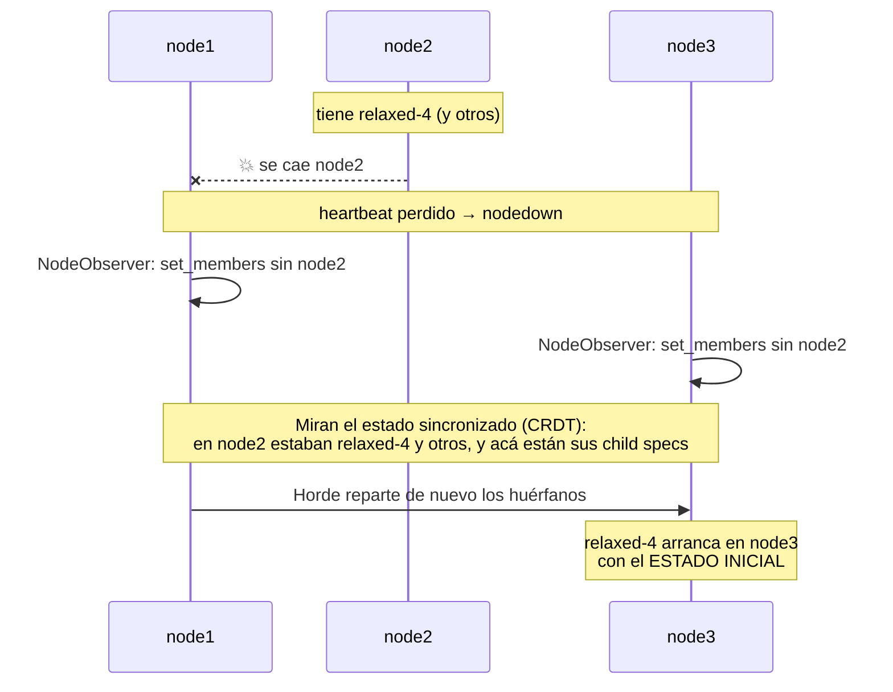

# Distribución en Elixir: nodos, libcluster y Horde

> Clase del 15/10.

Hasta ahora todo pasaba **dentro de una sola máquina virtual** (una sola consola `iex`). Teníamos procesos, links, monitores, supervisores... pero todo vivía en el mismo lugar. Si esa VM se moría, se moría todo.

Hoy damos el salto a **varias VMs conectadas entre sí** (un **cluster**). La clase va de lo más primitivo a lo más cómodo, igual que cuando vimos `spawn` + `send`/`receive` antes de llegar a `GenServer`:

1. **A mano**: conectar nodos con `Node.connect`, cookies, EPMD, `sys.config`, mandar mensajes a otro nodo.
2. **libcluster**: una librería que **conecta los nodos sola**. Solo hace eso.
3. **Horde**: una librería que da un **supervisor dinámico y un registry que abarcan todo el cluster**. Si se cae un nodo, sus procesos se levantan en otro.



Los ejemplos son de estos repos de la materia (cada uno suma algo sobre el anterior):

| Repo | Qué muestra |
|---|---|
| [iasc-actors-interconnect-nodes](https://github.com/arquitecturas-concurrentes/iasc-actors-interconnect-nodes) | Conexión manual, cookies, `sys.config`, `:net_kernel.monitor_nodes` |
| [iasc-actors-libcluster-example](https://github.com/arquitecturas-concurrentes/iasc-actors-libcluster-example) | libcluster, nombres repetidos en cada nodo, `:rpc.call` |
| [iasc-elixir-horde-minimal-example](https://github.com/arquitecturas-concurrentes/iasc-elixir-horde-minimal-example) | libcluster + Horde: procesos distribuidos y *failover* |

---

## 0. Vocabulario antes de arrancar

| Palabra | Qué significa (en criollo) |
|---|---|
| **Nodo** | Una instancia de la VM de Erlang (BEAM) corriendo. Cada vez que abrís un `iex` levantás un nodo. |
| **Cluster** | Un grupo de nodos conectados entre sí que se pueden mandar mensajes. |
| **Nombre de nodo** | Un átomo como `:a@altair` → `nombre@host`. Sin nombre, el nodo no se puede conectar con nadie. |
| **Cookie** | Una "contraseña" compartida. Solo se conectan nodos con la **misma** cookie. |
| **EPMD** | *Erlang Port Mapper Daemon*. Un programita que en cada máquina sabe en qué puerto escucha cada nodo. |
| **Distribución** | Repartir procesos entre varios nodos y que puedan hablar entre sí como si estuvieran en el mismo lado. |

> **Analogía**: cada nodo es una **oficina**; los procesos son los **empleados** de esa oficina. Hasta ahora teníamos una sola oficina. Ahora tenemos varias oficinas, en el mismo edificio o en distintas ciudades, conectadas por teléfono. La cookie es la clave de la central telefónica: si no la tenés, no te pasan la llamada.

Algo importante: **un nodo no es necesariamente un servidor web**. Es solo una VM. Puede tener un proyecto con Phoenix sirviendo en un puerto, o puede no servir nada.

---

## 1. Nodos a mano

### 1.1 Un nodo sin nombre no sirve para distribuir

```elixir
# Consola 1
$ iex
iex(1)> Node.self()
:nonode@nohost        # "no tengo nombre, no estoy en ningún host"
iex(2)> Node.list()
[]                    # no estoy conectado con nadie
```

Si abrís otra consola, también va a decir `:nonode@nohost`. **No son la misma VM**: son dos VMs distintas que comparten el "no-nombre". Así no hay forma de conectarlas.

### 1.2 Darle nombre: `--sname` y `--name`

```bash
iex --sname a      # nombre CORTO: queda a@<nombre-de-tu-máquina>, ej. a@altair
iex --sname b      # (en otra terminal)
```

```elixir
iex(a@altair)1> Node.self()
:a@altair           # ahora sí: un átomo con nombre@host
```

> `altair` es el nombre de la máquina del profe. En la tuya va a aparecer **tu hostname** (lo ves con `hostname` en la terminal). Tenelo en cuenta cuando copies comandos del repo.

Hay dos formas de nombrar:

| Opción | Ejemplo | Queda | Cuándo usarla |
|---|---|---|---|
| `--sname` | `iex --sname a` | `a@altair` | Todo en la misma máquina / red local simple |
| `--name` | `iex --name a@127.0.0.1` | `a@127.0.0.1` | Con IP o dominio completo (otras máquinas) |

⚠️ Un nodo con `--sname` **no se puede conectar** con uno con `--name`. Elegí uno y usalo en todos.

### 1.3 Conectar: `:net_adm.ping` y `Node.connect`

```elixir
iex(a@altair)1> :net_adm.ping(:c@altair)   # c no existe
:pang                                       # pang = "no te encontré"

iex(a@altair)2> :net_adm.ping(:b@altair)
:pong                                       # pong = "acá estoy" ... y ADEMÁS quedamos conectados

iex(a@altair)3> Node.list()
[:b@altair]
```

> **¿Por qué `:net_adm` empieza con dos puntos?** Porque es un **módulo de Erlang**, no de Elixir. En Elixir, los módulos de Erlang se llaman como átomos: `:net_adm`, `:observer`, `:rpc`, `:net_kernel`... Elixir puede usar todo Erlang de forma directa.

El `ping` no solo pregunta: **conecta**. Del lado de `b` no hicimos nada y ya ve a `a` en su `Node.list()`.

La forma "más linda" de conectar es `Node.connect/1`:

```elixir
Node.connect(:b@altair)    # true si conectó, false si no
```

### 1.4 El cluster es "todos contra todos" (malla completa)

Si `a` está conectado con `b`, y después `a` se conecta con `c`... **`b` y `c` también quedan conectados**, sin que nadie se lo pida.



Cuando un nodo se une a un cluster, la BEAM lo conecta con **todos** los que ya estaban. Por eso decimos que **todos se conocen con todos** (*full mesh*).

**¿Y qué pasa con libcluster y `Epmd`?** Si al nodo nuevo le ponés en su configuración la lista con `a` y `b`, él se conecta a ellos y entra al cluster igual, porque las conexiones en Erlang son **transitivas por defecto**: si `c` se conecta a `a`, termina conectado también con todos los que ya conocía `a`.

El límite es que **cada nodo nuevo necesita saber de antemano a quién conectarse**, y si los dos nodos de la lista se caen, ya no tiene por dónde entrar.

> Para escalar libremente conviene una estrategia de **descubrimiento dinámico**, como `Gossip` en una red local, o `DNSPoll` y `Kubernetes` en producción (ver [4.5](#45-estrategias-de-libcluster)).

### 1.5 Cookies

```bash
iex --sname a --cookie mi_token_secreto
iex --sname b --cookie mi_token_secreto
iex --sname c --cookie otra_cosa
```

```elixir
iex(c@altair)1> Node.connect(:a@altair)
false
```

y en la consola de `a` aparece:

```
[error] ** Connection attempt from node :c@altair rejected. Invalid challenge reply. **
```

El *challenge* es la prueba de "¿tenés la misma cookie que yo?". Como no la tiene, lo rechaza.

Se arregla cambiándole la cookie al nodo en caliente:

```elixir
iex(c@altair)2> Node.get_cookie()
:otra_cosa
iex(c@altair)3> Node.set_cookie(:mi_token_secreto)
iex(c@altair)4> Node.connect(:a@altair)
true
```

**¿Y si no le pongo cookie?** Erlang usa la que está guardada en el archivo `~/.erlang.cookie` (un valor al azar que se genera la primera vez). Por eso, en tu propia máquina, dos nodos sin `--cookie` se conectan entre sí: los dos leen el mismo archivo.

**¿Es seguridad de verdad? No.** La cookie es más bien una forma de **no mezclar clusters** (que un nodo del cluster "pepito" no se conecte por error al cluster "juancito"). La conexión no va encriptada ni nada. Esta VM nació para centrales telefónicas en redes cerradas, donde lo único expuesto al exterior era un servidor. Si querés seguridad, se pone **alrededor**: red privada, VPN, *firewall*, la nube con sus políticas, etc.

### 1.6 ¿Cómo se conectan por dentro? EPMD

Cuando levantás un nodo con nombre, además se levanta (si no estaba) el **EPMD**, que escucha en el puerto **4369** de esa máquina. Es como una **recepción de edificio**: sabe en qué puerto atiende cada nodo de esa máquina.



Todo va por **TCP**. Los nodos pueden estar en la misma máquina, en una red local, en una VPN o en la nube.

> 💡 **Comentario:** el EPMD es como un **service registry pequeño**, pero **local a cada máquina**: solo conoce a los nodos que corren en *esa* máquina (por eso A le pregunta al EPMD de la máquina 2, no al suyo). Y ojo: resuelve **nodos, no servicios**. Te dice en qué puerto está el nodo `b`, no qué hace ni qué servicios ofrece.

### 1.7 Heartbeat: "che, ¿seguís ahí?"

Mientras dos nodos están conectados, se pasan cada tanto un mensajito chiquito (un *tick* o *heartbeat*), de forma transparente. Es "la alarma de Homero" que dice que todo está bien.

- Si el heartbeat deja de llegar (se cortó la red, una partición, el otro nodo murió), **se corta la conexión** y los demás nodos se enteran de que ese nodo "se cayó".
- Cuando la red vuelve, **hay que volver a conectarlos** (a mano, o lo hace una librería como libcluster).

### 1.8 Un nodo aparte para el Observer (tip práctico)

El Observer a veces falla, y cuando falla **se lleva puesta la VM**. Si es un nodo que está procesando cosas, eso es malo. El truco:

```bash
iex --sname debug --cookie mi_token_secreto     # un nodo VACÍO, sin el proyecto
```

```elixir
iex(debug@altair)1> Node.connect(:a@altair)
iex(debug@altair)2> :observer.start()
```

En el Observer, en el menú **Nodes**, podés elegir cualquier nodo del cluster e inspeccionar sus procesos. Cada nodo tiene sus propias cosas. Y si un nodo se cae, el Observer te avisa.

> Para que el Observer funcione dentro de un proyecto `mix`, en `mix.exs` hacen falta estas apps:
> ```elixir
> def application do
>   [extra_applications: [:logger, :wx, :observer, :runtime_tools], ...]
> end
> ```
> `:wx` es la librería gráfica, `:observer` es el Observer y `:runtime_tools` son herramientas de *debugging* que el Observer usa.

---

## 2. Conectar nodos al arrancar: `sys.config`

Conectar a mano cada vez es tedioso. Erlang permite pasarle un archivo de configuración al arrancar ([sys.config del repo](https://github.com/arquitecturas-concurrentes/iasc-actors-interconnect-nodes/blob/main/sys.config)):

```erlang
%% OJO: esto es sintaxis de ERLANG, no de Elixir
[{kernel,
  [
    {sync_nodes_optional, ['a@127.0.0.1', 'b@127.0.0.1']},
    {sync_nodes_timeout, 5000}
  ]}
].
```

```bash
iex --name a@127.0.0.1 --erl "-config sys.config" -S mix   # start_a_node.bash
iex --name b@127.0.0.1 --erl "-config sys.config" -S mix   # start_b_node.bash
```

```elixir
iex(a@127.0.0.1)1> Node.list()
[:"b@127.0.0.1"]       # ¡sin hacer nada!
```

| Opción | Qué hace |
|---|---|
| `kernel` | La configuración es para la app `kernel` de Erlang (la base de todo). Siempre va. |
| `sync_nodes_optional` | Nodos que **pueden** estar. Al arrancar intenta conectarse; si no están, sigue igual. |
| `sync_nodes_mandatory` | Nodos que **tienen** que estar. Si no se conectan antes del timeout, **el nodo no arranca**. |
| `sync_nodes_timeout` | Cuánto espera (en ms) a esos nodos al arrancar (en el ejemplo, 5 segundos). |

En clase se levantó también un nodo `c` que **no estaba en la lista**, y se unió igual: al conectarse a `a`, por la malla completa (sección 1.4) quedó conectado con todos.

**Veredicto del profe**: funciona, pero es "áspero" (sintaxis de Erlang, opciones poco claras, poco flexible). Para el TP vamos a usar **libcluster**.

---

## 3. Hablar con procesos de otro nodo

### 3.1 `GenServer.call` a otro nodo

En el repo de interconexión hay un `PingPong` registrado con el nombre de su módulo:

```elixir
defmodule PingPong do
  use GenServer

  def start_link(state), do: GenServer.start_link(__MODULE__, state, name: __MODULE__)
  def init(state), do: {:ok, state}

  def handle_call(:ping, _from, state), do: {:reply, :pong, state}

  # --- Cliente ---
  def ping(),            do: GenServer.call(PingPong, :ping)            # al PingPong de MI nodo
  def ping_pid(pid),     do: GenServer.call(pid, :ping)                 # a un PID (de cualquier nodo)
  def ping_remote(node), do: GenServer.call({PingPong, node}, :ping)    # al PingPong de OTRO nodo
end
```

```elixir
iex(b@altair)1> GenServer.call({PingPong, :a@altair}, :ping)
:pong
```

**No hay que aprender nada nuevo**: es el `call` de siempre. Lo que cambia es **a quién** se lo mandamos. `GenServer.call/cast` aceptan varias formas de destino:

| Destino | Ejemplo | Significa |
|---|---|---|
| PID | `pid` | Ese proceso exacto, esté en el nodo que esté |
| Átomo | `PingPong` | El proceso registrado con ese nombre **en mi nodo** |
| `{átomo, nodo}` | `{PingPong, :a@altair}` | El proceso registrado con ese nombre **en el nodo `a`** |
| `{:global, término}` | `{:global, :mi_proceso}` | Registrado en el registro global del cluster |
| `{:via, módulo, nombre}` | `{:via, Registry, {MiRegistry, 1}}` | Buscalo usando ese registry (lo vimos la clase pasada) |



> **Los nombres registrados son por nodo, no por cluster.** Si el proyecto corre en `a`, `b` y `c`, hay **tres** procesos llamados `PingPong`, uno en cada nodo. Por eso hay que decir de **qué nodo** lo queremos.

### 3.2 El PID ahora dice en qué nodo vive

Un PID tiene tres números: `#PID<X.Y.Z>`. Hasta ahora el primero era siempre `0`. Ahora importa:

```
#PID<0.153.0>         → el 0 dice: "este proceso está en MI nodo"
#PID<24517.577.0>     → un número distinto de 0: "este proceso está en OTRO nodo"
     │      │   │
     │      │   └─ (detalle interno)
     │      └───── número del proceso dentro de su nodo
     └──────────── qué nodo es (0 = el mío)
```

Ese primer número **lo asigna la VM al conectarse** con el otro nodo, y no es fijo: no lo podés predecir, y el mismo nodo puede tener otro número visto desde otro lugar. Lo importante: **un PID identifica a un proceso en todo el cluster**, no solo en una VM. Por eso podés guardar el PID de un proceso remoto y mandarle mensajes con `send`, `call` o `cast` como siempre.

### 3.3 Enterarse de que un nodo se conecta o se cae: `:net_kernel.monitor_nodes`

`:net_kernel` es el módulo de Erlang más primitivo para manejar conexiones entre nodos (`Node.connect`, `disconnect`, etc. lo usan por debajo, y libcluster también). Tiene una función para **suscribirse** a los eventos de conexión:

```elixir
defmodule Cluster.Observer do
  use GenServer
  require Logger

  def start_link(_), do: GenServer.start_link(__MODULE__, %{})

  @impl GenServer
  def init(state) do
    :net_kernel.monitor_nodes(true)   # "avisame cuando un nodo se conecte o se desconecte"
    {:ok, state}
  end

  # Estos mensajes los manda Erlang (no otro proceso nuestro), por eso son handle_info
  @impl GenServer
  def handle_info({:nodedown, node}, state) do
    Logger.info("---- Node down: #{node} ----")
    {:noreply, state}
  end

  @impl GenServer
  def handle_info({:nodeup, node}, state) do
    Logger.info("---- Node up: #{node} ----")
    {:noreply, state}
  end
end
```



Es un **hook**: no responde nada (es `handle_info`, nadie espera respuesta). Acá solo se imprime, pero se podría hacer algo útil: **migrar procesos, replicar estado**, etc. Como veremos, Horde hace algo muy parecido por dentro.

> Si llamás `:net_kernel.monitor_nodes(true, node_type: :visible)` (como en el ejemplo de Horde), los mensajes traen **un elemento más**: `{:nodeup, node, info}` y `{:nodedown, node, info}`. Ojo con el *pattern matching*.

---

## 4. libcluster: que los nodos se conecten solos

[libcluster](https://hexdocs.pm/libcluster/readme.html) resuelve **un solo problema**: formar el cluster automáticamente (y reconectar cuando un nodo vuelve). Nada más. Lo que pase con el estado, los procesos, etc., sigue siendo problema nuestro.

> **Ojo: libcluster no levanta los nodos.** Cada nodo lo seguís levantando vos, en su propia terminal, con su nombre y la cookie compartida (por ejemplo `iex --sname a --cookie secreto -S mix`). libcluster corre **adentro de cada nodo**, como un proceso más del árbol de supervisión: lee la topología configurada, descubre a los demás nodos según una estrategia y, cuando encuentra uno, ejecuta él mismo el `Node.connect` que antes hacíamos a mano (y que, igual que a mano, solo conecta nodos con la **misma cookie**).

### 4.1 Instalación

En `mix.exs`, como dependencia (es externa a Elixir):

```elixir
defp deps do
  [
    {:libcluster, "~> 3.5"}
  ]
end
```

```bash
mix deps.get
```

### 4.2 Topología + `Cluster.Supervisor`

En la `Application` se define una **topología**: cómo se tienen que encontrar los nodos ([Application.ex del ejemplo](https://github.com/arquitecturas-concurrentes/iasc-actors-libcluster-example/blob/main/lib/Application.ex)):

```elixir
defmodule LibclusterExample do
  use Application

  def start(_type, _args) do
    topologies = [
      myapp: [                                   # nombre de la topología (cualquiera)
        strategy: Cluster.Strategy.Epmd,         # CÓMO se conectan: con EPMD, lo que vimos a mano
        config: [hosts: [:"a@127.0.0.1"]]        # al menos UN nodo inicial conocido
      ]
    ]

    children = [
      {Cluster.Supervisor, [topologies, [name: MyApp.ClusterSupervisor]]},  # ← la magia de libcluster
      PingPongSupervisor,
      %{id: PingPongDynamicSupervisor, start: {PingPongDynamicSupervisor, :start_link, [[]]}},
      RegistrySupervisor
    ]

    Supervisor.start_link(children, strategy: :one_for_one, name: MyApp.Supervisor)
  end
end
```

Dos cosas para hacer:
1. **Definir la topología** (es solo una lista de configuración).
2. **Levantar `Cluster.Supervisor`** pasándole esa topología. Ese supervisor hace todo el trabajo de conectar.

El profe lo pone dentro de un **supervisor de supervisores**, para tener un segundo nivel de supervisión junto con sus otros supervisores (`PingPongSupervisor`, el dinámico, el del registry).



**Ojo:** este árbol se levanta **entero en cada nodo**. Si levantás `a`, `b` y `c` con este proyecto, cada uno tiene su propio `PingPong`, `PingPong2`, `PingPongRegistry`, etc.

### 4.3 Levantarlo

```bash
iex --name a@127.0.0.1 -S mix
iex --name b@127.0.0.1 -S mix     # otra terminal
iex --name c@127.0.0.1 -S mix     # otra terminal
```

```elixir
iex(c@127.0.0.1)1> Node.list()
[:"a@127.0.0.1", :"b@127.0.0.1"]     # se conectó solo
```

Basta con que **un** nodo conocido (`a`) esté en la lista de `hosts`: el resto se suma por la malla completa. Si querés cookie, agregás `--cookie algo` a cada comando (en el ejemplo no se usa por simplicidad).

### 4.4 Nombres repetidos en cada nodo y `:rpc.call`

En el Observer, en el nodo `b`, aparece por ejemplo `PingPong2` con PID `<24517.577.0>` (primer número ≠ 0: lo estás mirando desde otro nodo). En el nodo `c` hay **otro** `PingPong2`, con otro PID. Los nombres **se repiten entre nodos**, porque el registro de nombres es por VM.

Eso puede ser bueno o malo según qué quieras. Si necesitás saber exactamente dónde está algo, conviene un **Registry**: guarda PIDs, y el PID ya dice a qué nodo pertenece.

El `PingPongRegistry` del ejemplo es un `Registry` (no un `GenServer`), y hay uno **por nodo**:

```elixir
defmodule PingPongRegistry do
  def start_link(_), do: Registry.start_link(keys: :unique, name: __MODULE__)

  def registrar_ping_pong(key, pid), do: Registry.register(__MODULE__, key, pid)
  def get_ping_pongs(), do: Registry.select(__MODULE__, [{{:"$1", :"$2", :_}, [], [{{:"$1", :"$2"}}]}])
  def get_ping_pong(id), do: Registry.lookup(__MODULE__, id)
end
```

¿Cómo le pido al registry **de otro nodo** sus ping pongs, si no es un GenServer y no puedo hacer `call`? Con la forma **más primitiva** de ejecutar algo en otro nodo, `:rpc.call` (*Remote Procedure Call*):

```elixir
# :rpc.call(nodo, módulo, función, [argumentos])
iex(a@127.0.0.1)1> :rpc.call(:"b@127.0.0.1", PingPongRegistry, :get_ping_pongs, [])
[{1, #PID<12345.210.0>}, {2, #PID<12345.211.0>}]
```

Significa: "nodo `b`, ejecutá `PingPongRegistry.get_ping_pongs()` en tu VM y mandame el resultado". Y con esos PIDs ya puedo hacer `GenServer.call(pid, :get)` desde `a`.

```elixir
# Ejemplo completo: crear un ping pong dinámico en b y usarlo desde a
iex(b@127.0.0.1)1> PingPongDynamicSupervisor.start_child(:soy_un_estado)

iex(a@127.0.0.1)1> [{_id, pid} | _] = :rpc.call(:"b@127.0.0.1", PingPongRegistry, :get_ping_pongs, [])
iex(a@127.0.0.1)2> GenServer.call(pid, :get)
%{id: 1, data: :soy_un_estado}       # el id lo genera System.unique_integer, puede ser otro número
```

### 4.5 Estrategias de libcluster

La estrategia dice **cómo se descubren** los nodos:

| Estrategia | Cómo funciona | Comentario |
|---|---|---|
| `Cluster.Strategy.Epmd` | Lista fija de nodos; conecta con EPMD (por **TCP**) | La más común. **La que usamos.** |
| `Cluster.Strategy.LocalEpmd` | Conecta los nodos que corren en la **misma máquina** | Útil para desarrollo local |
| `Cluster.Strategy.ErlangHosts` | Toma los hosts del archivo `.hosts.erlang` | |
| `Cluster.Strategy.Gossip` | Cada nodo se anuncia por **UDP multicast** en la red local y escucha a los demás | El profe **no la recomienda** (ver abajo) |
| `Cluster.Strategy.Kubernetes` y `Cluster.Strategy.DNSPoll` | Descubren los nodos consultando la API de Kubernetes o un registro DNS | Para producción en Kubernetes |
| `Cluster.Strategy.Rancher` | Igual, para Rancher | |
| Externas (EC2, Consul, etc.) | Paquetes aparte | Hay que instalar otra dependencia |

**¿Por qué no Gossip/UDP?** Pregunta de la clase: ¿qué diferencia hay entre TCP y UDP?

- **TCP**: cada paquete tiene **acuse de recibo** (*ACK*). Si no llega, se **retransmite**. Garantiza que llegue y en orden.
- **UDP**: no hay ACK. Los paquetes **se pueden perder** (y por eso tampoco hay orden garantizado).

Si el heartbeat viaja por algo que puede perder paquetes, en una red con problemas pueden perderse varios seguidos y el cluster puede **creer que un nodo se cayó cuando no se cayó** (un **falso negativo**). Con TCP eso no pasa por un paquete perdido suelto.

> Para el TP **no hace falta** Kubernetes. Pero si algún día ponen esto en producción, sepan que esas estrategias existen.

### 4.6 Qué resuelve y qué no

| ✅ libcluster resuelve | ❌ libcluster NO resuelve |
|---|---|
| Que los nodos se encuentren y se conecten solos | Dónde vive cada proceso |
| Reconectar cuando un nodo vuelve | Qué pasa con los procesos de un nodo que se cayó |
| | El estado (eso sigue siendo cosa nuestra) |
| | El `Registry`, la replicación y el traspaso del vuelo (los resolvés vos) |

Para lo segundo, viene Horde.

---

## 5. Horde: supervisor y registry para todo el cluster

### 5.1 La idea

Repaso: la clase pasada vimos supervisores **estáticos** (hijos fijos) y **dinámicos** (`DynamicSupervisor`, hijos creados a pedido). Los dos tienen un límite: **viven en un solo nodo**. Si se cae el nodo, se caen el supervisor y todos sus hijos, y no hay nadie que los reviva.

[Horde](https://hexdocs.pm/horde/readme.html) da:

- **`Horde.DynamicSupervisor`**: un supervisor dinámico **del cluster**. Le pedís un proceso y lo crea **en algún nodo del cluster** (no necesariamente en el tuyo).
- **`Horde.Registry`**: un registry **del cluster**. Registrás un nombre una vez y lo encontrás **desde cualquier nodo**.

| | `DynamicSupervisor` (Elixir) | `Horde.DynamicSupervisor` |
|---|---|---|
| Alcance | **Un nodo** | **Todo el cluster** |
| Conoce a... | Sus hijos de ese nodo | Sus hijos **y los de los Horde del mismo nombre en los otros nodos** |
| Si se cae un proceso | Lo reinicia ahí | Lo reinicia (en ese nodo **o en otro**) |
| Si se cae el nodo | Se pierde todo | Los procesos **se vuelven a levantar en los nodos que quedan** |

### 5.2 ¿Cómo hace? Muchos Horde que se sincronizan

En clase se preguntó: si hay un `HordeSupervisor` en el nodo 3, ¿a qué hijos conoce? La intuición de un compañero fue la correcta: **conoce a los suyos y además está sincronizado con los Horde de los otros nodos**.

No es un "sidecar" ni nada mágico: **todo son procesos**. Cada nodo que arranca con el proyecto levanta su árbol de supervisión, y en ese árbol hay un `HordeSupervisor` y un `HordeRegistry`. Como en todos los nodos **se llaman igual**, se reconocen entre sí y **comparten su estado** (qué procesos hay, con qué *child spec*, en qué nodo están).



Esa sincronización se hace con **CRDTs** (*Conflict-free Replicated Data Types*): estructuras de datos pensadas para sistemas distribuidos. Cada nodo tiene **su copia**, la modifica localmente y las copias **se mezclan** (*merge*) sin conflictos, de forma que **eventualmente** todas quedan iguales (consistencia eventual). Horde se comunica bastante seguido para que las diferencias duren poco.

> **Analogía**: es como un Google Sheets compartido entre las oficinas con la lista "qué empleado trabaja en qué oficina y cómo se lo contrata". Si se incendia una oficina, las demás miran la planilla, ven quiénes trabajaban ahí y **los vuelven a contratar** (desde cero: lo que tenían en la cabeza se perdió).

Además, se pueden tener **varios** Horde supervisors distintos (con distintos nombres), y no hace falta que todos los nodos los tengan. Por ejemplo, un nodo "observer" vacío está en el cluster pero no tiene Horde, así que **nunca** le van a caer procesos. Los procesos se reparten solo entre los nodos que tengan **ese** supervisor definido.

### 5.3 Instalación

```elixir
defp deps do
  [
    {:libcluster, "~> 3.5"},   # para conectar los nodos
    {:horde, "~> 0.10"}        # para distribuir los procesos
  ]
end
```

Horde **no conecta nodos**: para eso sigue estando libcluster. Se usan juntos.

### 5.4 El `Application` del ejemplo

([application.ex](https://github.com/arquitecturas-concurrentes/iasc-elixir-horde-minimal-example/blob/main/lib/application.ex))

```elixir
defmodule IascHordeExample.Application do
  use Application

  @impl true
  def start(_type, _args) do
    children = [
      # 1. libcluster: conecta los nodos
      {Cluster.Supervisor, [topologies(), [name: MinimalExample.ClusterSupervisor]]},

      # 2. Horde: el registry del cluster
      CustomIASC.HordeRegistry,

      # 3. Horde: el supervisor dinámico del cluster
      {CustomIASC.HordeSupervisor,
        [strategy: :one_for_one,
         distribution_strategy: Horde.UniformQuorumDistribution,   # cómo reparte los procesos
         process_redistribution: :active]},                        # rebalancea cuando entra un nodo

      # 4. Nuestro observador de nodos (no es de Horde)
      CustomIASC.NodeObserver.Supervisor
    ]

    Supervisor.start_link(children, strategy: :one_for_one, name: IascHordeExample.Supervisor)
  end

  # La topología ahora es una función (podría ser una variable, da igual)
  defp topologies do
    [
      horde_minimal_example: [
        strategy: Cluster.Strategy.Epmd,
        config: [hosts: [:node1@altair]]     # ⚠️ cambiá "altair" por TU hostname
      ]
    ]
  end
end
```



### 5.5 `HordeRegistry` y `HordeSupervisor`: el "template" de la documentación

Horde te pide que definas tus propios módulos con este código, que es casi copiar y pegar de la documentación:

```elixir
defmodule CustomIASC.HordeRegistry do
  use Horde.Registry

  def start_link(_) do
    Horde.Registry.start_link(__MODULE__, [keys: :unique], name: __MODULE__)
  end

  def init(init_arg) do
    [members: members()]
    |> Keyword.merge(init_arg)
    |> Horde.Registry.init()
  end

  # Los "miembros" son los HordeRegistry de todos los nodos visibles, incluido el mío
  defp members() do
    Enum.map(Node.list([:this, :visible]), &{__MODULE__, &1})
  end
end
```

```elixir
defmodule CustomIASC.HordeSupervisor do
  use Horde.DynamicSupervisor

  def start_link(opts) do
    Horde.DynamicSupervisor.start_link(__MODULE__, opts, name: __MODULE__)
  end

  def init(init_arg) do
    [members: members()]
    |> Keyword.merge(init_arg)
    |> Horde.DynamicSupervisor.init()
  end

  # Para crear procesos: le paso un child spec y Horde elige el nodo
  def start_child(child_spec) do
    Horde.DynamicSupervisor.start_child(__MODULE__, child_spec)
  end

  defp members do
    Enum.map(Node.list([:this, :visible]), &{__MODULE__, &1})
  end
end
```

**¿Qué es eso de `members`?**

- `Node.list()` **no te incluye a vos mismo**: solo los otros nodos.
- `Node.list([:this, :visible])` sí: `:this` = el nodo actual, `:visible` = todos los conectados.
- Con eso arma una lista de tuplas `{nombre, nodo}`:

```elixir
iex(node1@altair)1> Node.list([:this, :visible])
[:node1@altair, :node2@altair, :node3@altair]

# members() devuelve:
[{CustomIASC.HordeSupervisor, :node1@altair},
 {CustomIASC.HordeSupervisor, :node2@altair},
 {CustomIASC.HordeSupervisor, :node3@altair}]
```

Es decir: "mis compañeros son los procesos llamados `CustomIASC.HordeSupervisor` en cada uno de estos nodos". **Por eso es clave que se llamen igual en todos los nodos.**

Un `HordeSupervisor` así es bastante "universal": como recibe cualquier *child spec*, con uno solo (más su registry) alcanza para casi todo. Se pueden tener más si se quiere separar tipos de procesos.

### 5.6 Mantener los miembros al día: `NodeObserver`

Los `members` se calculan **al arrancar**. Pero los nodos entran y salen todo el tiempo. Así que el ejemplo reutiliza la idea de la sección 3.3: un GenServer que escucha `nodeup`/`nodedown` y **actualiza los miembros** de Horde:

```elixir
defmodule CustomIASC.NodeObserver do
  use GenServer
  require Logger
  alias CustomIASC.{HordeRegistry, HordeSupervisor}

  def start_link(_), do: GenServer.start_link(__MODULE__, %{})

  @impl GenServer
  def init(state) do
    :net_kernel.monitor_nodes(true, node_type: :visible)   # ← los mensajes traen 3 elementos
    {:ok, state}
  end

  @impl GenServer
  def handle_info({:nodedown, node, _node_type}, state) do
    Logger.info("---- Node down: #{node} ----")
    set_members(HordeRegistry)
    set_members(HordeSupervisor)
    {:noreply, state}
  end

  @impl GenServer
  def handle_info({:nodeup, node, _node_type}, state) do
    Logger.info("---- Node up: #{node} ----")
    set_members(HordeRegistry)
    set_members(HordeSupervisor)
    {:noreply, state}
  end

  defp set_members(name) do
    members = Enum.map([Node.self() | Node.list()], &{name, &1})
    :ok = Horde.Cluster.set_members(name, members)
  end
end
```

> Versiones nuevas de Horde aceptan `members: :auto`, que hace esto mismo solo. El ejemplo lo hace a mano para que se vea qué pasa por detrás.

### 5.7 El proceso que vamos a distribuir: `SleepProcess`

([sleep_process.ex](https://github.com/arquitecturas-concurrentes/iasc-elixir-horde-minimal-example/blob/main/lib/sleep_process/sleep_process.ex)) Es un GenServer muy tonto: espera un rato, genera un número al azar y lo imprime.

```elixir
defmodule IascHordeExample.SleepProcess do
  use GenServer
  require Logger
  alias CustomIASC.HordeRegistry

  # El child spec: cómo se crea este proceso (Horde lo guarda para poder recrearlo)
  def child_spec(id, seconds_to_sleep) do
    %{
      id: get_process_name_from_number(id),                     # :"relaxed-4"
      start: {__MODULE__, :start_link, [id, seconds_to_sleep]},
      restart: :transient                                       # ← se reinicia SOLO si muere con error
    }
  end

  def start_link(identifier, seconds_to_sleep) do
    name = get_process_name_from_number(identifier)
    GenServer.start_link(__MODULE__, {identifier, seconds_to_sleep, name}, name: name)
  end

  @impl GenServer
  def init({id, timeout, name}) do
    register_process(name)                              # se anota en el HordeRegistry
    Process.send_after(self(), :execute, timeout, [])   # se manda un mensaje a SÍ MISMO más tarde
    {:ok, {id, timeout}}
  end

  # Los "comandos" llegan como mensajes sueltos → handle_info (se mandan con send)
  @impl GenServer
  def handle_info(:execute, {_id, timeout} = state) do
    execute(timeout)                                    # duerme y loguea un número al azar
    {:noreply, state}
  end
  def handle_info(:terminate, {id, _} = state) do
    Logger.info("process #{id} Finishing.")
    {:stop, :normal, state}                             # termina BIEN → no se reinicia
  end
  def handle_info(:end_with_error, {id, _} = state) do
    Logger.info("process #{id} Erroring.")
    _a = 1 / 0                                          # explota → se reinicia
    {:noreply, state}
  end
  def handle_info(:stress, {_id, timeout} = state) do
    execute(1)
    Process.send_after(self(), :stress, timeout, [])    # se vuelve a mandar :stress → loop infinito
    {:noreply, state}
  end

  # Buscar el PID desde cualquier nodo, por el registry de Horde
  def whereis_identifier(id), do: id |> get_process_name_from_number() |> whereis()
  def whereis(name), do: name |> via_tuple() |> GenServer.whereis()
  def via_tuple(name), do: {:via, Horde.Registry, {HordeRegistry, name}}

  defp register_process(name), do: Horde.Registry.register(HordeRegistry, name, self())
  defp get_process_name_from_number(id), do: String.to_atom("relaxed-#{id}")
  # execute/1 duerme unos segundos y loguea un número al azar
end
```

Puntos clave:
- El **child spec** es la "receta" del proceso. Horde la guarda (y la sincroniza) para poder recrearlo en otro nodo.
- `Process.send_after(self(), mensaje, ms)`: el proceso se manda un mensaje **a sí mismo** dentro de un rato. Por eso `:stress` es un loop: cada vez que lo procesa, se lo vuelve a programar.
- Para encontrarlo usamos la **via tuple** con `Horde.Registry`, igual que la clase pasada con `Registry`, pero ahora **funciona desde cualquier nodo**.

### 5.8 El `RelaxedProcessesSpawner`: una fábrica de procesos

([relaxed_spawner.ex](https://github.com/arquitecturas-concurrentes/iasc-elixir-horde-minimal-example/blob/main/lib/sleep_process/relaxed_spawner.ex)) Es un `Task` que crea, estresa o frena procesos en masa:

```elixir
def create_process(process_number, ttl) do
  for number <- 0..process_number do
    child_spec = SleepProcess.child_spec(number, seconds_with_jitter(ttl))
    HordeSupervisor.start_child(child_spec)       # ← ESTA es la línea importante
  end
end

def stop(number) do
  for x <- 0..number do
    pid = SleepProcess.whereis_identifier(x)
    if pid, do: send(pid, :terminate)
  end
end
```

`HordeSupervisor.start_child(child_spec)` es todo lo que hay que hacer: **Horde elige el nodo, crea el proceso, lo supervisa y lo registra**. No tenemos que hacer nada más. El TTL tiene un poco de azar (*jitter*) para que no hagan todo al mismo tiempo.

---

## 6. La demo paso a paso

### 6.1 Levantar el cluster

```bash
iex --sname node1 --cookie some_cookie -S mix      # node_1.sh
iex --sname node2 --cookie some_cookie -S mix      # node_2.sh
iex --sname node3 --cookie some_cookie -S mix      # otra terminal
iex --sname observer --cookie some_cookie          # observer_node.sh: SIN -S mix (nodo vacío)
```

```elixir
iex(observer@altair)1> Node.connect(:node1@altair)
iex(observer@altair)2> :observer.start()
```

En el Observer (pestaña **Applications**, eligiendo cada nodo en **Nodes**):
- En `observer` no hay nada (no tiene el proyecto).
- En `node1`, `node2`, `node3` aparece la app `iasc_elixir_horde_minimal_example` con su supervisor, el `ClusterSupervisor` de libcluster, el `HordeRegistry`, el `HordeSupervisor` y el `NodeObserver`.

### 6.2 Crear 20 procesos

```elixir
iex(node1@altair)1> RelaxedProcessesSpawner.start_link_create(20, 12)
# [info] started process 0
# [info] started process 1
# ...
```

En el Observer se ve que **se repartieron**: algunos en `node1`, otros en `node2`, otros en `node3`. Y además de colgar del `HordeSupervisor`, aparecen **linkeados al `HordeRegistry`**: así Horde se entera de que el proceso murió.



### 6.3 Buscar un proceso desde cualquier nodo

```elixir
iex(node1@altair)2> alias IascHordeExample.SleepProcess
iex(node1@altair)3> SleepProcess.whereis_identifier(1)
#PID<14003.240.0>        # primer número ≠ 0: vive en OTRO nodo

iex(node1@altair)4> SleepProcess.whereis_identifier(3)
#PID<0.237.0>            # 0: vive en ESTE nodo
```

No me importa dónde está: lo pido por **nombre** y Horde me da el PID, esté donde esté.

### 6.4 Terminarlo bien: no vuelve

```elixir
iex(node1@altair)5> pid = SleepProcess.whereis_identifier(1)
iex(node1@altair)6> send(pid, :terminate)
# [info] process 1 Finishing.      (aparece en la consola del nodo donde vivía)

iex(node1@altair)7> SleepProcess.whereis_identifier(1)
nil                       # ya no existe
```

¿Por qué no lo revivió? Porque es `restart: :transient` y terminó con razón `:normal`. Funciona **igual que un supervisor dinámico** común (clase pasada): `:transient` solo reinicia si el proceso **falla**. Si fuera `:permanent`, lo reviviría siempre.

### 6.5 Romperlo: vuelve, con otro PID (¡y quizás en otro nodo!)

```elixir
iex(node1@altair)8> pid = SleepProcess.whereis_identifier(4)
#PID<0.241.0>
iex(node1@altair)9> send(pid, :end_with_error)
# [info] process 4 Erroring.
# [error] ... ArithmeticError: bad argument in arithmetic expression ...

iex(node1@altair)10> SleepProcess.whereis_identifier(4)
#PID<0.248.0>             # ¡volvió! Otro PID (antes 241, ahora 248)
```

En la demo cayó en el mismo nodo, pero **podría haber caído en otro**: depende de la estrategia de distribución. Lo que importa es que `relaxed-4` **sigue existiendo** y lo encontramos por el mismo nombre.

### 6.6 Matar un nodo entero: *failover*

Este es el punto fuerte de Horde. Si se cae `node2` (Ctrl+C dos veces en su consola):



```elixir
# Antes de matar node2
iex(node1@altair)11> SleepProcess.whereis_identifier(4)
#PID<25664.250.0>     # en node2

# Después de matar node2
iex(node1@altair)12> SleepProcess.whereis_identifier(4)
#PID<25665.260.0>     # ahora en node3 (otro primer número)
```

Y si **volvés a levantar** `node2`, con `process_redistribution: :active` Horde **rebalancea**: algunos procesos pueden volver a migrarse hacia `node2`. En la demo `relaxed-4` volvió a `node2`, pero **no tiene por qué** volver al nodo donde nació; con más nodos puede ir a cualquiera.

Lo mismo al agregar un `node4`: algunos procesos se mudan ahí. Y si matás `node4`, se redistribuyen otra vez entre los que quedan. A veces el reparto queda "medio raro" (un nodo con casi nada), pero se reparte.

⚠️ **Muy importante**: el proceso que se recrea **arranca con su estado inicial** (lo que dice el child spec). **El estado que tenía se perdió.** Lo que se conserva es que **ese proceso, con ese identificador, sigue existiendo** en algún lugar del cluster. Ese identificador podría ser, por ejemplo, un número de cuenta. Si necesitás el estado, lo tenés que guardar/replicar vos (como dijimos la clase pasada: Agent, ETS, base de datos, otro proceso réplica...).

### 6.7 Resumen: ¿cómo detecta Horde que se cayó algo y cómo lo arregla?

Pregunta de la clase. Respuesta: no hace nada que no hayamos visto, solo lo combina:

1. **Detectar** que un nodo se cayó/levantó: lo mismo que nuestro `NodeObserver` (eventos `nodeup`/`nodedown` de la VM, que vienen del heartbeat). Ahí actualiza los miembros.
2. **Detectar** que un proceso murió: el proceso está **linkeado** (supervisión de siempre).
3. **Saber qué había** en el nodo caído: el **registry** y el estado del supervisor están **sincronizados con CRDTs** en todos los nodos. Cada nodo sabe qué procesos había, dónde y con qué *child spec*.
4. **Arreglarlo**: con el *child spec* los vuelve a crear en los nodos vivos, según la estrategia de distribución.

Todo eso es transparente: para usar la librería, alcanza con entender lo de arriba. El detalle interno solo importa si la quieren extender.

### 6.8 Estrategias de distribución

Con qué criterio Horde elige el nodo para cada proceso (`distribution_strategy`):

| Estrategia | Cómo elige |
|---|---|
| `Horde.UniformDistribution` (por defecto) | Usa un *hash* del id del hijo para repartir parejo entre los nodos vivos |
| `Horde.UniformRandomDistribution` | Elige un nodo al azar |
| `Horde.UniformQuorumDistribution` | Como la uniforme, pero solo arranca procesos si este lado del cluster tiene **quórum** (mayoría de nodos). Sirve ante **particiones de red** (*netsplits*), para que las dos mitades no levanten el mismo proceso. **La que usa el ejemplo.** |

También se puede **escribir una propia**: hay que implementar el *behaviour* `Horde.DistributionStrategy` (un *behaviour* es como una interfaz: un módulo dice "implemento estas funciones"). Son pocas funciones: `choose_node/2` (qué nodo elijo) y `has_quorum?/1` (¿tengo quórum?).

> **Anécdota**: un grupo del 2° cuatrimestre de 2021 tenía un proceso con estado y otro proceso **réplica** (backup) de ese estado. Con la distribución uniforme, a veces caían **los dos en el mismo nodo**: si se caía ese nodo, se perdían ambos. Hicieron una estrategia custom que pone la réplica en **cualquier nodo menos** donde está el original. Incluso tuvieron que tocar el código de Horde, y el cambio **terminó mergeado** en el repo oficial.

Para la mayoría de los casos alcanza con la uniforme; si necesitan una custom depende de cómo diseñen el TP.

---

## Resumen

| Concepto | Qué hace | Cómo se usa |
|---|---|---|
| **Nodo** | Una VM de Erlang corriendo, con nombre | `iex --sname a` / `iex --name a@127.0.0.1` |
| **Cookie** | "Contraseña" para unirse al cluster (no es seguridad real) | `--cookie x`, `Node.set_cookie/1`, `Node.get_cookie/0` |
| **Conectar** | Une dos nodos (y por la malla, a todos con todos) | `Node.connect/1`, `:net_adm.ping/1` |
| **EPMD** | Recepción que dice en qué puerto está cada nodo (TCP, puerto 4369) | Automático |
| **Heartbeat** | Tick periódico para saber si la conexión sigue viva | Automático |
| **`sys.config`** | Conectar nodos al arrancar (sintaxis Erlang) | `--erl "-config sys.config"` |
| **Mensaje a otro nodo** | `call`/`cast` a un nombre en un nodo dado, o a un PID | `GenServer.call({PingPong, :a@altair}, :ping)` |
| **`:rpc.call`** | Ejecutar una función en otro nodo y traer el resultado | `:rpc.call(nodo, Mod, :fun, [args])` |
| **`monitor_nodes`** | Recibir `{:nodeup, n}` / `{:nodedown, n}` | `:net_kernel.monitor_nodes(true)` + `handle_info` |
| **libcluster** | Conecta los nodos solo, según una topología | `{Cluster.Supervisor, [topologies, opts]}` |
| **Estrategia libcluster** | Cómo se descubren los nodos | `Cluster.Strategy.Epmd` (TCP) mejor que `Gossip` (UDP) |
| **`Horde.DynamicSupervisor`** | Supervisor dinámico del cluster; failover entre nodos | `use Horde.DynamicSupervisor`, `start_child(child_spec)` |
| **`Horde.Registry`** | Registry del cluster: nombre → PID desde cualquier nodo | `{:via, Horde.Registry, {Reg, nombre}}` |
| **members** | Con qué Horde de otros nodos me sincronizo | `Node.list([:this, :visible])`, `Horde.Cluster.set_members/2` |
| **CRDT** | Estructura replicada que se mezcla sin conflictos | Lo usa Horde por dentro |
| **distribution_strategy** | En qué nodo cae cada proceso | `Horde.UniformDistribution`, `...Random...`, `...Quorum...` |
| **process_redistribution** | Si rebalancea al entrar un nodo | `:active` / `:passive` |

**Ideas para llevarse:**
1. Un **nodo** es una VM. Con nombre y misma cookie, los nodos forman un **cluster** donde **todos se conocen con todos**.
2. Mandar mensajes a otro nodo **es lo mismo de siempre**: `send`/`call`/`cast` con un PID o con `{nombre, nodo}`. El PID dice en qué nodo vive el proceso (primer número ≠ 0 = otro nodo).
3. Los **nombres registrados son por nodo**. Para encontrar algo en el cluster sin saber dónde está, hace falta un **registry distribuido** (Horde.Registry).
4. **libcluster solo conecta nodos.** **Horde** suma supervisión y registry a nivel cluster: si se cae un proceso o un nodo entero, el proceso se recrea en algún nodo vivo.
5. Horde **no salva el estado**: el proceso revive con su estado inicial. Replicar el estado es trabajo nuestro (y probablemente parte del TP).

La próxima clase hay **práctica** de esto, en grupo: primero con libcluster y después con Horde.

---

## Machete de consola

```bash
iex --sname a --cookie secreto -S mix                    # nodo con nombre corto + proyecto
iex --name a@127.0.0.1 --cookie secreto -S mix           # nodo con nombre largo
iex --sname debug --cookie secreto                       # nodo vacío para el Observer
iex --name a@127.0.0.1 --erl "-config sys.config" -S mix # conectar al arrancar con sys.config
hostname                                                 # para saber qué va después del @
```

```elixir
Node.self()                                   # quién soy
Node.list()                                   # con quién estoy conectado (sin mí)
Node.list([:this, :visible])                  # todos, incluido yo
Node.connect(:b@altair)                       # conectar (true/false)
Node.disconnect(:b@altair)
:net_adm.ping(:b@altair)                      # :pong / :pang (y conecta)
Node.get_cookie() / Node.set_cookie(:secreto)
:observer.start()                             # menú Nodes para ver otros nodos

GenServer.call({PingPong, :a@altair}, :ping)  # call a un proceso con nombre en otro nodo
:rpc.call(:"b@127.0.0.1", PingPongRegistry, :get_ping_pongs, [])   # ejecutar algo en otro nodo
:net_kernel.monitor_nodes(true)               # suscribirse a nodeup/nodedown

# Ejemplo de Horde
alias IascHordeExample.SleepProcess
RelaxedProcessesSpawner.start_link_create(20, 12)   # crear 21 procesos (0..20)
RelaxedProcessesSpawner.start_link_stress_them(20)  # estresarlos
RelaxedProcessesSpawner.start_link_stop(20)         # terminarlos bien
pid = SleepProcess.whereis_identifier(4)            # buscar por nombre en todo el cluster
send(pid, :terminate)                               # termina :normal → no vuelve (transient)
send(pid, :end_with_error)                          # explota → Horde lo revive (quizás en otro nodo)
Horde.DynamicSupervisor.which_children(CustomIASC.HordeSupervisor)  # hijos en todo el cluster
```

## Documentación

- [`Node`](https://hexdocs.pm/elixir/Node.html) · [`:net_kernel`](https://www.erlang.org/doc/apps/kernel/net_kernel.html) · [`:rpc`](https://www.erlang.org/doc/apps/kernel/rpc.html) · [Guía de Elixir: tareas distribuidas](https://hexdocs.pm/elixir/distributed-tasks.html)
- [libcluster](https://hexdocs.pm/libcluster/readme.html) · [`Cluster.Strategy.Epmd`](https://hexdocs.pm/libcluster/Cluster.Strategy.Epmd.html)
- [Horde](https://hexdocs.pm/horde/readme.html) · [Getting started](https://hexdocs.pm/horde/getting_started.html) · [`Horde.UniformQuorumDistribution`](https://hexdocs.pm/horde/Horde.UniformQuorumDistribution.html)
