# Sistemas distribuidos: escalabilidad, replicación, particionamiento y CAP

La clase pasada vimos **cómo** se conectan nodos en Elixir (libcluster, Horde). Esta clase da un paso atrás y mira el problema **en general**, sin importar el lenguaje:

- ¿**Cuándo** y **por qué** distribuir?
- ¿De qué **formas** se puede escalar un sistema?
- ¿Qué hacemos con el **estado** (los datos) cuando hay varios nodos? → **replicación** y **particionamiento (sharding)**
- ¿Cómo sabemos si un nodo está **vivo**? → **healthcheck, heartbeat, gossip**
- ¿Qué pasa cuando la **red se parte**? → **interleaving, netsplits y el teorema CAP**
- ¿Qué cosas **creemos** sobre la red que **son mentira**? → **las falacias de la distribución**

---

## 0. ¿Por qué distribuir?

Un **sistema distribuido** es un conjunto de computadoras (nodos) que se comunican por red y que, para el usuario, se ven como **un solo sistema**.

Se piensa en distribuir cuando **una sola máquina ya no alcanza**:
- **Cantidad de usuarios / carga**: un servidor no da abasto.
- **Costos**: una máquina gigante sale mucho más cara que varias normales (lo vemos en la sección 1).
- **Tolerancia a fallos**: si tengo una sola máquina y se rompe, se cae todo.
- **Latencia geográfica**: tener servidores cerca de los usuarios (Argentina, Europa, etc.).

Pero distribuir **no es gratis**: aparecen la red, la latencia, los fallos parciales y la consistencia de los datos. Todo el resto de la clase trata de esos problemas.

### ¿Arranco con un sistema distribuido o con un monolito?

**Depende de si conocemos la naturaleza del problema.** Lo típico es arrancar con un **monolito** (todo el sistema en un solo servidor, con una sola base de datos): es más barato, más rápido de construir y no tiene los problemas de un sistema distribuido. Esto se conoce como **Monolith First**.

El ejemplo de la clase fue **Facebook vs. TikTok**:
- **Facebook** arrancó como una aplicación chica (un monolito en PHP para una universidad). No sabían que iba a ser lo que es hoy. Distribuyeron **a medida que lo necesitaron**.
- **TikTok** salió con el respaldo de una empresa grande que ya sabía que apuntaba a escala masiva desde el día uno. Ahí sí tiene sentido pensar en distribución desde el principio.

> **Regla práctica**: si no sabés cuánto va a crecer, empezá con un monolito bien hecho. Distribuir antes de tiempo es pagar los costos de la complejidad sin tener sus beneficios.

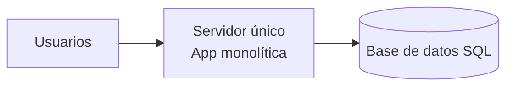

Problemas del monolito cuando crece:
- El **código** se vuelve cada vez más complejo (muchos componentes, muchos requerimientos).
- La **carga** crece y un solo servidor no alcanza → hay que **escalar**.

---

## 1. Escalar: vertical vs. horizontal

### Escala vertical (*scale up*)

**Hacer más grande la máquina**: más CPU, más RAM, más disco.

- ✅ No hay que cambiar nada del código.
- ❌ El sistema queda fuera de servicio mientras se hace el cambio.
- ❌ El costo crece de forma **exponencial**: cada mejora cuesta más y rinde menos.
- ❌ Hay un **límite físico** (no existe una CPU infinitamente rápida).

### Escala horizontal (*scale out*)

**Agregar más máquinas** iguales.

- ✅ Mucho más **barato**.
- ✅ El sistema **sigue disponible** mientras escalo.
- ✅ Más **tolerante a fallos**: si se cae una copia, quedan otras.
- ❌ La **arquitectura se complica**.
- ❌ Aumenta el **tráfico de red** entre componentes.

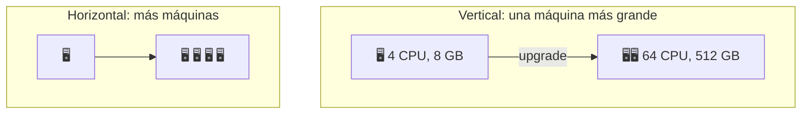

> **Analogía**: una pizzería que no da abasto. **Vertical** = contratar un pizzero más rápido y comprar un horno gigante (cada vez más caro, y hay un límite). **Horizontal** = abrir más hornos con más pizzeros (más barato, pero ahora hay que coordinar quién hace cada pedido).

### El load balancer

Si tengo varias copias de la aplicación, ¿cómo reparto los pedidos? Con un **load balancer** (balanceador de carga): recibe todos los pedidos y los reparte entre los servidores.

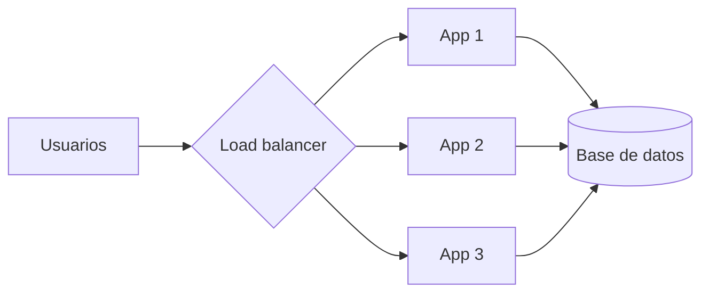

La estrategia puede ser simple (**round robin**: uno a cada uno, en ronda) o usar información de los nodos (cuál está menos cargado, cuál responde más rápido).

Hay dos variantes al clonar el monolito:
- **Clonar app + base, sin relación entre sí**: por ejemplo, un servidor completo por país. Cada uno tiene su propio estado.
- **Clonar solo la app** y que todas usen **una base de datos compartida** (el diagrama de arriba). Para el usuario sigue siendo un solo sistema.

---

## 2. El cubo de escalabilidad (*Scale Cube*)

¿Clonar es la única forma de escalar? **No.** El libro *The Art of Scalability* (Abbott y Fisher) propone un **cubo** con tres ejes. El origen del cubo es el monolito en un solo servidor, y la esquina opuesta es la escalabilidad máxima. Los ejes **se pueden combinar**.

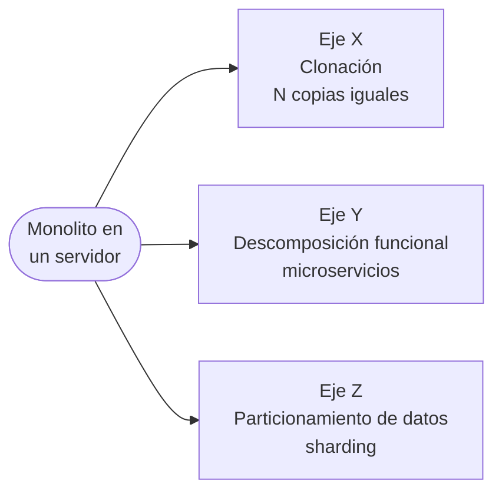

| Eje | Qué divide | Ejemplo | Resuelve | No resuelve |
|---|---|---|---|---|
| **X – Clonación** | Nada: copio todo | 3 copias de la app detrás de un load balancer | Carga de pedidos | Complejidad del código; la base sigue siendo una |
| **Y – Descomposición funcional** | Las **funciones** | Servicio de login, de usuarios, de productos | Complejidad; escalar cada parte por separado | Los datos de una función siguen en un lugar |
| **Z – Datos distribuidos** | Los **datos** | Clientes A–M en un servidor, N–Z en otro | Muchas escrituras; datos que no entran en una máquina | Agrega complejidad para ubicar cada dato |

### Eje X: clonación

Varias copias idénticas de la aplicación. Es lo que vimos con el load balancer.

Problema nuevo: **varias copias acceden a los mismos datos**, entonces hay que garantizar que los datos sigan siendo consistentes (con *locks*, o delegándolo en la base de datos). Y el código sigue siendo un monolito: si es enorme, sigue siendo difícil de mantener.

### Eje Y: descomposición funcional

Partir la aplicación **por responsabilidad**. Es lo que se conoce como **microservicios**. Dos formas de partir:
- **Por función o capacidad** (*capability services*): login, usuarios, productos...
- **Por dominio o entidad** (*entity services*): en una app de ventas → atención al cliente, ventas, catálogo.

Nuevos problemas: los servicios **tienen que coordinarse** entre sí (mensajes, requests) y aumenta el tráfico de red.

> Del apunte del compañero: la descomposición funcional **no implica necesariamente sharding**. Los microservicios pueden seguir compartiendo **una sola base de datos**.

### Eje Z: particionamiento de datos (sharding)

Hasta acá solo dividimos la **lógica**. Pero si hay **una sola base de datos que acepta escrituras**, esa base es un **cuello de botella**, aunque tenga réplicas (las réplicas son copias completas y por lo general solo una acepta escrituras).

El eje Z **divide el estado en subconjuntos**. Por ejemplo, productos por rango de letras:

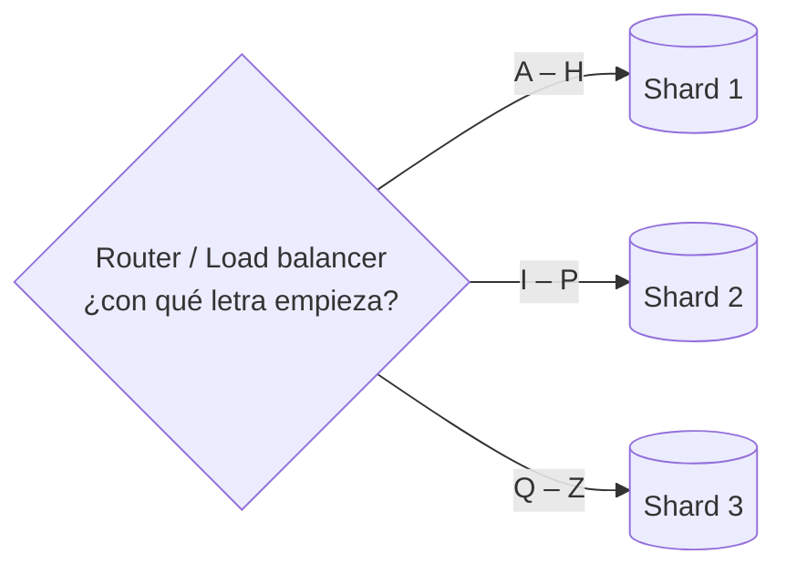

Ahora **cada shard acepta escrituras de su parte**: ya no hay una sola base recibiendo todas las escrituras. A cambio, necesito algo que sepa **a qué nodo mandar cada pedido** (un router, un load balancer, o que los nodos se pasen los pedidos entre ellos). Lo vemos en detalle en la sección 5.

### Combinar ejes

Un ejemplo combinando X e Y: separo en microservicios (Y), pero **todos los usuarios tienen que loguearse**. Si hay un solo servicio de login, es un **punto único de falla**. Entonces **clono el servicio de login** (X) detrás de un segundo load balancer.

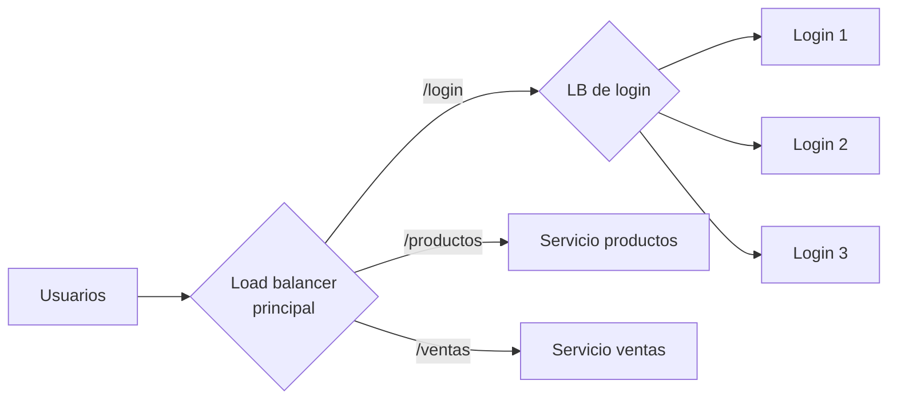

### Sesiones

Problema clásico al clonar: un usuario se loguea en el **servidor 1**, el siguiente pedido cae en el **servidor 2**, que **no sabe que está logueado**. Soluciones:

1. **Guardar las sesiones en un lugar compartido** (otra base de datos, un Redis, etc.): cualquier servidor puede verlas.
2. **Sticky sessions**: el load balancer, mediante una cookie, recuerda contra qué servidor se autenticó cada usuario y **siempre lo manda al mismo**.

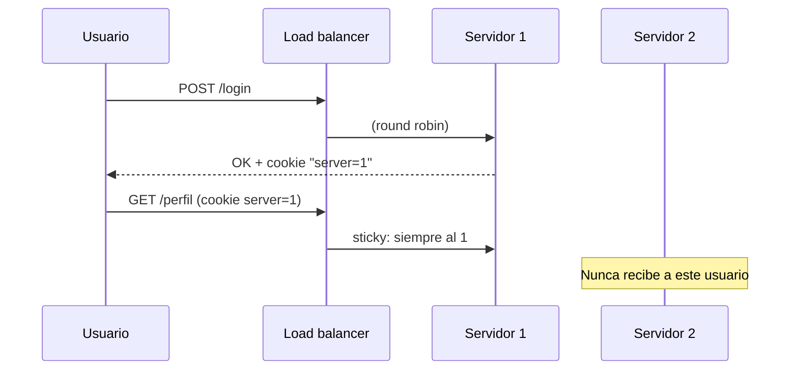

---

## 3. El estado distribuido: replicación vs. particionamiento

El eje Z nos llevó al tema más difícil: **los datos**. Correr código en muchas máquinas es "fácil" (no tiene estado). Lo difícil es **el estado**. Hay dos técnicas, y **no son una u otra: se combinan**.

| | **Replicación** | **Particionamiento (sharding)** |
|---|---|---|
| Qué hace | **Copia los mismos datos** en varios nodos | **Divide** los datos en pedazos (particiones), cada uno en un nodo |
| Para qué sirve | Redundancia (si se cae uno, hay otra copia), leer desde más lugares, menor latencia (copia cerca del usuario) | Datos que no entran en una máquina, repartir escrituras y carga |
| Analogía | Fotocopiar el mismo libro y repartir copias | Dividir una enciclopedia en tomos A–F, G–M... |

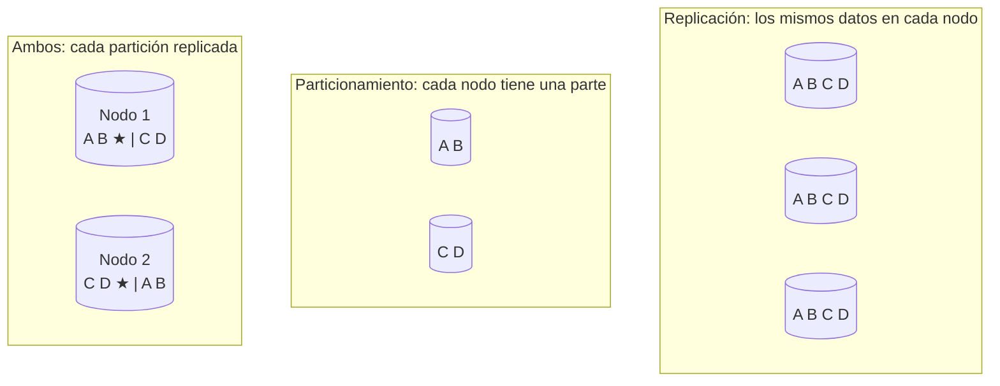

(★ = la copia "principal" de esa partición; la otra es una réplica.)

### ¿El sharding requiere replicación?

La idea es esta: si parto el estado en 3 bases y **se cae una**, **perdí un pedazo del estado** (un tercio de los clientes, por ejemplo). Con un monolito, al menos si se caía, se caía todo junto. Con sharding sin réplicas tengo **más puntos de falla**, y cada uno se lleva una parte de los datos.

Técnicamente se puede shardear sin replicar, pero en la práctica **cada shard se replica** para no perder datos ni disponibilidad. Por eso en sistemas reales siempre aparecen las dos cosas juntas.

---

## 4. Replicación

### 4.1 Los desafíos

Si los datos **nunca cambiaran**, replicar sería trivial: copiar una vez y listo. **Todo el problema es cómo manejar los cambios.** Las preguntas que se plantearon:

1. ¿Debería haber una **réplica principal** (líder)? ¿Cuántas?
2. ¿Las actualizaciones se propagan a las réplicas de forma **sincrónica** o **asincrónica**?
3. ¿Cómo manejo una **réplica que falla**? ¿Y si falla **el líder**?
4. ¿Cómo hace un nodo que **resucita** para ponerse al día?

### 4.2 Líder-seguidores (Master-Slave)

El esquema más común:

- **Escrituras**: **todas** las modificaciones (insert, update, delete) **pasan obligatoriamente por el líder** (*master*). El líder las aplica localmente y después las distribuye a los seguidores (*slaves*), de forma sincrónica o asincrónica.
- **Lecturas**: se pueden repartir entre el líder y los seguidores, o mandarlas **solo a los seguidores** para descargar al líder.

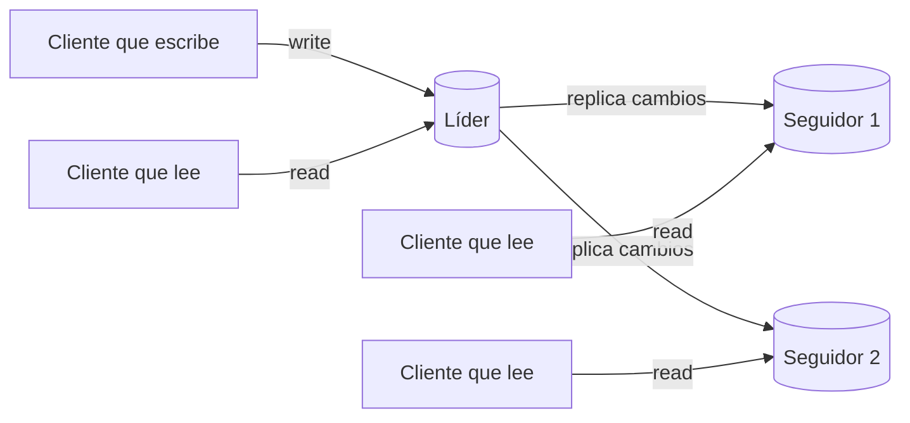

Funciona muy bien cuando hay **muchas más lecturas que escrituras** (lo típico en la web): agrego seguidores y escalo las lecturas.

### 4.3 Sincrónica vs. asincrónica

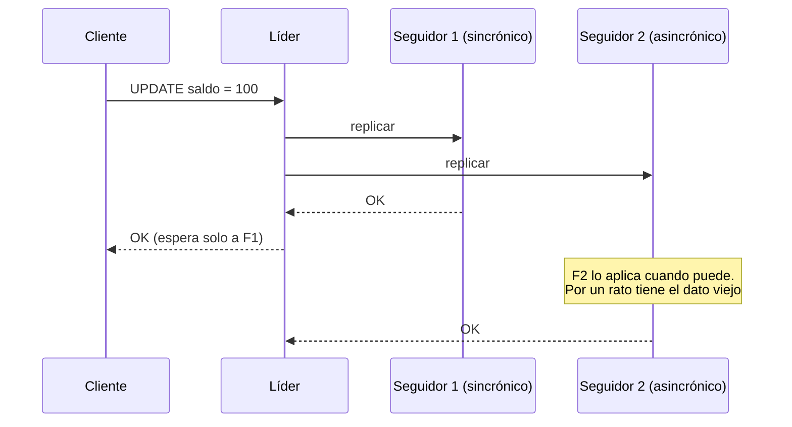

| | **Sincrónica** | **Asincrónica** |
|---|---|---|
| El líder responde OK... | cuando **los seguidores confirmaron** | **apenas lo guarda él** |
| Ventaja | El seguidor tiene seguro el dato | Rápido; si un seguidor está lento o caído, el líder sigue |
| Desventaja | Si un seguidor no responde, **las escrituras se traban** | Si el líder muere antes de replicar, **se pierde la escritura** |

En la práctica se suele usar un esquema **semi-sincrónico**: **un** seguidor sincrónico (para tener siempre al menos 2 copias actualizadas) y el resto asincrónicos.

### 4.4 Log replication 📘

Es la base de los **algoritmos de consenso** como **Raft**. Acá va la idea intuitiva.

**Idea**: en vez de copiar "la base de datos", el líder lleva un **log**: una lista ordenada de todas las operaciones que hizo. Los seguidores tienen **una copia del mismo log**. Si todos aplican **las mismas operaciones en el mismo orden**, llegan **al mismo estado**.

```
Log del líder:     [1: x=5] [2: y=3] [3: x=x+1] [4: borrar y]
Log de seguidor A: [1: x=5] [2: y=3] [3: x=x+1] [4: borrar y]   ← al día
Log de seguidor B: [1: x=5] [2: y=3]                            ← atrasado: le faltan 3 y 4
```

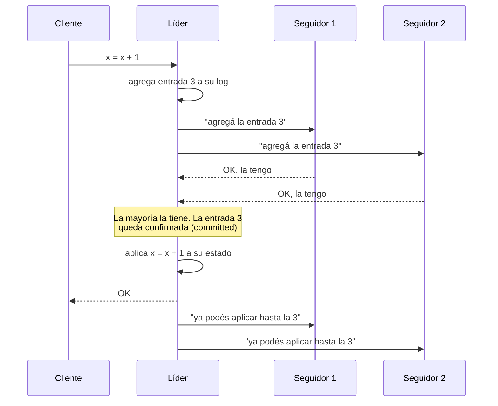

> **Analogía**: el líder es el profesor que dicta y los seguidores son alumnos copiando en su cuaderno. Mientras todos copien lo mismo y en el mismo orden, todos los cuadernos quedan iguales. Si un alumno se distrae, después le pide al profesor "¿qué dijiste desde la oración 2?" y se pone al día.

### 4.5 Agregar un nuevo seguidor 📘

No se puede simplemente copiar los archivos, porque mientras copio **siguen llegando escrituras**. Los pasos son:

1. Tomar un **snapshot consistente** (una "foto") de la base del líder en un momento dado, **sin frenar** las escrituras.
2. **Copiar el snapshot** al nuevo seguidor.
3. El seguidor le pide al líder **todos los cambios posteriores a esa foto**. El snapshot sabe en qué posición exacta del log se tomó.
4. Cuando el seguidor procesó todo ese atraso (*catch-up*), ya está **al día** y sigue recibiendo cambios como cualquier otro.

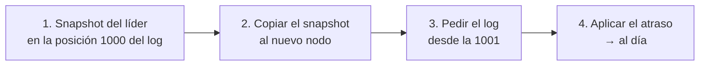

### 4.6 Manejo de fallas 📘

**Cualquier nodo puede caerse.** El objetivo es mantener la **alta disponibilidad** gracias a la replicación.

**Si se cae un seguidor** → *catch-up recovery*: el seguidor sabe cuál fue la última entrada del log que procesó. Al volver, le pide al líder todo lo posterior y se pone al día. Fácil.

**Si se cae el líder** → **failover**, mucho más delicado:

1. **Detectar** que el líder murió. Casi siempre con un **timeout**: si no responde durante X segundos, se lo da por muerto. (No hay forma de saber con certeza si murió o si la red está lenta. Lo vemos en la sección 7.)
2. **Elegir un nuevo líder**. El mejor candidato es el seguidor más actualizado. Que todos se pongan de acuerdo en quién es el nuevo líder es un problema de **consenso** (próxima clase).
3. **Reconfigurar** el sistema: los clientes tienen que mandar las escrituras al nuevo líder, y si el viejo vuelve, tiene que aceptar que **ya no es líder**.

Lo que puede salir mal:
- Con replicación asincrónica, el nuevo líder puede **no tener las últimas escrituras** del viejo. ¿Qué se hace con ellas? Por lo general **se descartan** (se pierden).
- **Split brain** (cerebro dividido): el viejo líder no se murió, solo quedó aislado. Ahora hay **dos nodos que creen ser líderes** y aceptan escrituras distintas. 💥
- **Timeout mal elegido**: si es muy corto, hay failovers innecesarios cuando la red está solo lenta. Si es muy largo, tarda mucho en recuperarse.

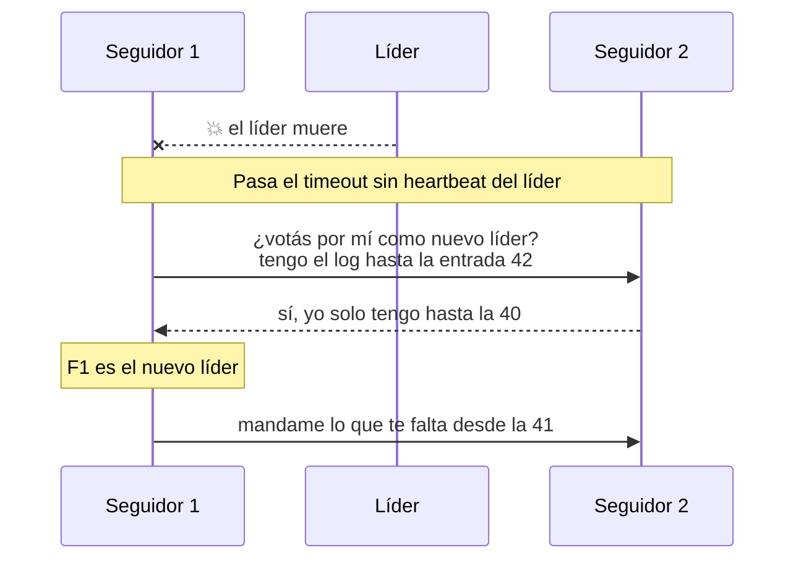

> **Conexión con Elixir**: es lo mismo que vimos con Horde. Cuando un nodo deja de mandar heartbeats, los demás lo dan por caído y reparten sus procesos. Y por eso el ejemplo usaba `Horde.UniformQuorumDistribution`: **solo el lado con mayoría** levanta procesos, para evitar un "split brain" de procesos duplicados.

### 4.7 Problemas de la consistencia eventual 📘

Con replicación **asincrónica**, si leo de un seguidor puedo ver **datos viejos**. Si dejan de llegar escrituras, todos los seguidores **eventualmente** se ponen al día: eso es la **consistencia eventual**. El problema es el "mientras tanto", que puede ser desde milisegundos hasta minutos. Tres anomalías clásicas:

**1. Leer lo que yo mismo escribí (*read-your-writes*)**

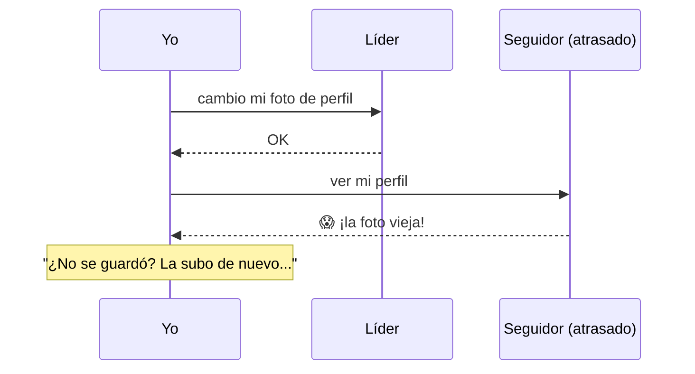

Solución típica: lo que el usuario **pudo haber modificado** (su propio perfil) se lee **del líder**.

**2. Lecturas monótonas (*monotonic reads*)**: veo un comentario nuevo, recargo la página, caigo en una réplica más atrasada y **el comentario desaparece**. Es como ir para atrás en el tiempo. Solución: que cada usuario lea siempre de **la misma réplica**.

**3. Prefijo consistente (*consistent prefix*)**: veo **la respuesta antes que la pregunta**.

```
Ana:   "¿Cuánto falta para el parcial?"   (llega a mi réplica TARDE)
Bruno: "Dos semanas."                     (llega a mi réplica ANTES)

Lo que yo veo:
  Bruno: Dos semanas.
  Ana:   ¿Cuánto falta para el parcial?   ← sin sentido
```

Solución: que las escrituras **relacionadas causalmente** se apliquen en orden.

### 4.8 Múltiples datacenters y multi-líder 📘

Si tengo datacenters en Buenos Aires, Madrid y Tokio con **un solo líder** en Buenos Aires, **toda escritura** de Tokio cruza el mundo. Lento. Y si se corta el enlace, Tokio no puede escribir.

Solución: **un líder por datacenter**. Pero, como dice el apunte, **el problema principal es que n datacenters son n líderes**: dos líderes pueden aceptar **escrituras en conflicto** sobre el mismo dato al mismo tiempo.

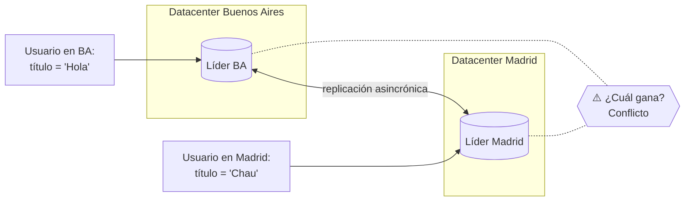

Hay que **resolver conflictos**: la última escritura gana, fusionar valores, preguntarle al usuario (como un conflicto de git)... Lo vemos en CAP (sección 8) y la próxima clase con los **CRDTs**, que justamente son estructuras pensadas para que estos conflictos **no puedan pasar**.

> Google Docs es un ejemplo de edición colaborativa: cada usuario es como un "líder" que escribe localmente y después se sincronizan los cambios.

### 4.9 Sin líderes (*leaderless*) 📘

Otra opción: **no hay líder**. El cliente escribe **en varias réplicas a la vez** y lee **de varias réplicas a la vez**. Es el estilo de **Amazon Dynamo**, **Cassandra** y **Riak**.

¿Cómo sé que leo un dato actualizado? Con **quórums**. Si hay **n** réplicas, cada escritura tiene que confirmarse en **w** réplicas y cada lectura tiene que consultar **r** réplicas:

> Si **w + r > n**, al menos una de las réplicas que leo **tiene seguro** la última escritura.

```
n = 3 réplicas, w = 2, r = 2   →  2 + 2 = 4 > 3 ✅

Escritura x=7:  [R1: x=7] [R2: x=7] [R3: x=5 (no llegó)]
Lectura (r=2):  consulto R2 y R3 → R2 dice 7, R3 dice 5
                → me quedo con la versión más nueva: 7
```

Como los conjuntos de escritura y de lectura **se superponen** en al menos un nodo, alguno tiene el dato nuevo.

### 4.10 Resumen de los modelos de replicación

| Modelo | Quién acepta escrituras | Ventaja | Problema principal |
|---|---|---|---|
| **Líder único** | Solo el líder | Simple, sin conflictos de escritura | El líder es el cuello de botella; failover delicado |
| **Multi-líder** | Un líder por datacenter | Escrituras locales y rápidas; tolera cortes entre datacenters | **Conflictos** de escritura |
| **Sin líder** | Cualquier réplica (con quórum) | Muy disponible; no hay failover | Conflictos; consistencia más débil |

---

## 5. Particionamiento (sharding) 📘

### 5.1 ¿Cómo decido qué dato va a qué partición?

El objetivo es **repartir parejo**. Si una partición recibe mucha más carga que las demás, se vuelve un **hot spot** (punto caliente) y perdemos el beneficio.

**Por rango de clave**: como los tomos de una enciclopedia (A–F, G–M...).
- ✅ Consultar rangos es fácil ("todos los clientes entre A y C").
- ❌ Riesgo de **hot spots**. Ejemplo: si la clave es la fecha, **todas** las escrituras de hoy van a la misma partición.

**Por hash de la clave**: aplico una función de hash a la clave y uso el resultado para elegir partición.
- ✅ Reparte **muy parejo**, aunque las claves sean parecidas.
- ❌ Se pierde el orden: consultar un rango implica preguntarle a **todas** las particiones.

```elixir
# Partición por hash, en Elixir: muy parecido a lo que hace Horde.UniformDistribution
nodos = [:node1, :node2, :node3]
particion = fn clave -> Enum.at(nodos, :erlang.phash2(clave, length(nodos))) end

particion.("cliente-ana")    # => :node2
particion.("cliente-bruno")  # => :node1
```

### 5.2 El problema de `hash mod N` y el hashing consistente

Con `hash(clave) mod N`, **si cambia N** (agrego o saco un nodo), **casi todas las claves cambian de nodo**. Hay que mover casi todos los datos. ❌

```
Con 3 nodos: hash = 10 → 10 mod 3 = 1 → nodo 1
Con 4 nodos: hash = 10 → 10 mod 4 = 2 → nodo 2   ← se tuvo que mudar
```

**Hashing consistente**: ubico nodos y claves en un **anillo**. Cada clave va al **primer nodo que encuentra avanzando en sentido horario**. Si agrego un nodo, **solo se mudan las claves del tramo que le toca a él**. El resto queda igual.

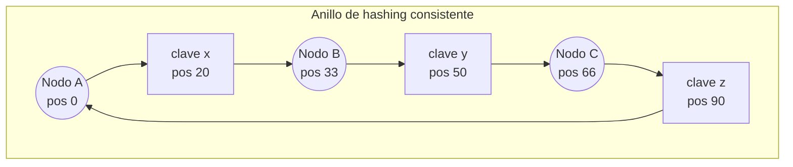

(x va a B, y va a C, z va a A. Si agrego un nodo D en la posición 55, **solo** `y` se muda de C a D.)

### 5.3 Rebalanceo y ruteo

- **Rebalanceo**: cuando agrego o saco nodos, hay que mover particiones. Hay que hacerlo **sin dejar de atender** y moviendo **la menor cantidad de datos posible**.
- **Ruteo de pedidos**: ¿cómo sabe el cliente a qué nodo ir? Tres opciones:
  1. Le pregunta a **cualquier nodo** y ese lo reenvía al correcto.
  2. Pasa por un **router / load balancer** que conoce el mapa de particiones.
  3. **El cliente** conoce el mapa y va directo.

> **Conexión con Elixir**: Horde hace exactamente esto con procesos. `distribution_strategy` es la regla de particionamiento ("¿en qué nodo vive `relaxed-4`?"), `process_redistribution: :active` es el rebalanceo al entrar un nodo, y `Horde.Registry` es el ruteo ("¿dónde está `relaxed-4`?" → su PID).

---

## 6. ¿Está vivo? Healthcheck, heartbeat y gossip

Para todo lo anterior (failover, rebalanceo, load balancer) necesitamos saber **qué nodos están vivos**.

### Healthcheck

Un **endpoint** del servicio (por ejemplo, `GET /health`) que responde si está en condiciones de atender pedidos. El load balancer o el orquestador (por ejemplo, Kubernetes) lo consulta cada tanto, y si falla, **deja de mandarle tráfico** a ese nodo o lo reinicia.

```elixir
# Ejemplo con Plug/Phoenix (ilustrativo)
get "/health" do
  db_ok? = match?({:ok, _}, Repo.query("SELECT 1"))
  if db_ok?, do: send_resp(conn, 200, "ok"), else: send_resp(conn, 503, "db caída")
end
```

Un buen healthcheck no solo dice "el proceso está corriendo": también chequea **sus dependencias** (¿llego a la base? ¿llego al servicio X?).

- ✅ Simple y estándar (HTTP).
- ❌ Es **a nivel aplicación**. Si el nodo entero se cuelga, no responde, pero tampoco te dice **por qué**.

Más detalle: [Health Check API (microservices.io)](https://microservices.io/patterns/observability/health-check-api.html).

### Heartbeat

Cada nodo **le manda periódicamente** a los otros un mensajito ("sigo vivo") por una conexión TCP. Si pasa un tiempo **bastante mayor** al intervalo normal sin recibirlo, se lo da por **caído**.

- Detecta caídas del **nodo**, no solo de la aplicación.
- Se recomienda que el heartbeat vaya **por un canal distinto** al de los datos, para que un mensaje gigante no lo demore (ver la falacia del ancho de banda en la sección 9).

> **Conexión con Elixir**: es exactamente el *tick* entre nodos de la BEAM que vimos la clase pasada, la "alarma de Homero" (`net_ticktime`, por defecto 60 segundos). Cuando falla, llega el `{:nodedown, nodo}` que escuchaba nuestro `NodeObserver`.

### Gossip

Con N nodos y heartbeats de todos contra todos, hay **N × (N−1) conexiones**: no escala. El protocolo de **gossip** (chisme) funciona como un rumor: cada nodo, cada tanto, le cuenta **lo que sabe** a **algunos** nodos al azar, y esos se lo cuentan a otros. En pocas rondas **todos se enteran**.

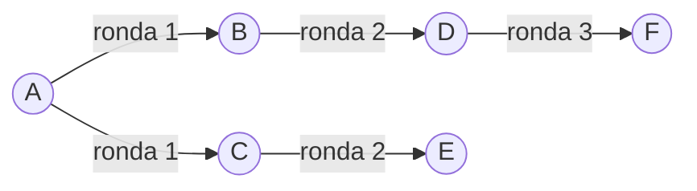

Además, el mensaje puede llevar **más información** que un bit: "se cayó el nodo de login X", "volvió el nodo de la base de datos". (Es lo que usa `Cluster.Strategy.Gossip` de libcluster.)

| | Healthcheck | Heartbeat | Gossip |
|---|---|---|---|
| Quién pregunta | Un tercero (LB, orquestador) | Los nodos entre sí | Los nodos entre sí, al azar |
| Nivel | Aplicación (HTTP) | Red / nodo (TCP) | Red / nodo |
| Información | "¿Podés atender?" | "Sigo vivo" | Estado del cluster |
| Escala | Bien | Mal con muchos nodos | Muy bien |

---

## 7. Interleaving y netsplits

Un **netsplit** (partición de red) es cuando la red se corta y el cluster queda **dividido en grupos que no se pueden comunicar**. Durante ese rato, cada grupo sigue funcionando por su cuenta: sus operaciones se **intercalan** (*interleaving*) sin que el otro grupo se entere.

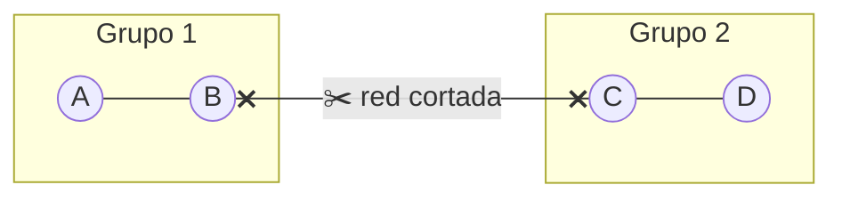

**El problema de fondo**: si un nodo no responde, **no hay forma de saber** si:
- 💀 **se murió** (falla de hardware o software), o
- 🌐 **está vivo** pero **la red** se cortó o hay demasiada latencia.

Desde afuera, las dos cosas se ven igual. Hay dos posturas:

| Postura | Supone que... | Ejemplo |
|---|---|---|
| **Pesimista** | Si no lo veo, **está muerto**. Las fallas de hardware o software son más comunes que las de red. | **Erlang/Elixir** asume esto (el `nodedown`) |
| **Optimista** | **Está vivo**; es la red que falló por un rato. Las fallas de red son más comunes. | |

**El ejemplo de MercadoLibre** (de la cátedra): un sitio de compra y venta con **dos nodos**. Cada transacción en un nodo se tiene que sincronizar con el otro (comprador y vendedor pueden estar en nodos distintos). Si un nodo deja de responder y en realidad **era la red**:

- Si somos **pesimistas** y **bloqueamos** las transacciones → no se vende → **perdemos plata** (no cobramos comisión).
- Si somos **optimistas** y **seguimos vendiendo en los dos lados** → puede pasar que **dos personas compren el mismo producto** (el último en stock), una en cada nodo. Cuando vuelve la red... ¿quién se lo lleva? 😬

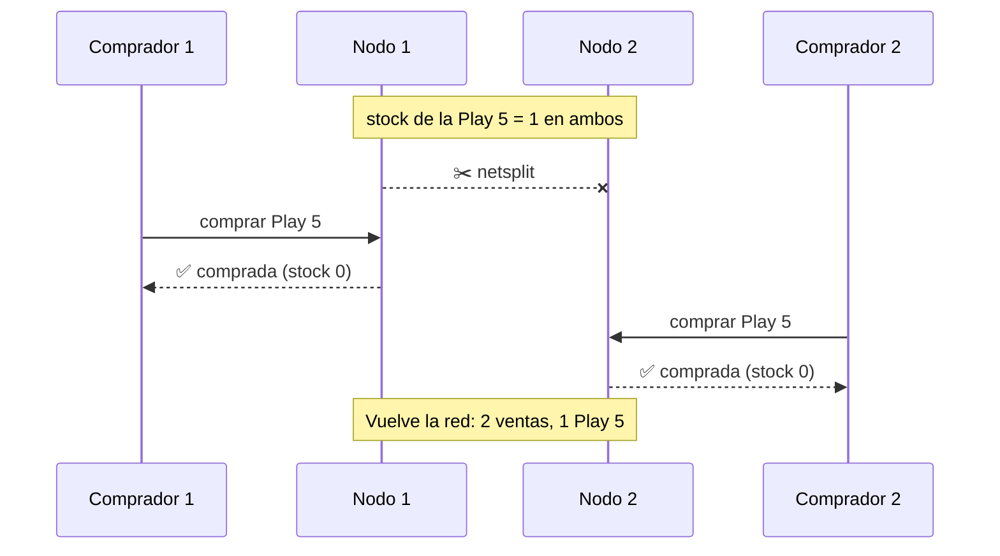

Las dos opciones tienen costo. Elegir entre ellas es **exactamente** lo que plantea el teorema CAP.

---

## 8. El teorema CAP

> ¿Hay alguna forma de mantener la aplicación **disponible** durante una partición **sin perder consistencia**? **No.** Esa es la idea del teorema CAP (Brewer, demostrado por Gilbert y Lynch en 2002).

### 8.1 Las tres letras

| Letra | Nombre | Significa |
|---|---|---|
| **C** | Consistencia (*Consistency*) | **Todos los nodos devuelven el mismo dato** en un momento dado. Si escribo en un nodo, **cualquier lectura posterior** desde **cualquier** nodo ve ese cambio. El sistema se ve como un bloque indivisible. |
| **A** | Disponibilidad (*Availability*) | **Todo pedido** a un nodo que no está caído **recibe una respuesta que no es un error**, aunque el dato no esté del todo actualizado. |
| **P** | Tolerancia a particiones (*Partition tolerance*) | El sistema **sigue funcionando** aunque se pierdan, demoren o corrompan mensajes entre nodos (es decir, aunque la red se parta en grupos). |

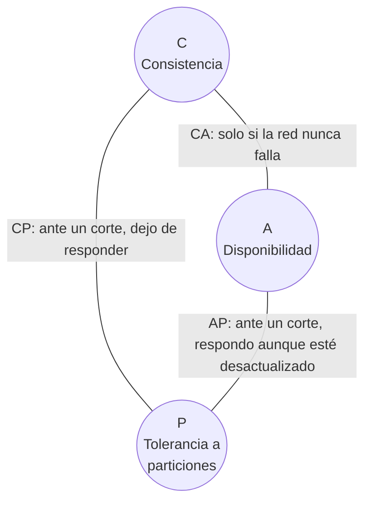

### 8.2 CAP clásico: elegí 2 de 3

La interpretación clásica: se pueden tener **CA, CP o AP**, nunca las tres.

Pero ojo: **P no es negociable** (como dice el apunte en mayúsculas). En un sistema distribuido real, **la red se va a cortar en algún momento** (sección 9: "la red es confiable" es una falacia). No podés elegir "no tener particiones". Entonces **la elección real es: cuando hay una partición, ¿C o A?**

- **CA** solo existe si **la red nunca falla**: un solo nodo, o un solo datacenter donde asumimos que no hay particiones (las bases relacionales tradicionales en un solo servidor).
- **CP**: ante una partición, **prefiero no responder antes que responder algo incorrecto**. El lado que no puede garantizar consistencia **se vuelve no disponible**. "El estado no cambió, no hay nada que hacer."
- **AP**: ante una partición, **sigo respondiendo** en ambos lados, aunque eso genere inconsistencias que **después hay que resolver**.

En el ejemplo de MercadoLibre: **pesimista ≈ CP**, **optimista ≈ AP**.

### 8.3 Si elijo AP: ¿cómo resuelvo los conflictos?

Cuando vuelve la red, los dos lados tienen versiones distintas. Estrategias:

| Estrategia | Cómo funciona | Problema |
|---|---|---|
| **La última escritura gana** (*Last Write Wins*) | Me quedo con el valor con el timestamp más reciente | Los relojes de distintas máquinas **no están sincronizados**: "la última" puede no ser la última de verdad. Y **se pierde** la otra escritura. |
| **Ganador al azar** | Elijo uno | Simple, pero arbitrario |
| **Relojes lógicos** (**relojes de Lamport**) | En vez de la hora real, un contador que se incrementa con cada operación y viaja con los mensajes | Ordena eventos de forma consistente sin depender de la hora de cada máquina |
| **Fusionar / que decida alguien** | Un nodo central o el usuario elige, o se fusionan los cambios. **Como un conflicto de git.** | Requiere lógica de negocio |

> La próxima clase se ven los **CRDTs**: estructuras que se pueden **fusionar siempre sin conflictos**, por diseño. Es lo que usa Horde por dentro.

### 8.4 Bases de datos y CAP (orientativo)

| Tipo | Ejemplos | Comentario |
|---|---|---|
| **CA** (un solo nodo) | PostgreSQL, MySQL en un servidor | Sin distribución no hay particiones |
| **CP** | HBase, MongoDB (configuración por defecto), ZooKeeper, etcd | Ante un corte, el lado sin mayoría o sin líder deja de aceptar escrituras |
| **AP** | Cassandra, DynamoDB, Riak, CouchDB | Siempre aceptan escrituras; consistencia eventual |

Muchas bases **se pueden configurar** para inclinarse hacia un lado o el otro (por ejemplo, Cassandra con niveles de consistencia por consulta). Ver también la [guía visual de NoSQL y CAP](http://blog.nahurst.com/visual-guide-to-nosql-systems) que se mostró en clase.

### 8.5 CAP gradual: no es blanco o negro

Brewer mismo, 12 años después ([CAP twelve years later](http://www.infoq.com/articles/cap-twelve-years-later-how-the-rules-have-changed)), aclaró que **no es "elegí 2 de 3" de forma absoluta**:

- Las particiones son **raras**. Cuando **no** hay partición, se puede tener C **y** A.
- La elección entre C y A se puede hacer **muchas veces**, con **granularidad fina**: por operación, por tipo de dato, por momento. Por ejemplo, el carrito de compras puede ser AP y el pago CP, **en el mismo sistema**.
- La disponibilidad **no es sí o no**: va de 0 a 100%. Y la consistencia también tiene **niveles**.
- **CAP en la práctica ocurre en un timeout**: el sistema manda un mensaje, no recibe respuesta, y tiene que decidir:
  - **cancelar** la operación → pierde **A**,
  - **seguir** igual → arriesga **C**.

  Reintentar solo **posterga** la decisión.

Ejemplos reales:
- **Yahoo PNUTS**: copias remotas **asincrónicas** (sacrifica C), pero con una **copia maestra local** a cada usuario (baja latencia). Funciona porque los datos de un usuario se particionan naturalmente según dónde vive.
- **Facebook**: una **copia maestra** en un lugar. Los usuarios remotos leen una copia cercana posiblemente vieja, pero **las escrituras van a la maestra**. A los 20–30 segundos todos ven lo actualizado.

### 8.6 Manejar una partición: tres momentos

```mermaid
flowchart LR
    N1["Operación normal<br/>(C y A)"] --> D["1. Se detecta<br/>la partición"]
    D --> M["2. Modo partición<br/>limitar operaciones<br/>o registrar todo"]
    M --> R["3. Recuperación<br/>reunificar estado<br/>y compensar errores"]
    R --> N2["Operación normal"]
```

1. **Detectar** que empezó una partición (casi siempre, por timeout).
2. **Entrar explícitamente en "modo partición"**. Dos estrategias:
   - **Limitar operaciones** (reduce A). Por ejemplo, "no se puede comprar el último producto en stock".
   - **Guardar información extra** de cada operación (su historia) para facilitar la recuperación.
3. **Recuperación**: cuando vuelve la comunicación, hay que:
   - dejar **ambos lados consistentes** (algo parecido a un *merge* de git; **la historia** de operaciones sirve más que el estado final),
   - **compensar los errores** cometidos durante la partición. Por ejemplo, a uno de los dos compradores de la Play 5 se le devuelve la plata y se le pide disculpas.

Hay sistemas donde **no se puede fusionar**: en esos casos se **restringen las operaciones** durante la partición. Otra opción es usar algún algoritmo para quedarse con el dato más nuevo.

### 8.7 PACELC: CAP + latencia

CAP solo habla de **qué pasa durante una partición**. Pero la mayor parte del tiempo **no hay partición**, y aun así hay que elegir algo. **PACELC** (Daniel Abadi, 2010) lo completa:

> **Si hay Partición (P)** → elegís entre **A**vailability y **C**onsistency (igual que CAP).
> **Si no (Else, E)** → elegís entre **L**atency y **C**onsistency.

¿Por qué latencia vs. consistencia? Porque para que **todas** las réplicas estén consistentes, cada escritura tiene que **esperar** que se repliquen (sincrónico = más lento). Si no espero (asincrónico = rápido), puedo leer datos viejos.

```mermaid
flowchart TD
    Q{"¿Hay una partición<br/>de red?"}
    Q -- "Sí (P)" --> PAC{"¿Disponibilidad o<br/>Consistencia?"}
    Q -- "No (Else)" --> ELC{"¿Latencia o<br/>Consistencia?"}
    PAC --> PA["PA: respondo igual"]
    PAC --> PC["PC: dejo de responder"]
    ELC --> EL["EL: respondo rápido,<br/>quizás desactualizado"]
    ELC --> EC["EC: espero a que<br/>todos tengan el dato"]
```

| Clasificación | Ejemplos | Qué significa |
|---|---|---|
| **PA/EL** | Cassandra, DynamoDB, Riak | Priorizan siempre la velocidad y la disponibilidad |
| **PC/EC** | HBase, BigTable, bases con consenso (etcd, ZooKeeper) | Priorizan siempre la consistencia |

### 8.8 Críticas a CAP

Hay críticas al teorema (por ejemplo, [*A Critique of the CAP Theorem*](https://doi.org/10.17863/CAM.13083), de Kleppmann): sus términos son ambiguos ("consistencia" en CAP no es lo mismo que la "C" de ACID) y es difícil aplicarlo tal cual a sistemas reales. Sirve como **modelo mental**, no como receta.

---

## 9. Las 8 falacias de la computación distribuida

Ocho cosas que **creemos** al diseñar un sistema distribuido y que **son falsas**. Erlang fue diseñado teniéndolas en cuenta.

| # | Falacia | Por qué es falsa | Qué hace Erlang/Elixir |
|---|---|---|---|
| 1 | **La red es confiable** | Cortes de luz, cables rotos, hardware que falla... pasa más de lo que uno cree | Mensajes **asincrónicos** + **timeouts**. Si un nodo se cae, se trata como una falla local (monitores, links, `nodedown`) |
| 2 | **La latencia es cero** | Siempre hay latencia de red, incluso en la misma máquina | Procesos aislados, mensajes asincrónicos, timeouts, monitores: te obliga a pensar que la respuesta puede tardar |
| 3 | **El ancho de banda es infinito** | Entre dos nodos hay **una sola conexión TCP**. Un mensaje enorme **bloquea** a los que vienen atrás... ¡incluido el **heartbeat**! Si se demora mucho, **se corta el vínculo** entre nodos | No hay magia: **no mandes mensajes gigantes** entre nodos |
| 4 | **La red es segura** | No lo es | Nada por defecto (la **cookie no es seguridad**, clase 6). Hay que usar TLS/SSL o asegurar la red alrededor |
| 5 | **La topología no cambia** | Cambia el hardware, se migran redes, cambian las IPs | Los nodos se identifican **por nombre** (`a@host`), no por IP fija |
| 6 | **Hay un solo administrador** | Con muchos servidores hay muchos equipos y muchas manos | Levantar procesos es fácil (supervisores), pero si un nodo muere para siempre, alguien tiene que intervenir |
| 7 | **El costo de transporte es cero** | **Serializar** datos lleva tiempo. Y la red cuesta plata: ISP, hardware, personal | — |
| 8 | **La red es homogénea** | Distintos lenguajes, formatos (JSON, XML...), protocolos | Erlang asume que todos los nodos hablan su protocolo. Pero si otro lenguaje lo implementa, puede unirse (**C node**, **BERT-RPC**). Es como *duck typing* |

---

## 10. Cómo se conecta con lo que ya vimos en Elixir

| Concepto de esta clase | Dónde lo vimos en Elixir |
|---|---|
| Escala horizontal, clonación (eje X) | Levantar el mismo proyecto en `node1`, `node2`, `node3` |
| Heartbeat | El *tick* entre nodos de la BEAM → `{:nodedown, nodo}` |
| Gossip | `Cluster.Strategy.Gossip` de libcluster |
| Postura pesimista ante netsplits | La BEAM da el nodo por muerto si no responde |
| Particionamiento / estrategia de distribución | `distribution_strategy` de Horde (`UniformDistribution` usa un hash) |
| Rebalanceo | `process_redistribution: :active` de Horde |
| Ruteo de pedidos | `Horde.Registry` + `via_tuple` |
| CP ante netsplits (quórum) | `Horde.UniformQuorumDistribution`: solo el lado con mayoría levanta procesos |
| Consistencia eventual / CRDTs | El estado de Horde se sincroniza con delta-CRDTs |
| "El supervisor no salva el estado" | Replicar el estado es nuestro problema → **replicación** (sección 4) |

---

## 11. Lo que se viene: próxima clase

La próxima clase profundiza justamente en lo que acá quedó abierto:

- **Comunicación en sistemas distribuidos**: sincrónica vs. asincrónica, mensajes, RPC, colas.
- **Coordinación**: cómo se ponen de acuerdo los nodos en el orden de los eventos (relojes lógicos de Lamport, relojes vectoriales) y quién hace qué (**elección de líder**).
- **Algoritmos de consenso**: cómo varios nodos acuerdan un valor aunque algunos fallen. Ahí aparece de verdad el **log replication** (sección 4.4) con **Raft** (y su antecesor, Paxos). Es lo que resuelve "¿quién es el nuevo líder?" sin split brain.
- **Consistencia eventual y CRDTs**: estructuras de datos que se pueden modificar en cualquier réplica, **sin coordinarse**, y que al juntarse **siempre convergen** al mismo valor. Son la respuesta elegante a "¿cómo resuelvo conflictos en un sistema AP?".

Un adelanto para entender la idea de un CRDT: el **contador que solo crece** (*G-Counter*):

```
Cada nodo cuenta SUS PROPIOS incrementos:
  Nodo A: %{a: 3, b: 0}     Nodo B: %{a: 0, b: 5}

Para fusionar: me quedo con el MÁXIMO de cada posición
  merge = %{a: max(3,0), b: max(0,5)} = %{a: 3, b: 5}   → valor total = 8

No importa el orden ni cuántas veces fusione: siempre da lo mismo. ✅ Sin conflictos.
```

---

## Resumen

| Concepto | En una línea |
|---|---|
| **Monolith first** | Empezar simple y distribuir cuando haga falta (salvo que ya sepas que vas a necesitar escala) |
| **Escala vertical** | Máquina más grande: fácil pero cara y con límite |
| **Escala horizontal** | Más máquinas: barata y tolerante a fallos, pero más compleja |
| **Load balancer** | Reparte pedidos entre copias (round robin, por carga...) |
| **Eje X / Y / Z** | Clonar / partir por función (microservicios) / partir los datos (sharding) |
| **Sticky sessions** | El LB manda a cada usuario siempre al mismo servidor |
| **Replicación** | Mismos datos en varios nodos → redundancia y lecturas |
| **Particionamiento (sharding)** | Datos divididos entre nodos → escala de escrituras y volumen. En la práctica, junto con replicación |
| **Líder-seguidores** | Escrituras solo al líder; lecturas en cualquiera |
| **Sincrónica / asincrónica** | Esperar a las réplicas (seguro, lento) vs. no esperar (rápido, puede perder datos) |
| **Log replication** | Todos aplican las mismas operaciones en el mismo orden → mismo estado |
| **Failover** | Reemplazar al líder caído; riesgo de split brain y escrituras perdidas |
| **Consistencia eventual** | Las réplicas convergen... eventualmente. Anomalías: read-your-writes, lecturas monótonas, prefijo consistente |
| **Multi-líder / sin líder** | Más disponibilidad a cambio de **conflictos**. Quórum: w + r > n |
| **Hash / rango / hashing consistente** | Formas de decidir en qué partición va cada dato |
| **Healthcheck / heartbeat / gossip** | Saber quién está vivo: a nivel app / nodo / rumor |
| **Netsplit** | La red se parte; no se distingue "muerto" de "incomunicado" |
| **CAP** | Ante una partición, elegís **C** o **A** (P no es negociable) |
| **PACELC** | Y sin partición, elegís **L**atencia o **C**onsistencia |
| **Falacias** | La red no es confiable, ni rápida, ni infinita, ni segura, ni fija, ni gratis, ni homogénea, ni tiene un solo admin |

**Ideas para llevarse:**
1. Distribuir resuelve problemas de **escala y tolerancia a fallos**, pero **agrega** problemas nuevos: red, latencia, fallos parciales, consistencia.
2. El código sin estado es fácil de escalar. **El estado es lo difícil**: replicarlo, partirlo y mantenerlo consistente.
3. **No se puede distinguir** un nodo muerto de uno incomunicado. Toda decisión ante una falla es una apuesta (pesimista u optimista).
4. **CAP**: cuando la red se parte, hay que elegir entre **responder** o **responder bien**. Y esa elección se puede hacer distinta para cada parte del sistema.

## Preguntas para repasar

1. ¿Por qué escalar verticalmente tiene un límite y uno horizontalmente "no"?
2. Tenés una app clonada en 3 servidores detrás de un load balancer y los usuarios se quejan de que "se les cierra la sesión". ¿Qué pasa y cómo lo resolvés?
3. ¿Por qué decimos que el sharding, en la práctica, necesita replicación?
4. Con replicación asincrónica, ¿qué puede pasar si el líder muere justo después de responder OK a una escritura?
5. Tenés `n = 5` réplicas sin líder. ¿Qué valores de `w` y `r` garantizan leer el último valor?
6. ¿Por qué `hash(clave) mod N` es mala idea si agregás nodos seguido? ¿Qué lo soluciona?
7. En el ejemplo de MercadoLibre, ¿qué haría un sistema CP y qué haría uno AP?
8. ¿Por qué "P" en CAP no se puede elegir dejar afuera?
9. ¿Qué agrega PACELC a CAP?
10. ¿Por qué mandar un mensaje de 500 MB entre dos nodos de Elixir puede hacer que el cluster crea que un nodo se cayó?

<details>
<summary>Respuestas</summary>

1. Una máquina tiene un límite físico (no hay CPUs infinitas) y el costo crece de forma exponencial. Con escala horizontal agregás máquinas comunes, aunque eso tiene su propio límite por la complejidad y el tráfico de red.
2. Las sesiones se guardan en memoria de cada servidor, y el siguiente pedido cae en otro servidor que no la tiene. Solución: un almacenamiento de sesiones compartido o sticky sessions.
3. Porque si se cae un shard, perdés **esa parte** de los datos. Sin réplicas, más shards = más puntos de falla.
4. La escritura puede **perderse**: el cliente cree que se guardó, pero el nuevo líder (un seguidor) nunca la recibió.
5. Cualquier combinación con `w + r > 5`, por ejemplo `w = 3, r = 3` o `w = 5, r = 1`.
6. Porque al cambiar N casi todas las claves cambian de nodo y hay que mover casi todos los datos. Lo soluciona el **hashing consistente**: solo se mueven las claves del tramo afectado.
7. CP: bloquea las compras (al menos en el lado sin mayoría) hasta que vuelva la red → pierde ventas. AP: sigue vendiendo en ambos nodos → puede vender dos veces el último producto y tener que compensar después.
8. Porque en un sistema distribuido la red **va a fallar**. No elegir P significa asumir que la red nunca falla, que es la falacia nº 1.
9. Que **aun sin particiones** hay que elegir: esperar a que todas las réplicas tengan el dato (consistencia, más latencia) o responder rápido (menor latencia, posiblemente desactualizado).
10. Porque entre dos nodos hay **una sola conexión TCP**. El mensaje gigante bloquea el canal, el heartbeat no llega a tiempo y el otro nodo lo da por caído (`nodedown`).

</details>

## Material

- Cátedra: [Distribución](https://arquitecturas-concurrentes.github.io/iasc-book/tema/distribucion) · [Interleaving](https://arquitecturas-concurrentes.github.io/iasc-book/tema/interleaving) · [CAP](https://arquitecturas-concurrentes.github.io/iasc-book/tema/cap) · [Mitos de la distribución](https://arquitecturas-concurrentes.github.io/iasc-book/tema/mitos_distribucion)
- [Distribunomicon – Learn You Some Erlang](https://learnyousomeerlang.com/distribunomicon): CAP y falacias desde el punto de vista de Erlang
- [CAP Twelve Years Later – Eric Brewer](http://www.infoq.com/articles/cap-twelve-years-later-how-the-rules-have-changed)
- *Designing Data-Intensive Applications* – Martin Kleppmann, caps. 5 (Replicación) y 6 (Particionamiento)
- Videos recomendados por la cátedra: [How We've Scaled Dropbox](https://www.youtube.com/watch?v=PE4gwstWhmc) · [Distributed Systems in One Lesson – Tim Berglund](https://www.youtube.com/watch?v=Y6Ev8GIlbxc)
