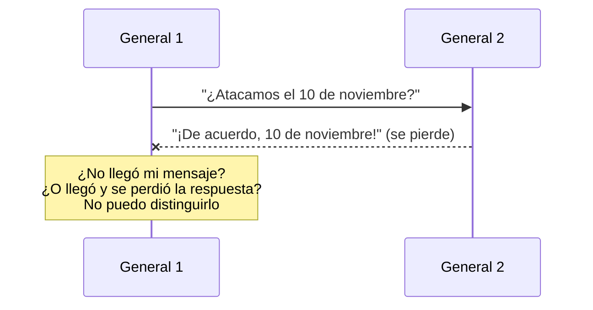
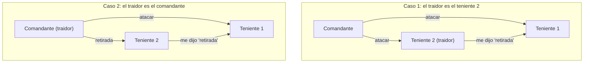
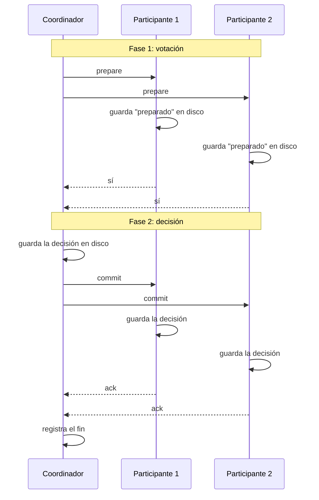
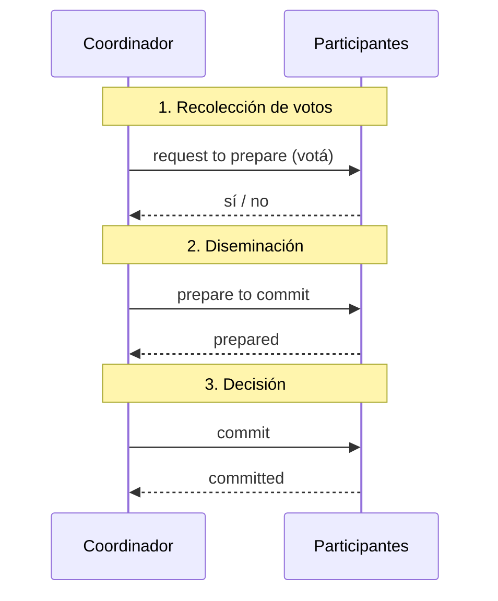
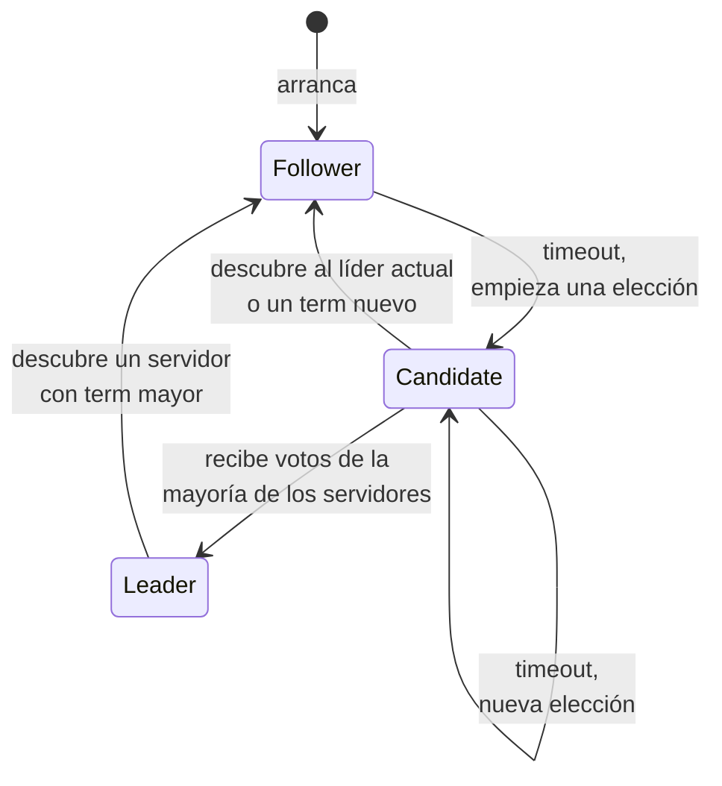
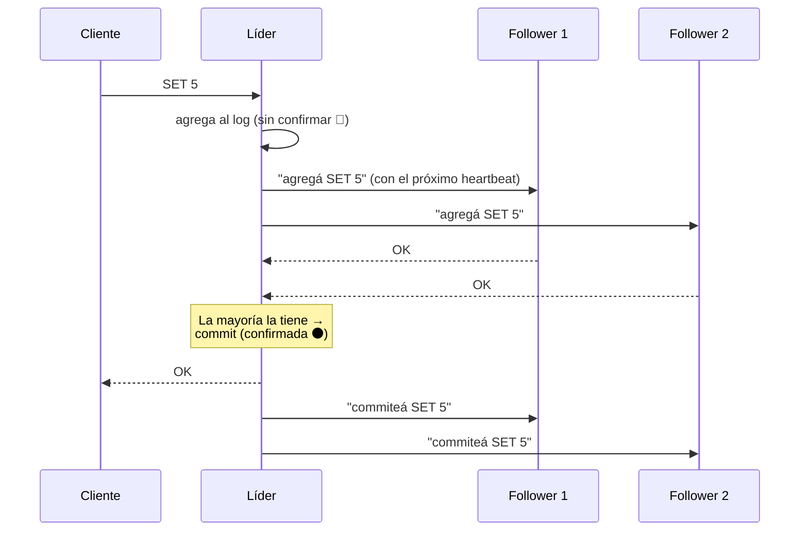
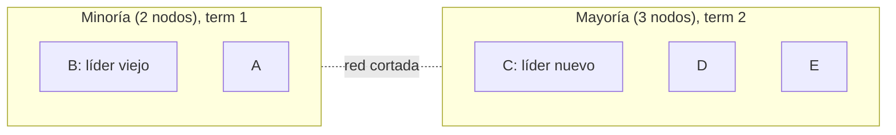
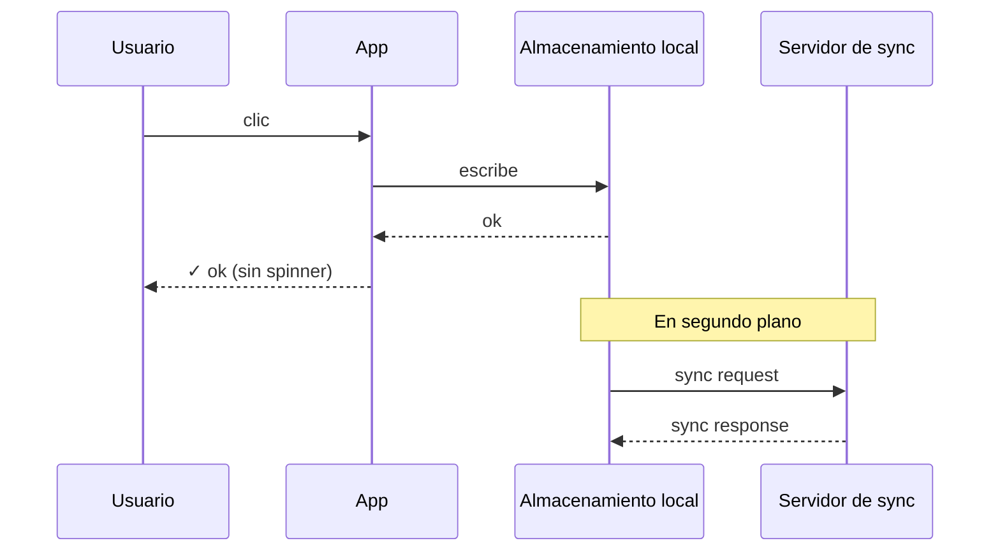

# Sistemas distribuidos II: coordinación, algoritmos de consenso y CRDTs

La clase pasada vimos **qué** problemas aparecen al distribuir (replicación, particionamiento, netsplits, CAP). Esta clase ataca la pregunta que quedó abierta:

> Si tengo **varios nodos con estado**, ¿cómo hago para que **se pongan de acuerdo**?

- ¿Por qué ponerse de acuerdo por red es **tan difícil**? → **los dos generales** y **los generales bizantinos**
- ¿Cómo se ponen de acuerdo **de forma atómica**? → **2 Phase Commit** y **3 Phase Commit**
- Repaso de CAP + **niveles de consistencia** (¿qué es la *linearizabilidad*?)
- ¿Cómo se ponen de acuerdo **por votación**? → **Raft**
- ¿Y si ponerse de acuerdo es **demasiado lento**? → **replicación optimista** y **CRDTs**

> ⚠️ **Entra en el parcial.** El profe dijo que entra todo hasta la clase que viene (relojes). **Paxos no se vio**: quizás lo dé la próxima clase.

---

## 0. Repaso: lo que ya sabemos

Threads, *guilds*, corrutinas y STM tienen algo en común: **corren en una única máquina**. Con Elixir (libcluster, Horde, Swarm) ya vimos sistemas distribuidos con el **modelo de actores**: procesos con estado que se mandan mensajes, ahora entre nodos distintos.

**Sistema distribuido**: *una colección de elementos informáticos autónomos que se comunican a través de una red, y que aparece a sus usuarios como un único sistema coherente.*

**¿Por qué distribuir?** Escalabilidad, tolerancia a fallos, descomposición funcional, cercanía geográfica, o porque **el dominio ya es distribuido**.

### Formas de comunicarse

| Estilo | Cómo es | Ejemplos |
|---|---|---|
| **RPC** (*Remote Procedure Call*) | Pedido → respuesta. Llamo a "una función" que corre en otra máquina y espero el resultado | REST, GraphQL, gRPC |
| **Paso de mensajes** | Mando un mensaje (a una cola o a un proceso) y sigo | Elixir (`send`), AMQP (RabbitMQ) |

| Arquitectura de red | Cómo es |
|---|---|
| **Cliente-servidor** | Muchos clientes hablan con un servidor central |
| **Peer to peer (P2P)** | Todos los nodos son iguales y hablan entre sí |

---

## 1. El problema de los dos generales

Dos ejércitos están del otro lado de unas montañas, con una ciudad en el medio. Solo pueden comunicarse con **mensajeros** que cruzan un bosque, y **los mensajeros pueden perderse o ser capturados**.

| Ejército 1 | Ejército 2 | Resultado |
|---|---|---|
| No ataca | No ataca | No pasa nada |
| Ataca | No ataca | Ejército 1 derrotado |
| No ataca | Ataca | Ejército 2 derrotado |
| Ataca | Ataca | **Ciudad capturada** |

**Lo que queremos**: el ejército 1 ataca **si y solo si** el ejército 2 ataca.

### ¿Por qué no se puede garantizar?



Desde el punto de vista del general 1, **que se pierda la respuesta es indistinguible de que se pierda la pregunta**. Y si el general 2 pide confirmación de la confirmación, el problema se repite: **siempre hay un último mensaje que nadie confirma**. No existe un número finito de mensajes que dé certeza.

### Ejemplo real: tienda online + pagos

| Tienda | Servicio de pagos | Resultado |
|---|---|---|
| No despacha | No cobra | No pasa nada |
| Despacha | No cobra | **La tienda pierde plata** |
| No despacha | Cobra | **Reclamo del cliente** |
| Despacha | Cobra | Todos contentos |

**Lo que queremos**: la tienda despacha **si y solo si** se cobró. Los "mensajeros" ahora son llamadas RPC por la red.

### Problemas que introduce

- **No hay conocimiento generalizado** entre los nodos: nadie sabe con certeza qué sabe el otro.
- Hace falta **comunicación constante** entre los nodos.
- **Los mensajes se pueden perder.**
- No hay certeza de que las cosas salgan bien.

> En resumen: **la red no es confiable** (la falacia nº 1 de la clase pasada). Casi siempre anda bien, pero no podemos asumir que **siempre** anda.

---

## 2. El problema de los generales bizantinos

*The Byzantine Generals Problem*, Lamport et al. (1982). Cambia las reglas:

- **Al menos 3 generales.**
- **Los mensajes siempre llegan** (el problema ya no es la red).
- **Puede haber traidores**: generales que mandan órdenes **contradictorias o falsas**.
- ¿Cómo se llega a un consenso?



**En los dos casos el teniente 1 recibe exactamente lo mismo** ("el comandante dijo atacar" y "el otro dice que dijo retirada"). No puede saber quién es el traidor. **Con 3 generales y 1 traidor, no hay consenso posible.**

### El resultado importante

- Hace falta mandar **muchos más mensajes** (todos les reenvían a todos lo que recibieron) para detectar inconsistencias.
- Se puede probar que **para llegar a un consenso, menos de ⅓ de los generales pueden ser traidores**.
- En fórmula: para tolerar **f** traidores necesito **n ≥ 3f + 1** generales.

| Traidores (f) | Generales mínimos (3f + 1) |
|---|---|
| 1 | 4 |
| 2 | 7 |
| 3 | 10 |

Con 4 generales y 1 traidor, los tres leales reciben 3 versiones, ven que **dos coinciden** y deciden por mayoría.

### ¿Qué es un "traidor" en un sistema real?

Un **nodo con estado corrupto o incorrecto** que manda datos que no debería. El ejemplo real es el mismo pedido de antes, pero ahora con tres partes (cliente, tienda, pagos) que tienen que acordar sobre la **orden**.

La idea es: **detectar** cuál es el nodo con el dato incorrecto y después **sincronizarlo** para llevarlo a un estado correcto.

### ¿Qué pasa en la realidad?

Los dos problemas juntos modelan las tres cosas que fallan en la vida real:

| Problema | En los generales | En sistemas reales |
|---|---|---|
| **Fallos en los nodos** | Generales traidores | Nodo con estado corrupto |
| **Fallas en la red** | Mensajeros perdidos | Mensajes perdidos, particiones |
| **Problemas de tiempo** | Mensajeros que tardan | **Latencia** |

Con particiones podemos terminar con **dos "verdades"** distintas, sobre todo si dejamos **escribir a una minoría**.

> 🦈 Las fallas de red no son solo "internet lento". El profe mostró la foto real de un **tiburón mordiendo un cable submarino** de internet que cruza el Atlántico: hubo problemas de conexión durante días en algunas zonas. Al final, **todo pasa por un cable**.

---

## 3. Tipos de sistemas de consenso

Para que los nodos se pongan de acuerdo sobre el estado, hay dos grandes familias de **protocolos**:

| Tipo | Idea | Ejemplos |
|---|---|---|
| **Protocolos de votación** (o de consenso) | El sistema **sigue funcionando** a pesar de que existan fallos. Funcionan **todo el tiempo**, no solo ante un fallo. Pueden ir confirmando operación por operación | **Raft**, Paxos |
| **Protocolos de commit** | Tienen un **comportamiento especial ante un fallo**: usan un algoritmo para resolverlo. Son **atómicos**: **todo o nada**. Hasta que no hay commit, no pasó nada | **2PC**, **3PC** |

> ⚠️ **Confusión de nombres**: los protocolos de commit **también tienen una "fase de votación"**. Lo que los distingue no es votar o no votar, sino que los de commit son **todo o nada** sobre un **conjunto de operaciones**, mientras que los de votación pueden confirmar **de a una operación**. El profe sugirió pensarlos como **"protocolos de consenso vs. protocolos de commit"**, que se confunde menos.

> 📝 Algo que quedó en los apuntes: *"Que se caiga o se levante un nodo es sincronización, no consenso"*. Consenso es acordar **un valor**, no enterarse de quién está vivo (eso es healthcheck/heartbeat/gossip de la clase pasada).

---

## 4. 2 Phase Commit (2PC)

- Permite el consenso en **dos fases** para consolidar una **transacción**.
- Se usa en **bases de datos distribuidas**.
- Dos actores:
  - **Coordinador**: uno solo. Dirige el proceso.
  - **Cohortes** o **participantes**: los nodos que tienen los datos.

### Las dos fases

1. **Fase de votación** (petición de commit): el coordinador manda `prepare` a todos. Cada participante revisa si **puede** hacer la operación, guarda en disco que está "preparado" y responde **sí** o **no**.
2. **Fase de decisión** (commit): el coordinador junta los votos y decide. Si todos dijeron sí, manda **commit**. Si alguien dijo no (o no respondió), manda **abort**. Cada participante aplica la decisión y responde con un `ack`.



> 💡 **"Force write"** (en el diagrama de la PPT) significa escribir **en disco** antes de seguir, para que si el nodo se cae y vuelve, se acuerde de qué había votado o decidido.

### La demo en Elixir: transferencias bancarias

El profe mostró una implementación con **Horde**: un **participante por nodo**, con el **saldo de una cuenta** en memoria, y un **coordinador** que se *spawnea* para cada operación (es un proceso supervisado: si se cae, se vuelve a levantar).

Ejemplo de operación: al nodo 1 se le sacan 30, al nodo 2 se le ponen 20 y al nodo 3 se le ponen 10. Cada participante vota según **reglas del dominio**:

- **Los movimientos tienen que sumar cero** (no se crea ni se destruye plata).
- **Tiene que haber saldo suficiente.**

Si las dos reglas se cumplen en todos → commit y **todos** los saldos cambian. Si alguno falla → abort y **ningún** saldo cambia. Esa es la **atomicidad**.

```
Escenario feliz:    -30 / +20 / +10   → todos votan sí → commit   ✅
Escenario de aborto: -60 / +35 / +35   → no suma cero   → abort    ❌ (nada cambió)
                     -200 con saldo 100 → saldo insuficiente → abort ❌
```

### Ventajas y desventajas

| Ventajas | Desventajas |
|---|---|
| **Garantiza la atomicidad global**: o se aplica en todos o en ninguno | **No soporta votos parciales**: es todo o nada. Necesita a **todos** los participantes |
| **Simple de implementar** | **Protocolo bloqueante**: el coordinador no avanza de fase hasta tener **todos** los votos |
| | Si **el coordinador falla**, los participantes tienen que **esperar a que se recupere** (quedan "preparados" sin saber qué hacer) |
| | **Un solo coordinador** por operación |

> ⚠️ **Ojo con "mayoría"**: en clase el profe habló varias veces de "por mayoría" en 2PC. En la definición clásica (y en las desventajas de la PPT), **2PC necesita el "sí" de todos los participantes**: con un solo "no" se aborta. Lo de mayoría aplica a Raft y, según la explicación de clase, a 3PC.

---

## 5. 3 Phase Commit (3PC)

La idea es **sacarle lo bloqueante a 2PC**.

- **No es bloqueante**: ante fallos **se tiene que seguir** y no se puede quedar trabado en una fase.
- Ante la recuperación, todos tienen que **llegar a la misma conclusión**.
- Implementa un **timeout máximo**: si se vence, se **aborta** la operación.
- Si no se puede continuar, se manda un mensaje de **abort** a todos.

### Las tres fases (según el diagrama)

1. **Recolección de votos**: el coordinador pide que voten (*request to prepare*) y los participantes responden sí o no.
2. **Diseminación**: el coordinador avisa la decisión con un **"prepárense para commitear"** (*prepare to commit*) y los participantes responden **"preparado"**.
3. **Decisión**: el coordinador manda **commit**, cada participante lo aplica y responde **"commit terminado"**.



> 📌 **Orden de las fases**: la PPT dice "Fase I: preparar, Fase II: votar, Fase III: decidir", pero el diagrama muestra **primero votar y después preparar**. El profe aclaró que **las dos variantes aparecen en la bibliografía** y que la más usada es la del diagrama: **votar → preparar → commitear**.

### ¿Para qué sirve la fase extra?

Entre que el coordinador junta los votos y manda a escribir, **algún participante se puede haber caído**. La fase de "¿están listos?" sirve para detectar eso antes de commitear.

- **2PC** necesita que estén **todos** para dar la transacción por commiteada.
- **3PC** (según la explicación de clase) avanza **con mayoría**: cuando la mayoría está preparada, ya puede mandar a escribir el dato.

### Ventajas y desventajas

| Ventajas | Desventajas |
|---|---|
| **Protocolo no bloqueante** | **Demasiados pasos: 3 RTT** (*round trip times*), o sea tres idas y vueltas por la red |
| | **No garantiza atomicidad** (la que sí garantizaba 2PC) |

### 2PC vs. 3PC

| | 2PC | 3PC |
|---|---|---|
| Fases | 2 | 3 |
| ¿Bloqueante? | Sí | No (timeouts) |
| ¿Atomicidad? | **Sí** | No |
| Si cae el coordinador | Todos esperan | Se sigue o se aborta por timeout |
| Costo en red | 2 RTT | 3 RTT |

---

## 6. Antes de votar... repaso de CAP

> *"Do you have 5 minutes to talk about CAP theorem?"*

Recordatorio de la clase pasada: **C**onsistencia, **A**vailability (disponibilidad), tolerancia a **P**articiones. Las tres juntas son imposibles.

### Críticas al CAP

- La **C** de CAP es **linearizabilidad**, no consistencia eventual.
- **Todos** los sistemas distribuidos tienen que tolerar particiones → **no se puede renunciar a P**.
- Por lo tanto, CAP se reduce a: **con partición, elegí entre C o A**.
- El teorema **ignora** la latencia, la tolerancia a fallos y los requisitos reales.

### Niveles de consistencia

> Esto responde la pregunta de clase: **¿qué es la linearizabilidad?**

De más fuerte a más débil:

| Nivel | Qué garantiza | En criollo |
|---|---|---|
| **Linearizabilidad** (consistencia fuerte) | **Orden total** y **coherente con el tiempo real** | El sistema se comporta **como si hubiera una sola copia** del dato. Si una escritura terminó, **cualquier** lectura posterior la ve. Fácil de razonar, **difícil de implementar** con fallas o alta latencia |
| **Secuencial** | **Orden global** (todos ven las operaciones en el mismo orden), pero ese orden **no tiene que coincidir con el tiempo real** | Todos están de acuerdo en el orden, aunque quizás no sea "el orden en que pasaron de verdad" |
| **Causal** | Solo respeta las relaciones **causa → efecto** | Si B pasó *por* A (ej.: respondo un mensaje), todos ven A antes que B. Lo que no está relacionado puede verse en cualquier orden. Más débil, **más escalable** |
| **Eventual** | **Ningún orden**. Solo que **eventualmente** todos ven lo mismo | Si dejan de llegar escrituras, en algún momento todas las réplicas convergen |

Comentario del profe: para tener **orden total real** (linearizabilidad) necesitás algo como **relojes sincronizados/atómicos**. Sin eso, los relojes de distintas máquinas difieren en milisegundos y no podés saber qué pasó primero, así que en la práctica quedás más cerca de la **secuencial**. **Los relojes se ven la clase que viene.**

### ¿Cuándo usar linearizabilidad?

- Cuando hacen falta **fuertes garantías de coherencia**: contadores bancarios, control de acceso, reservas de asientos.
- Hay que estar dispuesto a **aceptar menor disponibilidad y mayor latencia** (se prioriza la C de CAP).
- Para muchas otras aplicaciones, **causal o eventual alcanza** y es más eficiente.

> 💬 El profe **no estuvo de acuerdo** con el ejemplo de "reserva de asientos" de la PPT (dijo que en la práctica no siempre se hace así). Bancos y control de acceso sí. Para la mayoría de los sistemas, alcanza con consistencia secuencial.

### Modelos alternativos al CAP

- **PACELC** (Daniel Abadi): si hay **P**artición, elegí **A** o **C**; si no (**E**lse), elegí **L**atencia o **C**onsistencia. Incluso con la red sana, latencia y consistencia están en tensión.
- **Modelos sensibles al retardo**: modelan las garantías de consistencia **en función de la latencia** que agregan.
  - La linearizabilidad requiere coordinación → **más latencia**.
  - La consistencia eventual permite baja latencia → pero **lecturas desactualizadas**.
  - Algunos sistemas **miden la latencia todo el tiempo** y, si pasa un umbral, se declaran **degradados** o no disponibles.
  - En vez de "renunciar" a la consistencia, **se mide y se entiende su costo**.
- **Elegir el nivel adecuado según el caso de uso.**

---

## 7. Raft: consenso por votación

- Usa un **mecanismo de votación**.
- **3 tipos de actores**: *Followers*, *Candidates* y *Leaders*.
- Es una **máquina de estados**: según lo que pase, cada nodo va cambiando de rol.
- **Todos empiezan como followers.**
- A diferencia de 2PC, **no hay un coordinador designado de antemano**: el líder **se elige**. Y funciona **todo el tiempo**, no solo ante fallos.

### Roles

| Rol | Qué hace |
|---|---|
| **Leader** | **Único** que acepta **escrituras** del cliente. Las replica a los demás con **log replication** |
| **Follower** | Recibe y guarda las réplicas que le manda el líder. No acepta escrituras |
| **Candidate** | Estado **de paso**: un follower que se postula para ser líder |

### Máquina de estados



### Elección de líder

1. Cada follower tiene un **election timeout** (en la visualización, entre **150 y 300 ms**), **aleatorio** para cada nodo.
2. Si un follower **no escucha al líder** antes de que se le venza el timeout, se convierte en **candidato**.
3. El candidato **incrementa el term** (el número de "mandato"), se vota a sí mismo y pide votos a los demás.
4. Cada nodo vota **una sola vez por term**.
5. Si recibe votos de la **mayoría**, es el **nuevo líder**.
6. El líder manda **heartbeats** periódicos para que nadie más arranque una elección.

> 🔢 **El term** es como un "número de gobierno". Cada elección lo incrementa. Sirve para que un líder viejo se dé cuenta de que **ya no es el líder** (si ve un term mayor, vuelve a ser follower). Va a ser clave en las particiones.

**Split vote (empate)**: si dos candidatos arrancan a la vez y ninguno consigue mayoría, se vence el timeout y **se vuelve a votar**. Como los timeouts son **aleatorios**, en la siguiente ronda es muy probable que uno arranque antes y gane.

### Log replication



En la visualización:
- **Rojo** 🔴 = entrada en el log **sin confirmar** (el líder la recibió, pero todavía no la replicó en la mayoría).
- **Negro** ⚫ = entrada **commiteada**: ya es definitiva.

El líder confirma cuando **la mayoría** de los nodos tiene la entrada, no hace falta que la tengan todos.

### Particiones de red

Cluster de **5 nodos** que se parte en dos grupos: **2 de un lado** (con el líder viejo, B) y **3 del otro**.



- **Lado de la mayoría (3)**: dejan de recibir heartbeats de B, se vence un timeout, eligen un **nuevo líder** (C) e **incrementan el term** (term 2). Como son 3 de 5, **pueden commitear**.
- **Lado de la minoría (2)**: B sigue creyéndose líder y acepta escrituras, pero **nunca llega a mayoría** (2 de 5). Esas entradas **quedan en rojo**, sin commitear.
- **Raft necesita saber exactamente cuántos nodos tiene el cluster**, para poder calcular la mayoría.
- **Cuando la red vuelve**: B ve que existe un **term mayor** (2 > 1), **deja de ser líder**, **descarta** sus entradas sin commitear y **se sincroniza** con el log del líder nuevo.

> ✅ Así Raft evita el **split brain** de la clase pasada: solo puede commitear el lado con mayoría, y como no puede haber dos mayorías a la vez, hay una sola "verdad". En términos de CAP, **Raft es CP**: el lado minoritario no está disponible para escribir.

> 🎮 Visualización interactiva (la que mostró el profe): https://thesecretlivesofdata.com/raft/

---

## 8. ¿Los algoritmos de consenso arreglan todo?

**No.** **Ponerse de acuerdo lleva tiempo** (*12 Angry Men*).

- Con nodos en distintos continentes, cada ida y vuelta puede tardar **cientos de milisegundos**. Varias rondas de votación por cada operación se notan.
- Para apps **colaborativas en tiempo real** (Google Docs, Trello, Figma, Mural) es **imposible** tener una buena experiencia si cada tecla espera a un consenso global.
- El modelo clásico es: clic → request HTTP → servidor → base de datos → respuesta... y mientras tanto el usuario ve un **spinner**.

Hay dominios donde **no hace falta** consistencia fuerte (no son críticos, o hay gente colaborando desde todo el mundo y está bien no ver lo último al instante).

---

## 9. Replicación optimista

**La alternativa**: escribir **localmente** primero, responder OK **enseguida**, y **sincronizar en segundo plano**.



El costo:

1. **Cada nodo tiene una visión distinta del estado.**
2. Porque **cada nodo ve los eventos en un orden distinto**.

### Conflictos

Paula y Carlos arrancan con una lista vacía `[]`:

```
Paula agrega "Paula"  → ["Paula"]           Carlos agrega "Carlos" → ["Carlos"]
          ↓ se sincronizan ↓
Paula ve: ["Paula", "Carlos"]               Carlos ve: ["Carlos", "Paula"]   ❌ no coinciden
```

Peor: los dos arrancan con `["Alex"]`. Paula agrega "Paula"; Carlos hace `list.clear()` y después agrega "Carlos". ¿Cómo queda? ¿`["Paula", "Carlos"]`? ¿`["Carlos"]`? 😕

**Queremos que el estado converja**: que, una vez que se intercambiaron todos los cambios, **todos vean lo mismo**. Eso es **consistencia eventual**. No importa cuándo, ni que el orden de llegada haya sido distinto.

---

## 10. CRDTs al rescate

**CRDT** = *Conflict-free Replicated Data Type*: tipo de dato replicado sin conflictos.

> **CRDT = estructura de datos + algoritmo para mergear el estado y resolver los conflictos automáticamente.**

Hay CRDTs para: **registros, contadores, strings, listas, sets y mapas**.

**Garantía**: una vez que se comunicaron todos los eventos entre los usuarios → **todos van a estar en el mismo estado**.

- **Todos los nodos aceptan escrituras** (no hay líder, no hay votación).
- Nada se "pisa": se **acumulan** los cambios y se **combinan**.

### ¿Cómo resuelven los conflictos?

1. **Manteniendo un historial con todos los cambios** (parecido a Git).
2. **Haciendo todas las operaciones conmutativas**: si combinar A y B da lo mismo que combinar B y A, **el orden de llegada deja de importar**.

Ejemplo simple (de la clase pasada), el **G-Counter**:

```
Nodo A: %{a: 3, b: 0}     Nodo B: %{a: 0, b: 5}
merge = máximo de cada posición = %{a: 3, b: 5} → valor = 8
merge(A, B) == merge(B, A)  ✅  y mergear dos veces da lo mismo ✅
```

### ¿Cómo funciona por atrás? La lista ordenada

¿Cómo hacemos que el ejemplo de Paula y Carlos converja?

- Cada elemento tiene un **id único**: `(contador, id_nodo)`, por ejemplo `3A`.
- **Nuevo id** = `max(ids locales) + 1`, con el id del nodo pegado.
- Las inserciones se guardan como **"insertar X después de Y"** (por id, no por posición).
- **Al insertar, se saltean los elementos con id mayor** que ya estén en ese lugar. Así todos llegan al mismo orden.

```
Estado inicial (los dos):   Alex(1A), Cris(2A)

Paula (nodo A):  "insertar Paula(3A) después de 2A"
Carlos (nodo B): "insertar Carlos(3B) después de 2A"

Ambos terminan con:  Alex(1A), Cris(2A), Carlos(3B), Paula(3A)
```

¿Por qué Carlos queda antes? Los dos se insertaron "después de 2A" y tienen el mismo contador (3), así que se desempata por id de nodo: **3B > 3A**. Cuando llega la inserción de 3A, **saltea a 3B** porque tiene id mayor y se ubica después. No importa en qué orden lleguen las operaciones: **siempre da lo mismo**.

### Limitaciones

| Limitación | Detalle |
|---|---|
| **El estado final puede no ser el que querrías** | Si una persona dibuja una cabra y otra un gato en el mismo lugar, el merge puede darte... un **gato-cabra**. Converge, pero el resultado puede no tener sentido |
| **La resolución puede depender mucho del dominio** | A veces hay que resolver a mano (como un conflicto de Git) o con reglas propias |
| **No se pueden garantizar invariantes globales** | "El saldo nunca es negativo" no se puede asegurar si cada nodo escribe sin coordinarse. **Moraleja: no uses CRDTs para transacciones bancarias** :P |

> 🔗 **Conexión con Elixir**: **Horde usa CRDTs por dentro** (`DeltaCrdt`) para sincronizar su registry y su supervisor entre nodos (clase 6). Por eso Horde es eventualmente consistente.

> 🔗 **Conexión con el TP**: los CRDTs sirven para datos que **solo se acumulan** (alertas, notificaciones). Para algo con un invariante, como **no vender dos veces el mismo asiento**, no alcanzan: ahí hace falta coordinación (un único dueño del dato, 2PC o consenso).

### Recursos sobre CRDTs (de la PPT)

- Librerías: [Automerge](https://github.com/automerge/automerge) · [Yjs](https://github.com/yjs/yjs). La demo de la clase (el muro de mensajes) estaba hecha en JS con una de estas.
- Explicación intuitiva: https://www.youtube.com/watch?v=xxjHC3yLDqw
- Explicación formal: https://hal.inria.fr/inria-00609399v1/document
- *CRDTs: The Hard Parts* (los casos no tan felices): https://www.youtube.com/watch?v=x7drE24geUw

---

## 11. Pregunta de clase: ¿y blockchain?

> **¿A cuál de estos mecanismos se parece más blockchain?**

Respuesta del profe: es un modelo **completamente distribuido (P2P)**, con una **historia** de transacciones (parecido a los CRDTs en eso). Pero como **necesita atomicidad** (no se puede gastar dos veces la misma plata), en la forma de decidir **se parece más a 2PC "con historia"**. Los CRDTs no sirven porque no garantizan invariantes, y 3PC tampoco porque no es atómico.

> 📘 Agregado: en la bibliografía, el consenso de blockchain (Proof of Work / Proof of Stake) se estudia como **consenso tolerante a fallas bizantinas**, porque cualquier nodo puede ser un "traidor". Es el problema de la sección 2 a escala de internet.

Otro comentario del profe: **2PC se puede ver como un caso particular de Paxos**, una versión simplificada con un solo coordinador fijo y sin elección.

---

## Resumen

| Concepto | En una línea |
|---|---|
| **Dos generales** | Con mensajes que se pueden perder, **no hay forma** de estar 100% seguros de un acuerdo |
| **Generales bizantinos** | Con nodos "traidores", hace falta **n ≥ 3f + 1** (menos de ⅓ de traidores) para llegar a un consenso |
| **Protocolos de commit** | Atómicos, todo o nada, se activan ante una operación o un fallo (2PC, 3PC) |
| **Protocolos de votación** | El sistema sigue funcionando con fallos; corren todo el tiempo (Raft, Paxos) |
| **2PC** | Votación + decisión. Atómico y simple, pero **bloqueante** y depende del coordinador |
| **3PC** | Votación + preparación + decisión. **No bloqueante** (timeouts), pero **3 RTT** y **sin atomicidad** |
| **Linearizabilidad** | Como si hubiera una sola copia: orden total y en tiempo real |
| **Secuencial / causal / eventual** | Orden global sin tiempo real / solo causa-efecto / solo converge en algún momento |
| **PACELC** | Con partición, A o C; sin partición, L o C |
| **Raft** | Follower → Candidate → Leader. Líder elegido por **mayoría**, con **terms** y **timeouts aleatorios**. Commit cuando la mayoría tiene la entrada. Es CP |
| **Replicación optimista** | Escribo local, respondo ya y sincronizo después. Rápido, pero cada nodo ve un estado distinto |
| **CRDT** | Estructura + merge automático con operaciones **conmutativas** → **converge siempre** |
| **Límite de los CRDTs** | No garantizan **invariantes globales** (nada de transacciones bancarias) |

**Ideas para llevarse:**
1. Por red **no hay certezas**: los mensajes se pierden (dos generales) y los nodos pueden mentir (bizantinos).
2. **Consistencia fuerte = coordinación = latencia.** 2PC, 3PC y Raft compran consistencia pagando con tiempo y disponibilidad.
3. **Mayoría** es la idea clave de Raft: como no puede haber dos mayorías a la vez, no hay split brain.
4. Cuando la latencia importa más que la consistencia inmediata, **CRDTs**: todos escriben, todos convergen, pero sin invariantes globales.

## Preguntas para repasar

1. ¿Por qué el problema de los dos generales no se resuelve mandando más confirmaciones?
2. Tenés un cluster que tiene que tolerar 2 nodos con datos corruptos (bizantinos). ¿Cuántos nodos necesitás como mínimo?
3. ¿Qué diferencia hay entre un protocolo de commit y uno de votación, si los dos "votan"?
4. En 2PC, ¿qué pasa si el coordinador se cae después de que todos votaron "sí" pero antes de mandar la decisión?
5. ¿Qué gana 3PC respecto de 2PC y qué pierde?
6. ¿Qué diferencia hay entre linearizabilidad y consistencia secuencial?
7. En Raft, ¿por qué los election timeouts son aleatorios?
8. Cluster Raft de 5 nodos que se parte en 2 + 3, con el líder del lado de los 2. ¿Qué pasa con las escrituras en cada lado y qué pasa cuando vuelve la red?
9. ¿Qué tienen que cumplir las operaciones de un CRDT para que el orden de llegada no importe?
10. ¿Por qué no usarías un CRDT para el saldo de una cuenta bancaria (o para los asientos de un vuelo)?

<details>
<summary>Respuestas</summary>

1. Porque siempre hay un **último mensaje** que nadie confirma. Si se pierde, el que lo mandó no puede distinguir si llegó o no. Más mensajes solo corren el problema un paso más allá.
2. **n ≥ 3f + 1 = 3·2 + 1 = 7 nodos.**
3. Los de **commit** (2PC, 3PC) son **atómicos**: aplican un conjunto de operaciones todo junto o nada, y se activan para una transacción o ante un fallo. Los de **votación** (Raft) funcionan todo el tiempo, mantienen el sistema andando con fallos y pueden confirmar operación por operación.
4. Los participantes quedan **bloqueados**: votaron sí, así que no pueden abortar por su cuenta (el coordinador podría haber decidido commit), pero tampoco pueden commitear (podría haber decidido abort). Tienen que **esperar a que el coordinador vuelva**.
5. Gana que **no es bloqueante** (usa timeouts y puede seguir o abortar). Pierde **atomicidad** y es más lento: **3 RTT** en vez de 2.
6. Las dos dan un **orden global** igual para todos. La **linearizabilidad** además exige que ese orden **respete el tiempo real** (si una escritura terminó antes de que empiece una lectura, la lectura la ve). La **secuencial** no lo exige.
7. Para evitar que todos se postulen al mismo tiempo y **empaten** (split vote). Con timeouts distintos, casi siempre uno arranca antes y gana.
8. Lado de **2**: el líder viejo acepta escrituras pero **no puede commitearlas** (no tiene mayoría); quedan en rojo. Lado de **3**: eligen un líder nuevo con **term mayor** y **sí pueden commitear**. Cuando vuelve la red, el líder viejo ve el term mayor, **vuelve a ser follower**, **descarta** lo que no había commiteado y se sincroniza.
9. Tienen que ser **conmutativas** (A·B = B·A). En la práctica también asociativas e idempotentes, así mergear en cualquier orden o varias veces da lo mismo.
10. Porque los CRDTs **no garantizan invariantes globales**. Dos nodos podrían, sin coordinarse, gastar la misma plata o vender el mismo asiento, y el merge "convergería" a un estado inválido (saldo negativo, asiento vendido dos veces).

</details>

## Material

- PPT de la cátedra: *Sistemas Distribuidos, Parte II: Coordinación, algoritmos de consenso y CRDTs*
- *The Byzantine Generals Problem*, Lamport, Shostak y Pease (1982)
- [Raft – The Secret Lives of Data](https://thesecretlivesofdata.com/raft/) (visualización) · [raft.github.io](https://raft.github.io/)
- CRDTs: [Automerge](https://github.com/automerge/automerge) · [Yjs](https://github.com/yjs/yjs) · [CRDTs: The Hard Parts – Martin Kleppmann](https://www.youtube.com/watch?v=x7drE24geUw)
- *Designing Data-Intensive Applications* – Martin Kleppmann, caps. 7 (Transacciones) y 9 (Consistencia y consenso)
- El profe dijo que va a subir el **código de la demo de 2PC en Elixir**, la PPT y explicaciones al **IASC book** (generales bizantinos con el cálculo, y CAP/PACELC)

## Próxima clase

**Relojes** (lógicos de Lamport, vectoriales), un par de estructuras más y, si da el tiempo, **Paxos**. La clase siguiente **no entra en el parcial**.
