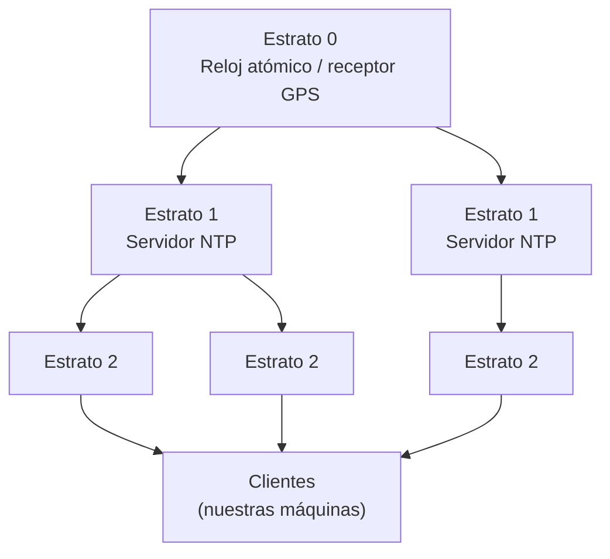
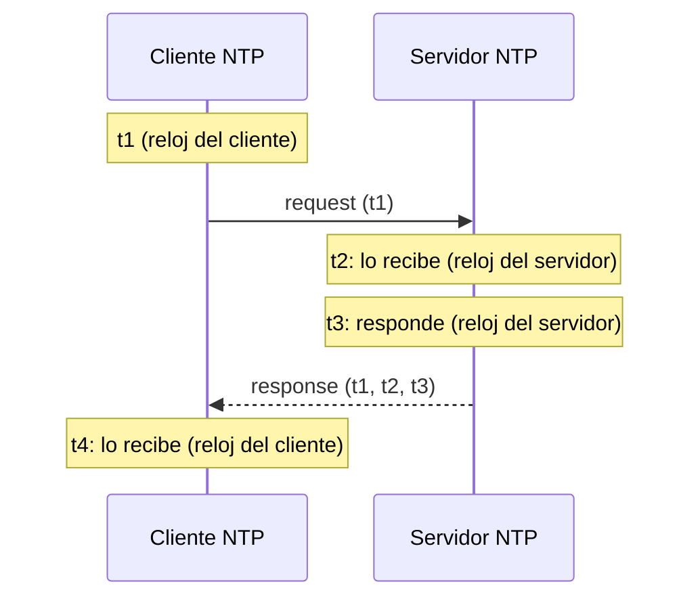
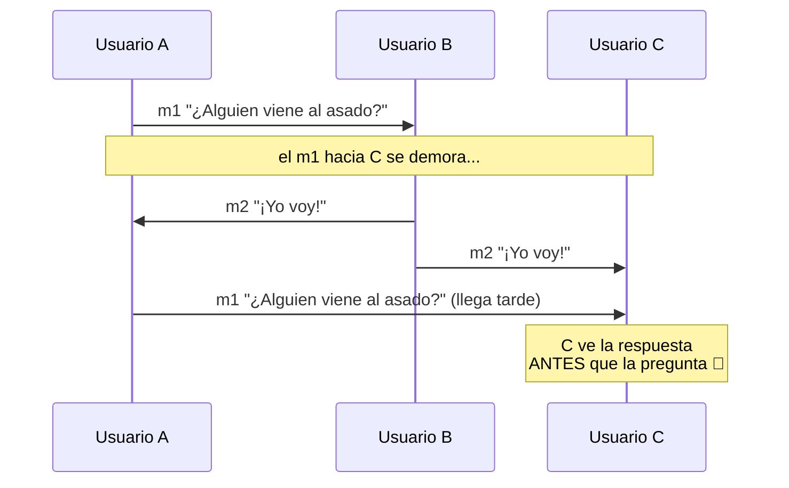
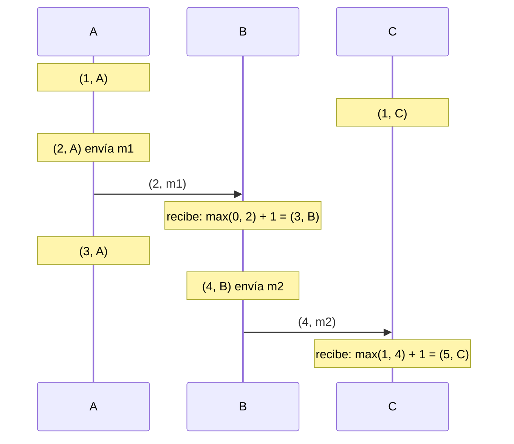
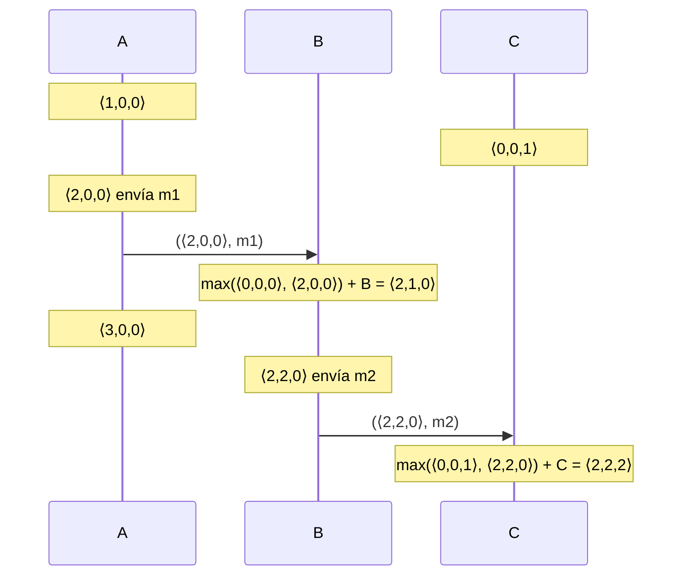
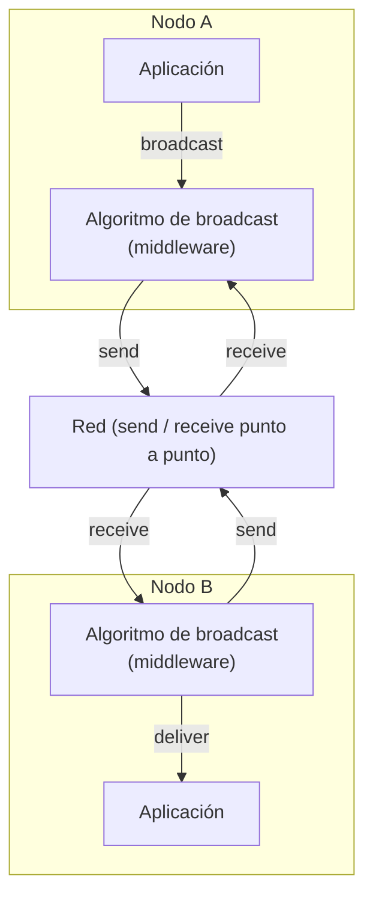
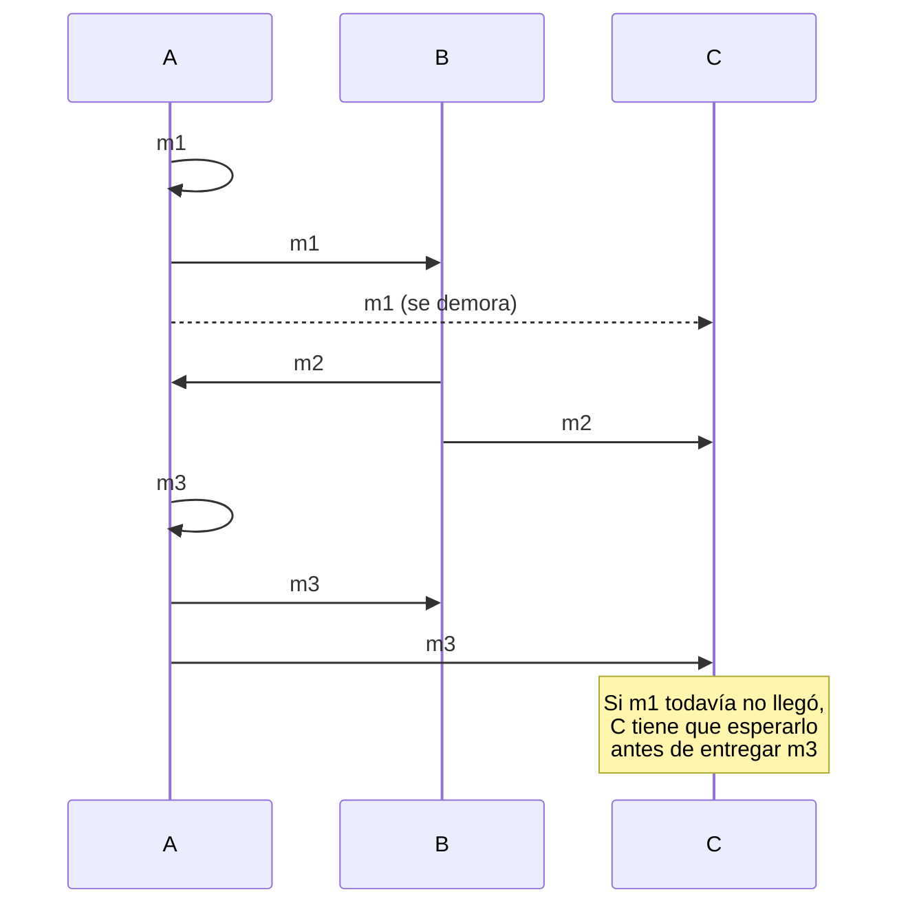
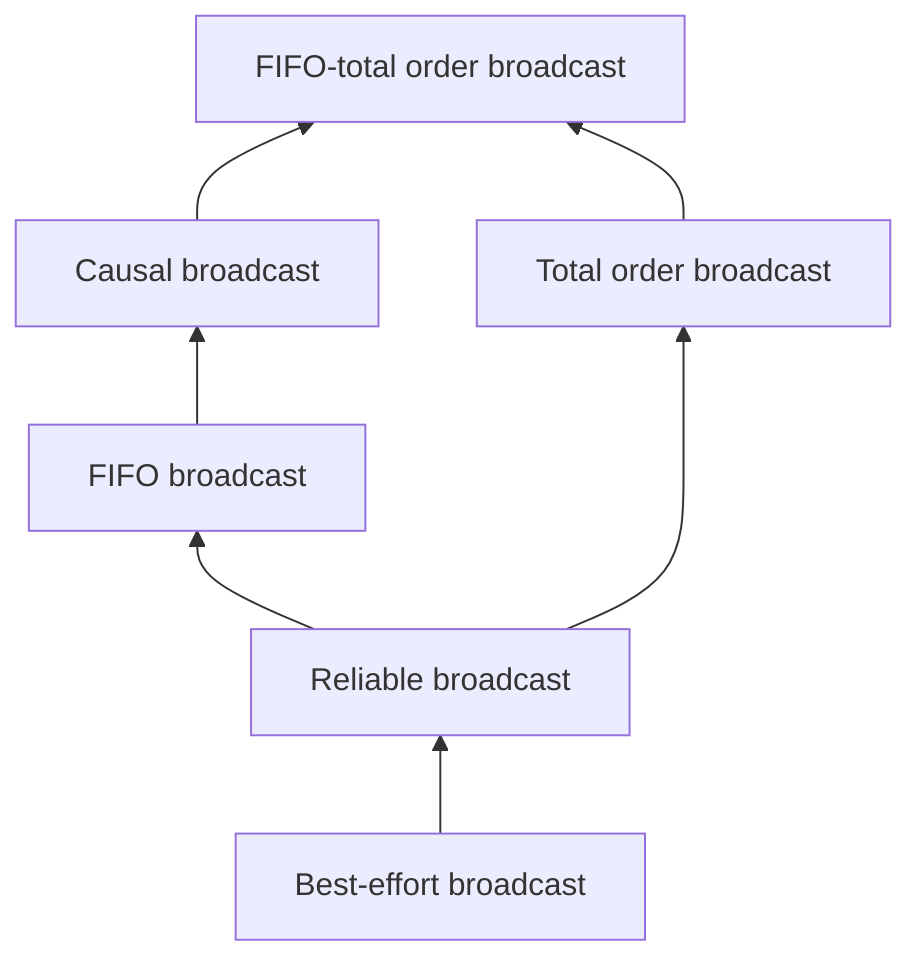
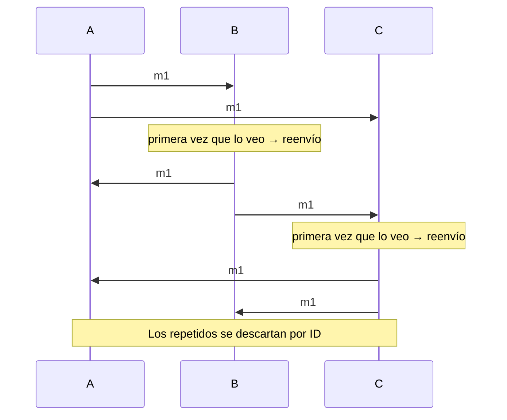

# Sistemas distribuidos III: sincronización de relojes, relojes lógicos y broadcast

La clase pasada quedó una deuda: para resolver conflictos ("¿cuál escritura vino primero?") o para tener consistencia secuencial o linearizable, **hace falta ordenar eventos**. La tentación es usar un timestamp... pero en un sistema distribuido **no hay un reloj compartido** (igual que no hay memoria compartida).

> ¿Cómo sabemos **qué pasó antes** en un sistema donde cada máquina tiene su propio reloj, y ninguno es perfecto?

- **Parte 1: relojes**
  - Relojes **físicos**: cuarzo, atómicos, GPS, el *drift* y los *leap seconds*
  - **NTP**: cómo se sincronizan los relojes por red
  - Relojes **monotónicos** vs. de **hora del día**
  - **Causalidad** (*happens-before*) y relojes **lógicos**: **Lamport** y **vectoriales**
- **Parte 2: broadcast**
  - Mandar un mensaje **a todo un grupo** de nodos: confiabilidad y **orden de entrega** (FIFO, causal, total)
  - Algoritmos: directo, **eager** y **gossip**

> ⚠️ **Entra en el parcial** (el profe había dicho que entraba todo hasta esta clase). **Paxos** lo va a mandar escrito **como bonus**: no se toma.

---

## 1. El caso del 30 de junio de 2012

En la noche del 30 de junio al 1 de julio de 2012 (hora del Reino Unido), **muchos servicios en línea de todo el mundo colapsaron al mismo tiempo**. Los servidores se bloquearon y dejaron de responder. **Algunas aerolíneas no pudieron procesar reservas ni check-ins durante horas.**

¿Qué pasó? Esa noche se agregó un **leap second** (segundo intercalar): el reloj oficial (UTC) marcó `23:59:60` antes de pasar a `00:00:00`. Un **bug en el kernel de Linux** al manejar ese segundo extra hizo que muchos procesos se trabaran consumiendo CPU, hasta que se aplicó un parche o se reinició el reloj.

> **Moraleja**: algo tan "obvio" como la hora puede tirar abajo un sistema. Y si no confiamos en la hora para no colgarnos, mucho menos para **ordenar eventos**.

### ¿Para qué usan el tiempo los sistemas distribuidos?

- **Planificadores, timeouts, detectores de fallos, reintentos** (los heartbeats de la clase 7 y los timeouts de Raft de la clase 8)
- **Métricas** de rendimiento y estadísticas (duraciones)
- **Logs y bases de datos**: registrar *cuándo* pasó algo
- Datos con **validez limitada**: entradas de caché, credenciales y tokens que vencen
- **Ordenar eventos y estado**: saber qué escritura es más nueva

Según el profe, **lo más delicado es el último punto**: para un log, un desfasaje de 200 ms no le cambia la vida a nadie; para decidir cuál de dos escrituras gana, **100 ms es un montón** (en un sistema grande pueden pasar muchísimas cosas en ese tiempo).

> 💬 Pregunta de clase: *¿si todo mi cluster está en una misma región de AWS, me tengo que preocupar?* Respuesta: el problema es **mucho menos probable**, pero **no hay garantías** salvo que el proveedor te asegure relojes sincronizados. Con nodos en **regiones distintas** es cuando estas técnicas cobran todo el sentido.

---

## 2. Relojes físicos

Hay dos tipos de reloj:

| Tipo | Qué cuenta |
|---|---|
| **Físico** | **Segundos** transcurridos (intenta representar el tiempo real) |
| **Lógico** | **Eventos** ocurridos (por ejemplo, mensajes enviados). Es un contador |

> Ojo con el nombre: el "reloj" de la **electrónica digital** (un oscilador que hace *tic*) **no es** el "reloj" de los **sistemas distribuidos** (que da *timestamps*). El oscilador solo cuenta pulsos; para saber "qué hora es" hay que contar desde una fecha de referencia.

### Relojes de cuarzo y el *drift*

Las computadoras usan **relojes de cuarzo**: baratos y fáciles de fabricar, pero **imprecisos**. Uno se adelanta un poquito, otro se atrasa un poquito. A esa deriva se la llama **clock drift**.

- Se mide en **ppm** (partes por millón).
- **1 ppm = 1 µs por segundo = 86 ms por día = 32 s por año.**
- La mayoría de las computadoras tienen una precisión de **≈ 50 ppm** → hasta **≈ 4 segundos por día**.
- La **temperatura** lo afecta: el cuarzo es más preciso cerca de los 25 °C y empeora con frío o calor (la curva de la PPT cae a −80 ppm a 70 °C).

El problema **no aparece de un día para el otro**: el error **se va acumulando de a poco**, y además **no es constante** (cambia con el tiempo y la temperatura). Así que no alcanza con medir la diferencia una vez y restarla siempre.

### Otros relojes

| Reloj | Cómo es |
|---|---|
| **Atómico** (ej.: Cesio-133) | Error casi nulo, pero **muy caro**. A veces se vende como servicio |
| **GPS** | Los satélites llevan relojes atómicos; un receptor GPS permite sincronizar dispositivos con esa precisión |

### Leap seconds

La rotación de la Tierra no es perfectamente regular, así que cada tanto se **agrega un segundo** al tiempo oficial (UTC) para que no se desfase del día solar. Se hace a fin de **junio** o de **diciembre** (`23:59:60`).

- No tiene que ver con el *drift*: el drift es la **imperfección del cuarzo** de cada máquina; el leap second es un **ajuste del tiempo oficial** que todos tienen que aplicar.
- Es **disruptivo**: aunque tengas un reloj atómico, si no aplicás el leap second quedás **desincronizado** de UTC.

> 📘 Agregado: el profe no recordaba la fecha del último. Fue el **31 de diciembre de 2016**. En 2022 se decidió **dejar de agregar leap seconds a partir de 2035**, justamente por los problemas que causan.

### ¿Por qué importa una diferencia "chiquita"?

Una operación se ejecuta en el servicio **A** y después se manda al servicio **B**. Si el reloj de B está **300 ms atrasado**, el timestamp de B puede quedar **antes** que el de A, aunque B haya ocurrido después. Si usamos esos timestamps para decidir **qué pasó primero**, **el resultado está mal**.

En la PPT, el reloj de un sistema se modela como:

```
C_i(t) = a · H_i(t) + b
```

donde `H_i(t)` es el tiempo que da el hardware del nodo `i`, y `a` (velocidad) y `b` (corrimiento) son las correcciones que hay que aplicarle para acercarlo al tiempo real. Sincronizar relojes es, básicamente, **estimar `a` y `b`**.

---

## 3. NTP (Network Time Protocol)

El protocolo más conocido para sincronizar relojes por red. Los sistemas operativos vienen configurados para usar **servidores NTP** por defecto (por eso, cuando tu compu tiene la hora mal y se conecta a internet, se corrige sola).

**Objetivo**: no que todos tengan **mágicamente la hora exacta**, sino que cada equipo **estime cuánto se desvía** de una fuente más precisa y **corrija** su reloj. **Preciso, pero no perfecto.**

### Jerarquía en estratos



- **Estrato 0**: la referencia (reloj atómico o GPS). No es algo a lo que se conecten las máquinas comunes.
- **Estrato 1**: servidores sincronizados **directamente** con un dispositivo de estrato 0.
- **Estrato 2**: se sincronizan con el estrato 1, y así sucesivamente. Normalmente nosotros vemos estrato 2 (o 1 como mucho).

> El número de estrato **no es una medida de latencia** ni garantiza precisión: un servidor de estrato 2 **cercano** puede dar mejores mediciones que uno de estrato 1 **en otro continente**. Hay que tener en cuenta el **jitter** (la variación de la demora de la red).

### ¿En qué ayuda?

- Puede consultar **varios servidores**, **descartar valores atípicos** y promediar el resto.
- Hace **varias consultas al mismo servidor** y usa estadística para reducir el error causado por la latencia variable de la red.
- En buenas condiciones de red deja la desviación en **unos pocos milisegundos**... **pero podría ser mucho peor**.

### Cómo estima la desviación



| Fórmula | Qué es |
|---|---|
| **δ = (t4 − t1) − (t3 − t2)** | **Demora de red ida y vuelta**: todo el tiempo que esperó el cliente, menos lo que el servidor tardó en procesar |
| **t3 + δ/2** | Hora estimada **del servidor** cuando al cliente le llega la respuesta (se asume que la vuelta tardó la mitad del total) |
| **θ = t3 + δ/2 − t4 = (t2 − t1 + t3 − t4) / 2** | **Desviación estimada** (*clock skew*): cuánto hay que corregir el reloj del cliente |

**Ejemplo**: el cliente manda en `t1 = 100`; el servidor recibe en `t2 = 150` y responde en `t3 = 152`; el cliente recibe en `t4 = 110`.

```
δ = (110 − 100) − (152 − 150) = 10 − 2 = 8      → la red tardó 8 en total (4 por tramo)
θ = (150 − 100 + 152 − 110) / 2 = (50 + 42) / 2 = 46   → el cliente está 46 atrasado
```

> El supuesto débil es que **la ida y la vuelta tardan lo mismo**. Si la red es asimétrica, la estimación tiene error.

### Cómo corrige

| Desviación \|θ\| | Qué hace |
|---|---|
| **< 125 ms** | **Slew**: acelera o frena el reloj **gradualmente** (hasta 500 ppm). Se sincroniza en ≈ 5 minutos, **sin saltos** |
| **125 ms a 1000 s** | **Step**: **salta** de golpe al timestamp estimado del servidor |
| **≥ 1000 s** | **Pánico**: no hace nada y deja que lo resuelva una persona 😱 |

El gráfico de la PPT muestra un NTP arrancando: el **offset** (rojo, en ms) se va acercando a 0 mientras la **corrección de frecuencia** (azul, en ppm) se estabiliza en el *drift* propio de esa máquina (≈ −45 ppm).

---

## 4. Relojes monotónicos vs. de hora del día

El "step" de NTP tiene una consecuencia: **el reloj de hora del día puede saltar, incluso hacia atrás**.

```python
import time

# ❌ Con el reloj de hora del día
start = time.time()
# ... hacer algo ...
# ← justo acá NTP salta el reloj para atrás :(
end = time.time()
elapsed = end - start        # ¡puede dar negativo o cualquier cosa!

# ✅ Con el reloj monotónico
start = time.monotonic()
# ... hacer algo ...
end = time.monotonic()
elapsed = end - start        # siempre ≥ 0 y correcto
```

| | **Hora del día** (`time.time()`) | **Monotónico** (`time.monotonic()`) |
|---|---|---|
| Qué devuelve | Fecha y hora (segundos desde 1970, UTC) | Un número que cuenta desde un punto **arbitrario** (ej.: cuando arrancó la máquina) |
| ¿Puede retroceder? | **Sí** (NTP, leap seconds, cambio manual) | **Nunca**: solo avanza |
| ¿Comparable entre máquinas? | Sí (más o menos, con el error de sincronización) | **No**: cada máquina tiene su propio origen |
| Usarlo para | Saber **qué hora es** (timestamps de un log) | **Duraciones, timeouts, vencimientos de caché** |

> 📌 **Aclaración**: en clase el profe dijo que el monotónico "usa tiempo UTC". En realidad **no tiene que ver con UTC ni con la fecha**: su valor absoluto no significa nada, solo sirve para **restar dos lecturas de la misma máquina**. Por eso **no sirve para ordenar eventos de dos máquinas distintas** (eso sí lo dijo en clase).

Otro reloj mencionado: **`time.process_time()`** mide **tiempo de CPU** consumido por el proceso, que no es lo mismo que el tiempo real transcurrido (si el proceso está esperando, no cuenta). En Python también existe `time.monotonic_ns()` para nanosegundos.

> 🔗 **En Elixir/Erlang**: `System.monotonic_time/0` para medir duraciones y `System.os_time/0` / `DateTime.utc_now/0` para la hora del día.

---

## 5. El orden de los mensajes

Tres usuarios. **A** manda `m1` a B y a C. **B** recibe `m1` y responde `m2` a A y a C. Pero el `m1` hacia C **se demora** en la red:



`m2` **es consecuencia** de `m1` (B respondió *porque* recibió `m1`), pero C los ve al revés. ¿Lo arreglamos poniéndole un timestamp físico a cada mensaje (`t1` a `m1`, `t2` a `m2`) y ordenando por eso? **No alcanza**: si el reloj de B está atrasado, puede pasar que `t2 < t1`, y C seguiría ordenando mal.

> Lo que necesitamos no es saber la **hora**, sino la **causalidad**: qué evento **pudo haber causado** a cuál.

---

## 6. Causalidad: la relación *happens-before*

Los **tiempos lógicos** buscan una **sincronización interna** (relativa entre los procesos, no con la hora real). Se basan en dos principios:

1. Si dos eventos ocurren **en el mismo proceso**, ese proceso sabe **con exactitud** cuál fue primero.
2. Cuando se manda un mensaje, **el envío ocurrió necesariamente antes que la recepción**.

De ahí sale la relación **happens-before** (`→`, "ocurre antes"), de Lamport (1978). `a → b` si se cumple alguna de estas reglas:

| Regla | Qué dice |
|---|---|
| **Orden local** | `a` y `b` pasan en el **mismo nodo** y `a` pasó primero |
| **Envío/recepción** | `a` es **mandar** un mensaje y `b` es **recibir** ese mensaje |
| **Transitividad** | `a → c` y `c → b` (si A le manda a B y B le manda a C, es como si A "le hubiera llegado" a C) |

Si no vale ni `a → b` ni `b → a`, los eventos son **concurrentes**: `a ∥ b`.

**Idea tomada de la física (relatividad)**:
- Si `a → b`, entonces `a` **podría haber causado** `b`.
- Si `a ∥ b`, sabemos que `a` **no puede haber causado** `b` (ninguna información de `a` llegó a donde pasó `b`).

> ⚠️ `→` es un **orden parcial**: hay pares de eventos (los concurrentes) que **no se pueden comparar**. Por ejemplo, dos nodos que no se mandan ningún mensaje: sus eventos son todos concurrentes entre sí.

**Orden causal**: un orden total `≺` es **causal** (o consistente con la causalidad) si `a → b` ⇒ `a ≺ b`. O sea, puede ordenar como quiera a los concurrentes, pero **nunca pone un efecto antes de su causa**.

> ✍️ **«causal» ≠ «casual»**. Causal viene de **causa**. (En clase se dice "casual" varias veces, pero es *causal*.)

### Relojes lógicos vs. físicos

- **Timestamps físicos**: útiles para muchas cosas, pero **pueden ser inconsistentes con la causalidad** (el ejemplo de la sección 5).
- **Relojes lógicos**: diseñados para **capturar dependencias causales**:

```
(e1 → e2)  ⇒  T(e1) < T(e2)
```

Vemos dos: **relojes de Lamport** y **relojes vectoriales**.

---

## 7. Relojes de Lamport

Un reloj lógico es un **contador que solo crece** (monotónico). **Su valor absoluto no importa**: no es una hora, solo sirve para comparar.

### Algoritmo

Cada nodo tiene **su propio contador `t`** (no hay un contador global):

```
al iniciar:                    t := 0
ante cualquier evento local:   t := t + 1
al mandar un mensaje m:        t := t + 1;  enviar (t, m)
al recibir (t', m):            t := max(t, t') + 1;  entregar m a la aplicación
```

En criollo: **cada cosa que hago suma 1**; **cada mensaje lleva mi contador**; y **cuando recibo uno, me "pongo al día"** con el contador más alto y sumo 1.

### Ejemplo (el de la PPT)



Fijate que **B arranca directamente en 3**: al recibir `m1` "salta" hasta el contador de A. Y C pasa de 1 a **5**.

### Propiedades

- Si `a → b`, entonces **`L(a) < L(b)`** ✅ (respeta la causalidad).
- Pero **`L(a) < L(b)` no implica `a → b`**: en el ejemplo, `L(1, C) = 1 < L(3, A) = 3`, y sin embargo son **concurrentes**.
- Puede pasar **`L(a) = L(b)` con `a ≠ b`**: `(3, A)` y `(3, B)` tienen el mismo número.

### Orden total con Lamport

Para desempatar, se agrega el **nodo** donde ocurrió el evento. El par **`(L(e), N(e))` identifica unívocamente** a cada evento. Y se define:

```
a ≺ b  ⇔  L(a) < L(b)   ó   (L(a) = L(b)  y  N(a) < N(b))
```

Este **orden total es causal**: `a → b` ⇒ `a ≺ b`. Todos los nodos, mirando los mismos pares, ordenan los eventos **igual**.

En el ejemplo: `(1,A) ≺ (1,C) ≺ (2,A) ≺ (3,A) ≺ (3,B) ≺ (4,B) ≺ (5,C)`.

> 🔗 **¡Ya lo usamos!** El id `(contador, nodo)` de la **lista CRDT** de la clase 8 (`3A`, `3B`, "nuevo id = max + 1") es **exactamente un timestamp de Lamport**. Y el **term de Raft** también es un reloj lógico: "si veo un term mayor, me pongo al día".

> 📌 **Aclaración**: en una pregunta de clase se dijo que Lamport da "un estado único para todo el sistema". Más preciso: **cada nodo tiene su propio contador**, y lo que se obtiene es un **orden total** de los eventos que **todos pueden calcular igual**. Lo que **no** da Lamport es saber si dos eventos son **concurrentes**: para eso están los vectoriales.

---

## 8. Relojes vectoriales

Con Lamport, si `L(a) < L(b)`, **no podemos saber** si `a → b` o `a ∥ b`. Si queremos **detectar qué eventos son concurrentes**, necesitamos **relojes vectoriales**.

- Con `n` nodos `N = ⟨N0, N1, ..., Nn−1⟩`, cada timestamp es un **vector** `V(a) = ⟨t0, t1, ..., tn−1⟩`.
- **`ti` = cantidad de eventos del nodo `Ni`** que "conoce" ese evento.
- Cada nodo guarda su vector actual `T`.

### Algoritmo

```
al iniciar:                    T := ⟨0, 0, ..., 0⟩
ante un evento en el nodo Ni:  T[i] := T[i] + 1
al mandar un mensaje m:        T[i] := T[i] + 1;  enviar (T, m)
al recibir (T', m):            T[j] := max(T[j], T'[j]) para cada j;  T[i] := T[i] + 1
```

La diferencia con Lamport: en vez de **un** número, cada nodo lleva **un contador por cada nodo**, y al recibir hace el **máximo posición por posición** (igual que el **merge del G-Counter** de la clase 7).

### Ejemplo (el de la PPT, nodos ⟨A, B, C⟩)



**Un vector representa un conjunto de eventos**: el evento y **todas sus causas**. Por ejemplo, `⟨2, 2, 0⟩` = "los 2 primeros eventos de A, los 2 primeros de B y ninguno de C".

### Cómo se comparan

| Relación | Cuándo |
|---|---|
| **T = T'** | Son iguales **en todas las posiciones** |
| **T ≤ T'** | `T[i] ≤ T'[i]` **en todas las posiciones** |
| **T < T'** | `T ≤ T'` y `T ≠ T'` |
| **T ∥ T'** | Ni `T ≤ T'` ni `T' ≤ T` (cada uno es mayor en alguna posición) |

### Propiedades (acá está la gracia)

```
V(a) < V(b)   ⇔   a → b       (b "sabe" todo lo que sabía a, y algo más)
V(a) = V(b)   ⇔   a = b
V(a) ∥ V(b)   ⇔   a ∥ b       (¡detecta concurrencia!)
```

Con Lamport era **solo "⇒"**; con vectoriales es **"⇔"**: el vector **caracteriza exactamente** la causalidad.

Ejemplos con el diagrama:

| Eventos | Vectores | Resultado |
|---|---|---|
| `m1` enviado y `m2` recibido | `⟨2,0,0⟩` vs. `⟨2,2,2⟩` | `⟨2,0,0⟩ < ⟨2,2,2⟩` → **causal** |
| Tercer evento de A y envío de B | `⟨3,0,0⟩` vs. `⟨2,2,0⟩` | A gana en la posición 0, B en la 1 → **concurrentes** ∥ |
| Primer evento de C y primero de A | `⟨0,0,1⟩` vs. `⟨1,0,0⟩` | **Concurrentes** ∥ |

### Lamport vs. vectorial

| | **Lamport** | **Vectorial** |
|---|---|---|
| Tamaño | **1 número** | **n números** (uno por nodo): crece con el cluster |
| `a → b` ⇒ `T(a) < T(b)` | ✅ | ✅ |
| `T(a) < T(b)` ⇒ `a → b` | ❌ | ✅ |
| ¿Detecta concurrencia? | ❌ | ✅ |
| Orden total | ✅ (desempatando por nodo) | No directamente (es un orden parcial) |

### ¿Para qué sirven? (lo que se discutió en clase)

- Para **secuenciar eventos** y saber **cuál vino antes**, por ejemplo **juntar logs de distintos datacenters** en el orden correcto, **sin depender de que los relojes físicos estén sincronizados**.
- Para **detectar conflictos**: si dos escrituras sobre el mismo dato tienen vectores **concurrentes**, nadie "pisó" conscientemente al otro → **hay un conflicto** que resolver (merge, CRDT, preguntarle al usuario). Si uno es **menor**, el mayor ya lo incluye y gana sin conflicto.
- **No reemplazan a un algoritmo de consenso**: no hacen que los nodos se pongan de acuerdo, solo **ordenan** lo que pasó.

> 📌 **Ojo**: en clase el profe dijo que para **sincronizar estado** él iría por un **reloj físico**. Eso funciona si los relojes están bien sincronizados (o si se acepta perder alguna escritura, como en *last write wins*). Pero la propia PPT advierte que **los timestamps físicos pueden ser inconsistentes con la causalidad**, y en la bibliografía (ej.: Dynamo, Riak) se usan justamente **relojes vectoriales** (o variantes) para detectar escrituras concurrentes en datos replicados.

---

## 9. Broadcast

**Broadcast** (multidifusión o *multicast*) = **comunicación grupal** entre nodos:

- Un nodo manda un mensaje y **todos los nodos del grupo** lo tienen que recibir.
- El grupo puede ser **estático** (los nodos se conocen de antemano y no cambian) o **dinámico** (nodos que entran y salen, ej.: autoescalado con HPA en Kubernetes).
- **Si un nodo falla, los demás siguen comunicándose.**
- Es **más general que el multicast de IP**: se construye sobre **mensajes punto a punto** (`send`/`receive`).

### Confiabilidad y tiempo

| Tipo | Qué garantiza |
|---|---|
| **Best-effort** (mejor esfuerzo) | Lo manda una vez. **Si se pierde, se perdió** (como UDP) |
| **Reliable** (confiable) | Los nodos que no fallan **retransmiten**, hasta que el mensaje llegue a todos |

**Modelo de tiempo asíncrono o parcialmente sincrónico**: **no hay un límite máximo para la latencia** de un mensaje. (Por eso nunca se puede estar seguro de si un mensaje "se perdió" o "todavía no llegó": los dos generales otra vez.)

### Las capas: broadcast vs. deliver



- **receive**: el mensaje **llegó por la red** al middleware.
- **deliver**: el middleware se lo **entrega a la aplicación**.

Son **cosas distintas**: el middleware puede **retener** un mensaje recibido hasta que sea su turno (para respetar un orden), o **descartarlo** si es un duplicado.

> 💡 En muchos modelos, **el que hace el broadcast también se entrega su propio mensaje** (con el mismo mecanismo). Así su propio estado se actualiza **en el mismo orden** que el de los demás, en vez de aplicar el cambio local "por fuera" y arriesgarse a un orden distinto.

### Propiedades del broadcast confiable

| Propiedad | Qué significa |
|---|---|
| **Validez** | Si un nodo correcto hace broadcast de `m`, **eventualmente lo entrega** |
| **Acuerdo** (*agreement*) | Si un nodo correcto entrega `m`, **todos** los nodos correctos lo entregan |
| **Integridad** | Cada mensaje se entrega **como máximo una vez**, y solo si alguien lo mandó |

**Duplicados**: como la confiabilidad implica **retransmitir**, el mismo mensaje puede llegar varias veces (por ejemplo, si una latencia larga hizo creer que se había perdido). Por eso cada mensaje lleva un **ID único** (un hash o `(nodo, número de secuencia)`) y el receptor **descarta los que ya vio**. Importa sobre todo si las operaciones **no son idempotentes**.

### ¿Y si un nodo entra en el medio?

Con grupos dinámicos aparecen preguntas difíciles:
- ¿Desde cuándo se considera que un nodo **ya es parte** del grupo? ¿Cuando todos lo conocen? ¿Cuando todos le pueden hacer ping?
- ¿Tiene que recibir los **mensajes viejos**? Normalmente **no**, salvo que **el dominio lo necesite**. En ese caso hay que elegir algún nodo que le pase el historial... pero ¿cómo sabés que ese nodo tiene **todos** los mensajes, si quizás se cayó en algún momento? Es un problema **no determinístico**: se puede averiguar, pero es complicado.

---

## 10. Órdenes de entrega

| Tipo | Regla | En criollo |
|---|---|---|
| **FIFO** | Si `m1` y `m2` salen **del mismo nodo** y `broadcast(m1) → broadcast(m2)`, entonces `m1` se entrega antes que `m2` | Lo que **un mismo nodo** manda, llega **en el orden en que lo mandó**. Entre nodos distintos, cualquier orden |
| **Causal** | Si `broadcast(m1) → broadcast(m2)`, entonces `m1` se entrega antes que `m2` | **Ninguna respuesta llega antes que su pregunta**, venga de quien venga. Los **concurrentes**, en cualquier orden |
| **Orden total** | Si `m1` se entrega antes que `m2` en **un** nodo, entonces se entrega antes en **todos** | **Todos ven todo en el mismo orden**. Incluido el emisor con sus propios mensajes |
| **FIFO + orden total** | Combinación de FIFO y orden total | Mismo orden para todos, **y** respetando el orden de cada emisor |

### FIFO



`m1` y `m3` son de A → **`m1` siempre antes que `m3`**. `m2` es de B → puede ir en cualquier lado.
**Órdenes válidos**: `(m2, m1, m3)`, `(m1, m2, m3)` o `(m1, m3, m2)`.

### Causal

Ahora B **manda `m2` después de recibir `m1`**, y A manda `m3` después de `m1`:
- `broadcast(m1) → broadcast(m2)` (B respondió a `m1`)
- `broadcast(m1) → broadcast(m3)` (mismo nodo)
- `m2 ∥ m3` (concurrentes: ninguno sabía del otro)

**Órdenes válidos**: `(m1, m2, m3)` o `(m1, m3, m2)`. `m1` siempre primero; `m2` y `m3` en cualquier orden.

> Es el broadcast que **resuelve el ejemplo de la sección 5** (la respuesta antes que la pregunta). Y se implementa con **relojes vectoriales**: cada mensaje lleva su vector, y el receptor **retiene** el mensaje hasta haber entregado todo lo que ese vector dice que vino antes.

### Orden total

Todos los nodos entregan en **el mismo orden** (en el ejemplo de la PPT: `m1, m3, m2`), **incluso el propio emisor**: B no puede entregarse `m2` a sí mismo enseguida si el orden acordado dice que primero va `m3`.

> 🔗 El orden total es lo que necesita la **log replication** (clase 8): si todos aplican **las mismas operaciones en el mismo orden**, llegan al mismo estado. En la práctica se implementa con un **líder** que asigna el orden (como Raft) o con un algoritmo de **consenso**. Por eso es el más caro.

### Relación entre los modelos



La flecha significa **"más fuerte que"**:
- **Causal es más fuerte que FIFO** (si respeta toda la causalidad, respeta en particular el orden de cada emisor).
- **Orden total no es más fuerte que causal ni al revés**: son garantías **distintas**. El orden total pide "todos igual", pero no necesariamente respetando causas; el causal respeta causas, pero cada nodo puede ordenar distinto a los concurrentes.
- **FIFO-orden total** es el más fuerte de todos.

> 📌 **Aclaración**: en clase se dijo que el orden total es "la suma entre causal y FIFO". Según la PPT (y el diagrama), lo que combina dos cosas es el **FIFO-orden total** = **FIFO + orden total**.

### ¿Cuál elijo? (lo que respondió el profe)

Depende de **cuánto te importa el orden** y de **cuántos broadcasts concurrentes** hay:

| Necesidad | Elección |
|---|---|
| No importa si se pierde (algo que solo se muestra por pantalla) | **Best-effort** |
| Tiene que llegar, el orden no importa (ej.: **logs**, que ya traen timestamp y se ordenan después) | **Reliable** |
| Importa el orden de cada emisor | **FIFO** |
| Importa que no se rompa causa → efecto (ej.: chat, comentarios con respuestas) | **Causal** (la que más suele elegir el profe como término medio) |
| **Todos** tienen que ver **exactamente lo mismo en el mismo orden** | **Orden total** |

> Comentario del profe: con **muchos broadcasts concurrentes** (ej.: 20-30 por segundo con 10 nodos), el causal deja **mucho sin ordenar** (todos los concurrentes). Si necesitás un orden garantizado **siempre**, no te arriesgues: **orden total**.

---

## 11. Algoritmos de broadcast

Se separan en **dos capas**:

1. **Confiabilidad**: convertir el best-effort en **reliable**, retransmitiendo los mensajes perdidos.
2. **Orden**: sobre esa transmisión confiable, **aplicar el orden de entrega** (FIFO, causal, total).

### Primer intento: el emisor le manda a todos

El emisor manda el mensaje **directamente a cada nodo**, usando enlaces confiables (**reintentar + eliminar duplicados**).

**Problema**: **el emisor se puede caer a mitad de camino**. A le manda `m1` a C, se cae antes de mandárselo a B, y **B nunca lo recibe**.

### Eager reliable broadcast

**La primera vez que un nodo recibe un mensaje, lo retransmite a todos los demás.**



- ✅ **Confiable**: aunque A se caiga después de mandárselo a uno solo, ese uno se lo pasa a todos.
- ❌ **Hasta O(n²) mensajes** para n nodos (cada uno le manda a todos). Con muchos nodos, es una tormenta de mensajes y duplicados.

### Gossip

Para **muchos nodos**: **la primera vez que un nodo recibe un mensaje, lo reenvía a otros 3 nodos elegidos al azar** (el número puede variar según el tamaño del cluster).

- Como un **rumor** (o una epidemia): cada uno se lo cuenta a unos pocos, y en pocas rondas lo sabe todo el mundo.
- **Llega a todos eventualmente, con alta probabilidad** (no con certeza).
- Es un punto intermedio entre "uno le manda a todos" y "todos le mandan a todos": **mucho menos tráfico** y **tolerante a fallos**.

| Algoritmo | Mensajes | ¿Tolera que se caiga el emisor? | Garantía |
|---|---|---|---|
| Directo | n | ❌ | Confiable si el emisor no falla |
| Eager | **O(n²)** | ✅ | Confiable |
| Gossip | **O(n · fanout)** | ✅ | Probabilística (con alta probabilidad) |

> 🔗 Es el mismo **gossip** de la clase 7 para saber quién está vivo: ahí se propagaba "quién está vivo"; acá, cualquier mensaje.

### Conexión con Elixir (pregunta de clase sobre libcluster)

- La **distribución de Erlang** (los mensajes entre nodos, con **EPMD** para encontrar los puertos) va **sobre TCP** → es **confiable** y mantiene el orden entre dos procesos.
- La **estrategia `Gossip` de libcluster** usa **multicast UDP** para **descubrir nodos** → es **best-effort**. El profe contó que, en un ejemplo en **red local**, **había mensajes que no llegaban**. Así que no hay que confiar en que todo lo que viaja por UDP llegue.

---

## Resumen

| Concepto | En una línea |
|---|---|
| **Leap second 2012** | Un segundo extra en UTC + un bug de Linux = servidores y aerolíneas caídos |
| **Reloj físico / lógico** | Cuenta segundos / cuenta eventos |
| **Clock drift** | El cuarzo se adelanta o atrasa (≈ 50 ppm ≈ 4 s/día), según la temperatura |
| **Leap second** | Ajuste de un segundo al tiempo oficial por la rotación de la Tierra |
| **NTP** | Sincroniza por red con servidores en **estratos**. Skew: θ = (t2 − t1 + t3 − t4) / 2 |
| **Slew / step / pánico** | < 125 ms ajusta de a poco; hasta 1000 s salta; más, no hace nada |
| **Monotónico** | Nunca retrocede: para **duraciones y timeouts**, no para comparar entre máquinas |
| **Happens-before (→)** | Orden local + envío antes que recepción + transitividad. Es un orden **parcial** |
| **Concurrentes (∥)** | Ni `a → b` ni `b → a`: ninguno pudo causar al otro |
| **Lamport** | Un contador por nodo; al recibir, `max + 1`. `a → b ⇒ L(a) < L(b)`, pero no al revés. Orden total desempatando por nodo |
| **Vectorial** | Un contador **por nodo** en cada vector; al recibir, máximo posición a posición. `V(a) < V(b) ⇔ a → b`: **detecta concurrencia** |
| **Broadcast** | Mandarle un mensaje a todo el grupo, sobre mensajes punto a punto |
| **Best-effort / reliable** | Puede perderse / retransmite hasta que llegue (y descarta duplicados por ID) |
| **FIFO / causal / total** | Orden por emisor / respeta causa-efecto / todos en el mismo orden |
| **Eager / gossip** | Todos reenvían a todos (O(n²)) / cada uno reenvía a unos pocos al azar |

**Ideas para llevarse:**
1. **No hay un reloj global.** Los relojes físicos derivan, se corrigen a saltos y pueden ir para atrás. Sirven para logs y métricas, pero **no son confiables para ordenar eventos** entre máquinas.
2. Para **medir duraciones**, usá un reloj **monotónico**.
3. Lo que importa para ordenar no es la hora sino la **causalidad**. **Lamport** da un orden total que la respeta; los **vectoriales** además **detectan qué es concurrente** (= posible conflicto).
4. El broadcast tiene dos problemas separados: **que llegue** (reliable, eager, gossip) y **en qué orden** (FIFO, causal, total). Cuanto más fuerte el orden, más caro.

## Preguntas para repasar

1. Una máquina tiene un reloj de cuarzo con 50 ppm de drift y no se sincroniza nunca. ¿Cuánto se puede desviar en un mes?
2. ¿Qué diferencia hay entre el clock drift y un leap second?
3. Un cliente NTP manda en `t1 = 0`, el servidor recibe en `t2 = 30` y responde en `t3 = 31`, y el cliente recibe en `t4 = 5`. Calculá δ y θ. ¿El cliente está adelantado o atrasado?
4. ¿Por qué no hay que medir cuánto tarda una función con `time.time()`?
5. ¿Por qué no se pueden comparar lecturas de `time.monotonic()` de dos máquinas?
6. Con relojes de Lamport, `L(a) = 3` y `L(b) = 5`. ¿Podemos asegurar que `a → b`? ¿Y si `L(a) = 5` y `L(b) = 3`?
7. Compará `⟨2, 1, 0⟩` con `⟨1, 2, 0⟩` y `⟨2, 1, 0⟩` con `⟨3, 1, 2⟩`. ¿Qué relación tiene cada par?
8. Nodo B recibe `(⟨3, 0, 1⟩, m)` y su vector local es `⟨1, 4, 2⟩`. ¿Cómo queda su vector?
9. En un chat grupal alguien ve la respuesta "¡sí!" antes que la pregunta "¿vamos?". ¿Qué tipo de broadcast lo evita?
10. ¿Por qué el eager broadcast es confiable pero no escala, y qué propone gossip?

<details>
<summary>Respuestas</summary>

1. 50 ppm = 50 µs por segundo ≈ 4,3 s por día → en 30 días, **≈ 130 segundos** (más de 2 minutos).
2. El **drift** es la imperfección del cuarzo de **cada máquina** (cada una se desvía distinto y de a poco). El **leap second** es un ajuste del **tiempo oficial** (UTC) que todos tienen que aplicar a la vez, por la rotación de la Tierra.
3. δ = (5 − 0) − (31 − 30) = 5 − 1 = **4**. θ = (30 − 0 + 31 − 5) / 2 = (30 + 26) / 2 = **28** → el cliente está **28 atrasado**. Como |θ| es chico, se corrige con *slew* si las unidades son ms; si fueran segundos, con un *step*.
4. Porque el reloj de hora del día **puede saltar** (NTP, leap seconds, cambios manuales), incluso hacia atrás, y la resta da cualquier cosa. Para duraciones va el **monotónico**.
5. Porque cada máquina cuenta desde **su propio origen arbitrario** (ej.: cuando arrancó). El número absoluto no significa nada fuera de esa máquina.
6. **No**: `L(a) < L(b)` no implica `a → b`; pueden ser concurrentes. En cambio, si `L(a) = 5 > L(b) = 3`, **sí** podemos asegurar que **`a` no ocurrió antes que `b`** (si `a → b`, tendría que ser `L(a) < L(b)`).
7. `⟨2,1,0⟩` vs. `⟨1,2,0⟩`: el primero gana en la posición 0 y el segundo en la 1 → **concurrentes**. `⟨2,1,0⟩` vs. `⟨3,1,2⟩`: todas las posiciones son ≤ y no son iguales → **`⟨2,1,0⟩ < ⟨3,1,2⟩`**, el primero **ocurrió antes** (causalmente).
8. Máximo posición a posición: `⟨max(1,3), max(4,0), max(2,1)⟩ = ⟨3, 4, 2⟩`, y después B suma 1 en su posición: **`⟨3, 5, 2⟩`**.
9. **Broadcast causal**: la respuesta es consecuencia de la pregunta (`broadcast(pregunta) → broadcast(respuesta)`), así que se retiene hasta haber entregado la pregunta.
10. Es confiable porque **todos reenvían** la primera vez que ven el mensaje: aunque el emisor se caiga, alcanza con que le haya llegado a uno. Pero genera **hasta O(n²) mensajes**. **Gossip** reenvía a **unos pocos nodos al azar** (ej.: 3): mucho menos tráfico, y llega a todos **con alta probabilidad**.

</details>

## Material

- PPT de la cátedra: *Sincronización de Relojes y algoritmos de Broadcast*
- [NTP: algoritmo y ajustes](https://www.ntp.org/ntpfaq/NTP-s-algo/) (el gráfico de offset y frecuencia de la PPT)
- *Time, Clocks, and the Ordering of Events in a Distributed System*, Leslie Lamport (1978): el paper del happens-before y los relojes de Lamport
- *Distributed Systems* (curso de Cambridge), Martin Kleppmann: de ahí salen la mayoría de los diagramas de la PPT (relojes, NTP, broadcast)
- *Designing Data-Intensive Applications*, Martin Kleppmann, cap. 8 (*The Trouble with Distributed Systems*: relojes no confiables) y cap. 9 (orden y causalidad)
- El profe va a subir **ejemplos y casos de uso de relojes de Lamport**, una explicación más detallada de las propiedades, y un texto **bonus sobre Paxos** (no se toma)
