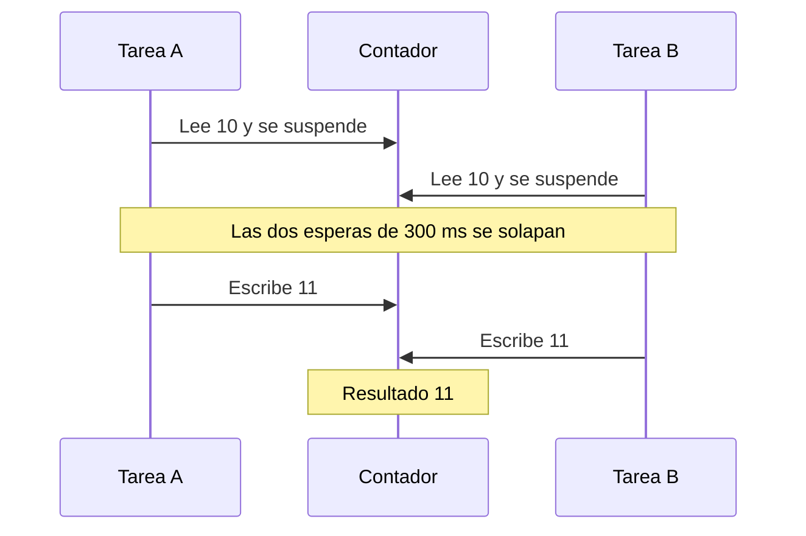
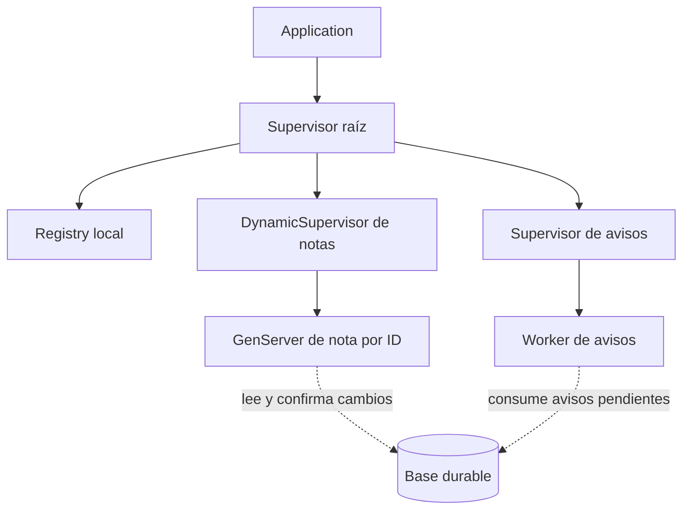
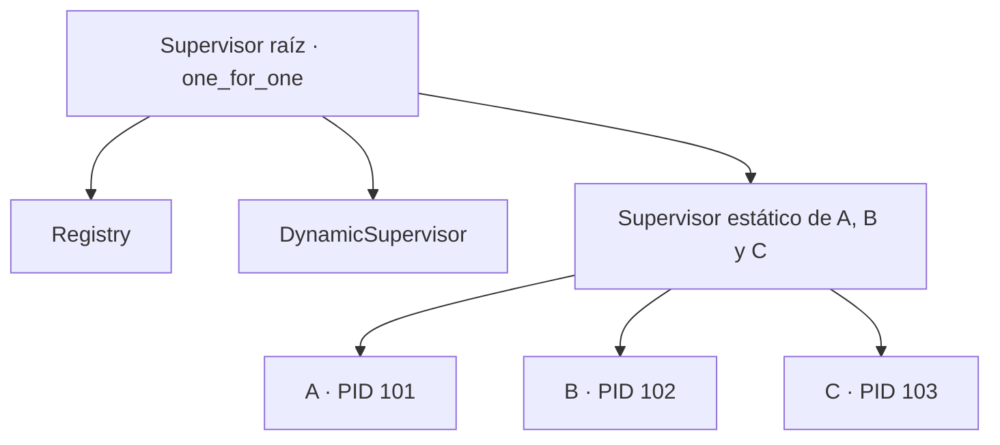
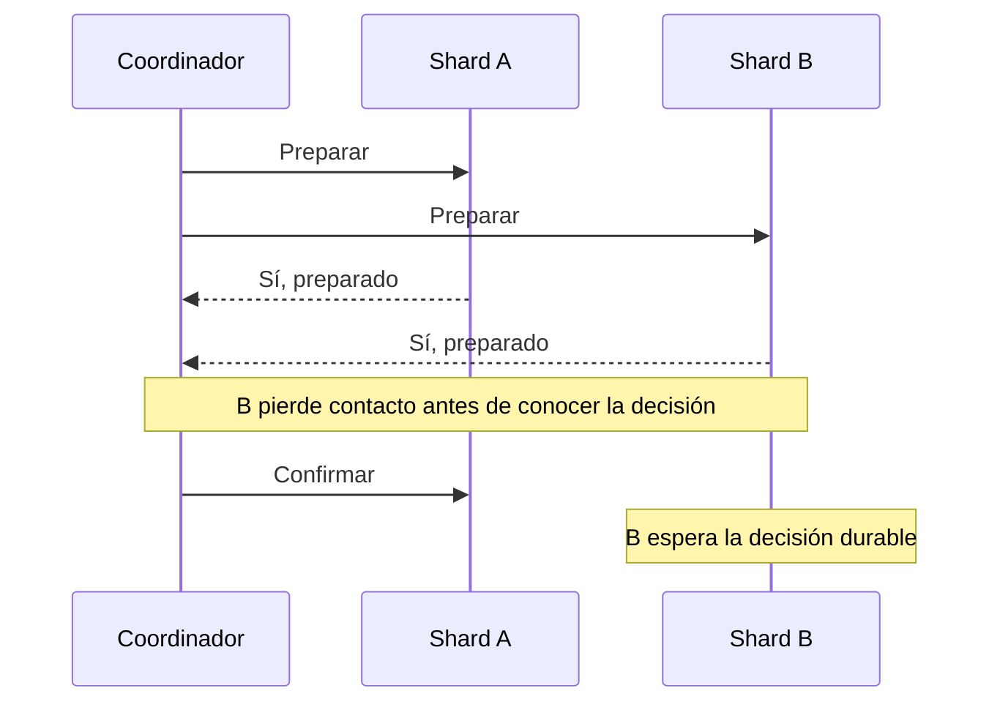
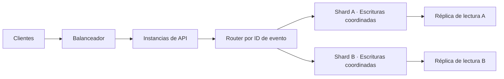
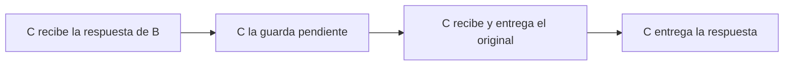

# Simulacro del Parcial 1

El [Parcial 1](Parcial%201.md) reúne el recuerdo de un teórico de **verdadero o falso con justificación**, menciones a Raft y 2PC sin sus enunciados exactos, y bocetos de un práctico de **notas compartidas**. Las consignas de esta página son nuevas y están inspiradas en ese formato.

Antes de abrir una respuesta, escribí **V o F y una razón concreta**. Si la frase es falsa, buscá un contraejemplo o indicá bajo qué condición podría ser verdadera. En los prácticos, dibujá primero tu solución y compará decisiones, estado, fallas y recuperación.

## Verdadero o falso

### 1. En un solo núcleo, dos corrutinas pueden progresar en el mismo intervalo aunque nunca ejecuten instrucciones de la aplicación a la vez.

**Respuesta:**

**Verdadero.** El runtime puede alternar sus turnos cuando una corrutina se suspende. Eso permite concurrencia. La ejecución simultánea de código de CPU requeriría capacidad de cómputo adicional.

### 2. Si un event loop corre en un solo hilo, una actualización que lee, espera I/O y escribe queda protegida contra carreras.

**Respuesta:**

**Falso.** El `await` puede ceder el hilo. Dos tareas pueden leer el mismo valor antes de que cualquiera escriba. El resultado depende del orden de la intercalación.

### 3. En asyncio, el sistema operativo decide directamente qué corrutina lista reanudar.

**Respuesta:**

**Falso.** El sistema operativo planifica el hilo y puede informar que la I/O está lista. El event loop organiza las tareas y elige qué corrutina reanudar.

### 4. Una función declarada con `async def` puede bloquear todo el event loop si llama a `time.sleep` en su hilo.

**Respuesta:**

**Verdadero.** `time.sleep` bloquea el hilo que lo ejecuta. Declarar la función con `async def` no cambia esa llamada. `await asyncio.sleep(...)` permite que el bucle atienda otras tareas durante la espera.

### 5. En un proceso MRI del modelo visto en clase, cuatro hilos nativos garantizan que cuatro tareas CPU-bound ejecuten código Ruby simultáneamente.

**Respuesta:**

**Falso.** El GIL limita la ejecución de código Ruby a un hilo por vez en ese modelo. Una llamada de I/O que libera el GIL puede permitir que otro hilo avance. Para la carga de CPU hay que distinguir MRI de JRuby o usar varios procesos.

### 6. Si un actor vivo está atendiendo un mensaje, un segundo mensaje que se le entrega puede quedar pendiente en el buzón.

**Respuesta:**

**Verdadero.** El actor puede seguir ocupado mientras el segundo mensaje espera. Después lo selecciona según su mecanismo de recepción. El hecho de que esté ocupado no causa por sí mismo que se pierda el mensaje.

### 7. Si el buzón contiene primero `:aviso` y después `{:saldo, 10}`, un `receive` que solo acepta `{:saldo, n}` puede procesar el segundo.

**Respuesta:**

**Verdadero.** `receive` selecciona el primer mensaje que coincide con el patrón. `:aviso` queda pendiente para una recepción que lo acepte.

### 8. Si `send/2` devuelve el mensaje y luego el cliente imprime «listo», el destinatario ya actualizó su estado.

**Respuesta:**

**Falso.** El retorno de `send/2` no confirma procesamiento. Para saber si se aplicó el cambio, el protocolo tiene que devolver una confirmación o permitir verificar el estado después.

### 9. Si vence el timeout de un `GenServer.call`, se garantiza que el servidor no aplicó el pedido.

**Respuesta:**

**Falso.** Venció la espera del cliente. El servidor pudo haber procesado la solicitud antes de enviar una respuesta tardía, o puede procesarla luego. Reintentar un efecto requiere deduplicación o idempotencia.

### 10. Dos operaciones separadas de `Agent.get` y `Agent.update` pueden perder un incremento aunque el Agent procese una solicitud por vez.

**Respuesta:**

**Verdadero.** A y B pueden leer 10 y después guardar 11 cada uno. La serialización es por solicitud. Una sola `Agent.update(pid, &(&1 + 1))` aplica el incremento al estado que el Agent tiene en el momento de ejecutarla.

### 11. Después de un reinicio de OTP, un cliente puede seguir usando el PID anterior sin resolver el nombre de nuevo.

**Respuesta:**

**Falso.** El PID identifica una instancia durante su vida. El reemplazo tiene otro PID. Un nombre lógico puede mantener la identidad de servicio y resolver el PID actual, con una posible ventana de indisponibilidad.

### 12. Un monitor permite que el observador reciba `:DOWN` por una falla sin que esa falla lo termine por el vínculo del monitor.

**Respuesta:**

**Verdadero.** Un monitor observa en una dirección y entrega una notificación. Un link puede propagar una salida anormal. El observador todavía puede decidir qué hacer ante la falla.

### 13. En `:one_for_all`, si un hijo permanente falla y corresponde reiniciarlo, el supervisor también detiene y vuelve a iniciar a los hermanos permanentes.

**Respuesta:**

**Verdadero.** La estrategia recupera el grupo en conjunto. Con `:one_for_one`, la falla de ese hijo solo provocaría el reinicio de ese hijo.

### 14. Tres respuestas `{:error, :sin_stock}` de un GenServer consumen necesariamente tres reinicios de `max_restarts`.

**Respuesta:**

**Falso.** La intensidad cuenta reinicios, no resultados de negocio. Un servidor puede responder `{:error, :sin_stock}` y seguir vivo con el mismo PID.

### 15. Si dos nodos de Elixir están conectados, `Registry` local encuentra automáticamente los procesos registrados en ambos.

**Respuesta:**

**Falso.** Conectar nodos habilita comunicación por red. OTP Registry registra procesos locales. Horde.Registry es una herramienta distinta con registro distribuido y convergencia eventual.

### 16. Si Horde vuelve a iniciar un trabajador en otro nodo, el estado que estaba solo en memoria puede perderse.

**Respuesta:**

**Verdadero.** El reemplazo ejecuta su inicialización. Para reconstruir el estado anterior necesita almacenamiento o réplicas administradas por la aplicación.

### 17. Si un clúster Raft de cinco miembros se divide en grupos de tres y dos, el grupo de dos no puede comprometer entradas nuevas.

**Respuesta:**

**Verdadero.** Una mayoría requiere tres votos o réplicas según la fase. Un líder viejo puede seguir vivo en la minoría, pero no reúne una mayoría para hacer commit.

### 18. En 2PC, una mayoría de votos afirmativos alcanza para confirmar aunque un participante haya votado que no.

**Respuesta:**

**Falso.** Todos los participantes deben votar sí para confirmar. Un solo voto negativo impide el commit. La mayoría de réplicas se usa para otras decisiones, como en Raft.

### 19. Una API replicada en cuatro nodos puede seguir saturada si las cuatro instancias dependen de la misma base de datos saturada.

**Respuesta:**

**Verdadero.** Agregar réplicas de la API distribuye el trabajo de esa capa. Si la base sigue siendo el cuello de botella, más instancias incluso pueden aumentar la presión sobre ella.

### 20. Si un G-Counter basado en estado recibe dos veces el mismo vector remoto, la segunda fusión puede sumar de nuevo esos incrementos.

**Respuesta:**

**Falso.** La fusión toma el máximo por componente. Aplicar el máximo dos veces con el mismo estado da el mismo vector. El total se calcula sumando los componentes del vector fusionado.

### 21. Una marca de Lamport menor alcanza para demostrar que un evento causó a otro.

**Respuesta:**

**Falso.** La causalidad implica una marca menor. El recíproco falla porque eventos sin una cadena causal también pueden tener marcas ordenadas.

### 22. FIFO por emisor puede entregar una respuesta antes del mensaje que provocó esa respuesta si los emitieron nodos distintos.

**Respuesta:**

**Verdadero.** FIFO conserva el orden de cada emisor. La dependencia entre emisores es una garantía de orden causal.

## Ejercicios prácticos

### 1. Corrutinas, tiempo y actualización perdida

A y B comparten un contador inicial de 10. Cada tarea lee el contador, espera 300 ms con `await asyncio.sleep(0.3)` y escribe el valor leído más uno. Ambas se agendan juntas en un solo hilo. Despreciá el tiempo de CPU.

1. Dibujá una intercalación posible y calculá el resultado y el tiempo aproximado.
2. ¿Qué cambia si se reemplaza la espera por `time.sleep(0.3)`?
3. Proponé una corrección que conserve el solapamiento de las esperas.

**Solución:**

- Con `asyncio.sleep`, esta ejecución dura unos **300 ms** y termina en **11**. Ambas lecturas ocurrieron antes de la primera escritura.
- Con `time.sleep`, una tarea retiene el único hilo hasta escribir. Después la otra lee 11 y escribe 12. En ese escenario simplificado se tarda unos **600 ms** y queda **12**.
- Para conservar el solapamiento, esperá la I/O primero. Después hacé la lectura y actualización juntas, sin un punto de suspensión entre ellas, siempre que el contador solo se use en ese bucle. También podés delegar el incremento completo a un dueño del estado.

**Punto de corrección:** hay que justificar por separado el tiempo y el valor final. Un solo hilo no elimina la primera intercalación.

### 2. Notas compartidas · Diseño integrador en Elixir

Los usuarios crean notas de hasta **200 caracteres**, con fecha y hora de expiración. Pueden compartirlas con otros usuarios. Cada destinatario lista las notas que recibió y debe poder recibir un aviso de expiración. Un actor puede caer y reiniciarse. Después, el sistema debe funcionar en varios nodos y tolerar que uno se caiga.

1. Dibujá el árbol OTP y anotá el estado de cada proceso. Explicá qué se registra con una clave lógica.
2. Describí qué mensajes intervienen al compartir una nota y al avisar su expiración. ¿Qué pasa si alguien intenta compartir justo cuando vence?
3. Explicá cómo recuperás una nota tras el reinicio. Separá el papel de libcluster, Horde y el almacenamiento.
4. Elegí qué garantía darías a las lecturas de la bandeja y a las escrituras sobre una nota durante una partición de red.

**Solución:**

Las flechas continuas representan supervisión. Las punteadas representan acceso a datos. En un nodo, el Registry arranca antes que los procesos que lo usan.

| Componente | Estado o responsabilidad |
| --- | --- |
| **GenServer de nota** | ID, versión, vencimiento y referencia del temporizador. Puede mantener una copia del texto y destinatarios para trabajar. |
| **Registry** | Mapea una clave lógica como `{:nota, id}` al PID actual. El ID sobrevive al cambio de PID. |
| **Datos durables** | Texto validado, vencimiento, destinatarios y avisos pendientes con un identificador único. Se puede indexar por destinatario para la bandeja. |
| **Worker de avisos** | Lee eventos pendientes, notifica y registra el resultado. Una clave como `{id_nota, id_usuario, versión}` permite deduplicar intentos. |

**Compartir.** El cliente llama al GenServer por ID. El actor valida permisos, fecha de expiración y el destinatario, y guarda el vínculo. Si el pedido llega tarde, devuelve un error. La decisión se toma con el estado vigente, incluso si el mensaje del temporizador todavía no entró al buzón.

**Expirar.** Al recibir `:expirar`, el proceso verifica la fecha y la versión. Guarda el nuevo estado y un aviso pendiente por cada destinatario en la misma transacción de base de datos. El worker puede reintentar la notificación. Si falla después de enviar y antes de confirmar, puede repetirse el intento, así que el receptor o canal necesita deduplicar. Al rehidratar, si ya pasó la fecha, se ejecuta el mismo flujo idempotente; si falta tiempo, se agenda otro temporizador.

**Distribuir.** libcluster conecta los nodos. Horde puede localizar por nombre y ubicar o reiniciar trabajadores. Particioná por ID de nota, y recuperá los trabajadores desde almacenamiento durable y replicado acorde a los fallos esperados. El temporizador y la copia en memoria se reconstruyen. Conservá las decisiones de escritura en un almacenamiento con una regla de coordinación, incluso si hay dos instancias durante una partición.

**CAP.** Para la escritura de un vínculo y el cierre por expiración, elegí preservar el orden sobre la nota. Si el lado aislado no puede confirmar el estado con el dueño autorizado o el quórum, demora o rechaza la escritura. La bandeja puede presentar una vista eventualmente consistente si el producto admite que una nota tarde en aparecer. La bandeja no debe usarse por sí sola para autorizar una escritura sobre la nota.

**Punto de corrección:** identificá el dueño del estado, dibujá el árbol, explicá cómo se retoma cada vencimiento y distinguí recuperación de procesos de recuperación de datos. Funciona también un diseño con actores por usuario si queda definido quién posee cada dato y cómo persiste.

### 3. Supervisión · Seguir los PID y la intensidad

Un supervisor raíz contiene un Registry y un DynamicSupervisor. Un supervisor estático separado agrupa los hijos permanentes A, B y C, con PID iniciales 101, 102 y 103. A y C no dependen de B. El supervisor de A, B y C tiene `max_restarts: 2` y `max_seconds: 5`.

1. Dibujá el árbol.
2. Si B falla, ¿qué PID cambian bajo `:one_for_one` y bajo `:one_for_all`?
3. En una ejecución nueva con `:one_for_one`, B cae a los segundos 1, 2 y 3. ¿Qué ocurre en el tercero? ¿Qué pasa con el Registry?
4. ¿Qué servicio permite encontrar a B sin guardar su PID anterior?

**Solución:**

Con **uno a uno** solo cambia el PID de B. Con **uno a todos** cambian los tres. Dado que son independientes, **uno a uno** evita reinicios innecesarios. El DynamicSupervisor puede iniciar otros hijos a demanda; no se usó para comparar la estrategia uno a todos, que no admite.

Al necesitar el tercer reinicio dentro de 5 segundos, el supervisor de A, B y C termina con sus hijos. Si su especificación en el supervisor raíz permite reiniciarlo y este no supera su propio límite, se recrea el subárbol. El Registry y el DynamicSupervisor son hermanos del supervisor estático y siguen vivos bajo la estrategia **uno a uno** de la raíz.

Si B registra una clave lógica al arrancar, el **Registry** permite resolver el nuevo PID. Durante la transición, la clave puede quedar brevemente sin proceso. El registro no conserva el estado de B.

### 4. Raft vs. 2PC · Dos decisiones distintas

En una plataforma de pedidos, cada shard replica su log con **Raft**. En un shard de cinco miembros se produce una partición **3–2**, y el líder anterior queda del lado de dos. Después, un movimiento de saldo que cruza dos shards usa **2PC**. Uno de los participantes votó sí y queda preparado, pero pierde contacto con el coordinador antes de conocer la decisión.

1. ¿Qué lado de Raft puede confirmar nuevas entradas? ¿Qué necesita para hacerlo?
2. En 2PC, ¿puede el participante preparado abortar o confirmar unilateralmente?
3. ¿Podés reemplazar el voto de un shard por «la mayoría de los shards dijo sí»?

**Solución:**

El grupo de **tres** puede elegir un líder válido y confirmar entradas nuevas si mantiene una mayoría accesible. El lado de dos puede conservar un líder anterior temporalmente, pero no puede hacer commit sin mayoría.

En el diagrama, el coordinador recibe los dos votos afirmativos y decide **commit**, que registra de forma durable antes de notificar. B, desde su lado, solo sabe que votó sí y quedó preparado. No puede deducir la decisión. Si abortara por su cuenta, podría contradecir una confirmación que A ya aplicó. Espera y recupera la decisión cuando haya comunicación con un coordinador o mecanismo que la conozca.

La mayoría en Raft acuerda **el mismo log** entre réplicas. En 2PC los shards tienen **partes distintas** de la transacción. Si uno vota no, la transacción no se confirma.

### 5. Particionamiento, réplicas y escalabilidad

Un sitio de reservas corre cuatro copias de la API y una sola base de datos. La API puede escalar, pero la base está saturada. Las lecturas de catálogo toleran unos segundos de atraso. Para reservar el último asiento, el negocio exige que solo una operación pueda tener éxito.

1. Proponé una mejora para las lecturas y otra para repartir los datos.
2. Elegí una clave de partición y explicá qué pasaría con un evento de popularidad excepcional.
3. Ante una partición de red, ¿qué permitirías del lado que no puede confirmar una reserva? ¿Qué harías con las lecturas de catálogo?
4. ¿Qué le pedís a un healthcheck de readiness?

**Solución:**

- **Lecturas.** Usá réplicas de lectura o caché para el catálogo si puede mostrar datos atrasados. Una lectura que decide una reserva debe consultar el camino que protege el inventario.
- **Partición.** Una clave como ID de evento mantiene sus asientos juntos y facilita enrutar pedidos. Un evento enorme puede saturar su shard. Quizá convenga aislarlo o repartirlo por zonas si las reglas permiten reservar sin coordinar entre zonas.
- **CAP.** Conservá una decisión única de reserva. Del lado sin autoridad ni quórum, rechazá o demorá la operación. Puede ser aceptable mostrar un catálogo viejo si es explícito que la disponibilidad del asiento se confirma al reservar.
- **Readiness.** Comprobá si esa instancia puede atender el tráfico que se le envía, por ejemplo que esté inicializada y que tenga acceso a la dependencia requerida. Una sonda frecuente debe ser barata. Readiness decide ruteo; no es por sí sola una orden de reiniciar la aplicación.

### 6. Relojes, broadcast y convergencia

A y B empiezan con Lamport 0 y vector `[0,0]`. A envía un mensaje original a B. Antes de recibirlo, B registra un evento local. B recibe el original y luego emite una respuesta. Un nodo C recibe la respuesta por otra ruta antes de recibir el original.

1. Calculá los relojes de A al enviar y de B tras cada uno de sus tres eventos.
2. ¿Qué puede entregar C bajo FIFO por emisor? ¿Qué tiene que hacer si exige orden causal?
3. En otro flujo, durante una partición, A incrementa dos veces un G-Counter y B lo hace tres veces. ¿Cómo se fusionan y qué pasa si B reenvía el mismo estado?

**Solución:**

| Evento | Lamport | Vector [A, B] |
| --- | --- | --- |
| A envía | 1 | `[1,0]` |
| B registra el evento local | 1 | `[0,1]` |
| B recibe el original | 2 | `[1,2]` |
| B envía la respuesta | 3 | `[1,3]` |

Los eventos iniciales de A y B tienen vectores incomparables. La respuesta sí depende del original. FIFO por emisor puede entregar primero la respuesta porque A y B son emisores distintos. Con orden causal, C conserva la respuesta hasta entregar el original.

En el G-Counter se fusionan `[2,0]` y `[0,3]` por máximo componente a componente. Ambas réplicas llegan a `[2,3]`, cuyo valor es **5**. Si se recibe de nuevo `[0,3]`, los máximos no cambian.

## Dónde volver a estudiar

- Corrutinas, event loop y carreras en un solo hilo: [2. Corrutinas](../Clases/2.%20Corrutinas.md)
- GIL, MRI y JRuby: [1. Intro, green threads y procesos](../Clases/1.%20Intro,%20green%20threads%20y%20procesos.md)
- Actores, mensajes, Agent: [4. Elixir](../Clases/4.%20Elixir.md)
- Supervisión, estrategias, intensidad y Registry: [5. Supervisores](../Clases/5.%20Supervisores.md)
- Horde, libcluster y caída de nodos: [6. Distribución libcluster y Horde](../Clases/6.%20Distribución%20libcluster%20y%20Horde.md)
- Particionamiento, réplicas, healthcheck y CAP: [7. Sistemas distribuidos escalabilidad y CAP](../Clases/7.%20Sistemas%20distribuidos%20escalabilidad%20y%20CAP.md)
- Raft, 2PC y CRDTs: [8. Coordinación, consenso y CRDTs](../Clases/8.%20Coordinación,%20consenso%20y%20CRDTs.md)
- Lamport, vectoriales y broadcast: [9. Relojes y broadcast](../Clases/9.%20Relojes%20y%20broadcast.md)
