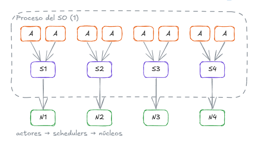
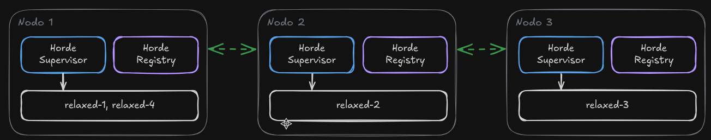

### Concurrencia
El SO reparte **threads** entre procesos. Hace falta más de un proceso cuando hay **1 solo thread corriendo a la vez** por proceso.
- **IO/CPU Bound**
- **Condición de carrera** / **Starvation** / **Deadlock**

---

## Procesos SO, Hilos SO, Green Threads

### MRI - Ruby 1.8.7
- **Green threads**, IO bloquea → el kernel no los ve
- Paralelismo con **varios procesos**
- no **GIL**, no compiten con nadie

### MRI - Ruby 1.9
- **Threads SO**
- **GIL**, no es thread safe (**checkpoints** del GIL en ciertos puntos para ver si 10.000 instrucciones), IO no bloquea
- Cada proceso tiene su GIL, mientras corre lo tiene
- Por estar hecho en C, GIL necesario para **proteger al intérprete**.

### JRuby - JVM
- **Threads Nativos**
- no **GIL**, por estar (JVM) hecha para correr múltiples threads en paralelo
- Usa **todos los núcleos** y no bloquea

---

## Event Loop y Corrutinas
> - Muchísima I/O con un solo thread.
> - No sirve para CPU Bound.
> - **NO HAY PARALELISMO**

- Muchos threads para muchos sockets de conexión → te quedás sin memoria / threads antes que sin sockets.
- **Planificación**: **Apropiativa** (Scheduler SO) / **Cooperativa** (Contexto cede el control)
- **CPS** (*Continuation Passing Style*): En vez de hacer `return` se recibe un callback y se ejecuta con el resultado. Usar el resultado fuera de la continuación es *code smell*. **Callback hell** (se alivia con pipeline).

### Event Loop - JS
El loop viene en **runtime**. Trabaja con **callbacks** y **promises**, `await` / `async` es sugar de promises para escribirlo como sincrónico, es **eager**

El **Callback** es pasarle la continuación como parametro a la función asíncrona. La **Promise** devuelve un objeto que representa el resultado futuro.

- **Heap** (var. y estructuras), **Call Stack** (en ejecución, 1), **Callback Queue** (donde van los callbacks al terminar)
- Puede haber **condición de carrera** si cuando cede otro modifica su trabajo y al volver quiere seguir trabajando.

### Corrutinas - Python
Python lleva un **contador de cuántas referencias** apuntan a cada objeto. Cuando estas referencias llegan a 0 libera la memoria. Para proteger cada contador utiliza el **GIL**.

Trabaja con **corrutinas**. El loop es una **biblioteca**: la biblioteca `asyncio` y sus métodos, le ceden el control al event loop hasta terminar, al terminar el event loop lo retoma, es **lazy**

La **Corrutina** es una función que se puede pausar y retomar donde quedó, la continuación es lo que queda de la función. Solo cede en sus `await`s, si llama a algo bloqueante es lo mismo.

- `yield`: entrega un valor, pausa congelando el estado y `next` la retoma después del `yield`. `return` borra el estado. Llamar a la función solo crea el objeto generador, no ejecuta.
- `await`: espera a eso que cedió el control y retoma cuando el event loop le devuelve el control.
- `Future`: el resultado que no existe
- `Task`: agenda la corrutina (objeto `Future` pausado que alguien tiene que retomar) en el loop y la ejecuta cuando.

Por detrás siguen existiendo los callbacks, pero la `Task` se lo pone a ese `Future` para decirle que cuando resuelva la retome.

#### Formas de correr corrutinas
- `ayncio.run(coro)`: corre una corrutina de punta a punta.
- `await coro`: espera el resultado y cede el control mientras tanto.
- `create_task(coro)`: no espera el resultado y cede el control
- `gather(coro1, coro2...)`: corre todas en el orden que se pasaron, si falla una siguen las demás (devuelve lista con errores)
- `TaskGroup`: corre y espera a todas, si una falla cancela las demás.

---

## STM
> - Transacciones cortas
> - Estado Mutable Compartido
> - Operaciones como **UNA SOLA**
> - Mutex agrega más complejidad de la necesaria

- `IO` encerrado en un tipo, es una **monad**. Una acción que cuando el runtime de GHC la ejecuta después produce un valor.
- **Functor** (F/VE) / **Applicative** (FE/VE) / **Monad** (FDVE/VE)
- La **Monad IO** encadena computos en un contexto, permite escribir código secuencial en un lenguaje como Haskell.

#### Estado Mutable
- `IORef`: referencia a un aposición en memoria. No es threadsafe.
- `MVar`: variable mutable que puede estar llena o vacía (bloquea hasta tener el valor). Sirve para pasar resultados entre threads.

Pero esto vuelve a traer el problema de los threads y locks.

### Optimista
A de ACID, **atomicidad**, todo o nada. Ejecuta suponiendo que no habrá conflicto y **VERIFICA AL FINAL** si el trabajo sigue siendo válido.

Si lo logra hace **COMMIT**, publica cambios. Si no funciona **RE-EJECUTA** desde el principio, con un costo.

- `TVar`: Variables compartidas transaccionales. Sus operaciones se vuelve `STM` en vez de `IO`, más restringido. Una única operación.

STM **no bloquea** a las TVars.

---

## Actores
Los procesos de la **BEAM** NO son los del SO, son livianos planificados por la VM. Funciona con **un scheduler por nucleo** y reparte los actores entre ellos. **Un único proceso alcanza para los 4 núcleos.**

La BEAM es un **SOLO proceso del SO**, pero levanta un scheduler por core.

- **Actor**: contextos de ejecución aislados
- **Mailbox**
- **Pattern Matching**
- **Call** asincrónico / **Recieve** sincrónico - `spawn`
- **Let it crash**
- **Nodo**: instancia de la VM de earlang
- **Cluster**: grupo de nodos conectados que pueden enviarse mensajes. Conexiones transitivas, cuando uno se conecta se conoce con todos, si el nodo sabe a quien conectarse.
- **PID**: identificador del proceso en todo el por cluster.
- **Cookie**: challenge para conectar solo los nodos que deben conectarse entre sí, tiene una por default en una misma máquina. No es seguridad, la seguridad va por fuera. 
- **EPMD**: Uno por máquina, se levanta solo al arrancar el nodo por nombre, sabe en qué puerto atiende cada nodo. 
- **Heartbeat**: La caída se detecta por FALTA de tick → no distingue si el otro nodo se cayó, si se cortó la red (partición) o si está muy lento. Solo sabe que se perdió la comunicación.
- **Failover**: se cae el nodo activo → la aplicación se levanta en el siguiente de la lista. ante falta de heartbeat detectar la caída del nodo (nodeup | nodedown)
- **Takeover**:  vuelve un nodo de MAYOR prioridad → recupera la aplicación y el respaldo la detiene.

---

### Componentes de Actores
- **OTP**: Mddlwares, librerías y herramientas que encapsulan implementaciones.
- **Observer**: herramienta gráfica para visualziar memoria, CPU, schedulers y procesos vivos con estado, mailbox, links y monitores.
- **libcluster**: únicamente forma el cluster automáticamente y reconectar cuando vuelve. NO LEVANTA. Estrategias de discovery: EPMD | LocalEPMD | EarlangHost | Gossip (aviso UDP multicast, no recomendado porque al no haber ACK en UDP se pueden perder los paquetes, el heartbeat, falso negativo) | Kubernetes o DNS (Consultando API de Kubernetes o registro DNS)
- **Horde**: cubre lo que libcluster no; DÓNDE vive cada proceso, supervisión y registry a nivel cluster.

#### Señal
Forma de **propagar errores**. Los procesos reciben señales, que **no son mensajes**, manejadas por la VM, sin pasar por el mailbox, viajan con una razón y permiten terminar el proceso.

#### Link
relacion **bidireccional** entre procesos para propagar el error.

#### Monitor
**unidireccional**, **no propaga la muerte**, cuando el monitoreado muere al monitor le llega un mensaje al mailbox. No levanta devuelta al proceso.

#### Tasks
abstraccion sirve de procesos para **batch**, no recibe mensajes personalizados, **no tiene estado**.

#### Agents
interfaz ya armada para **guardar estado**; `get`, `update` y variantes. Menos personalizable.

#### GenServer (OTP)
sirve para crear **procesos de larga vida**, en vez de ejecutar y morir (como `spawn`). Quedan escuchando su mailbox en loop. `handle_cast` para manejar estado y `handle_call`, quien llama queda esperando, hace `receive` + `send`, por detrás es asincrónico.

#### Registry
Proceso funciona como guía telefónica.  Cuando un proceso registrado MUERE, su entrada
SE BORRA SOLA; cuando el supervisor lo REINICIA y se vuelve a registrar con la misma clave, queda con el PID NUEVO.

Es **local al nodo**, no encuentra los registrados en otro nodo, aunque estén contectados.

Localiza, no supervisa ni guarda el estado. 

#### Registry (Horde)
Registry DEL CLUSTER: registrás un nombre una vez y lo encontrás DESDE CUALQUIER NODO (via tuple {:via, Horde.Registry, {Reg, nombre}}).

#### Supervisores (OTP)
Proceso especial de OTP cuyo único trabajo es **SUPERVISAR A SUS HIJOS**: los **CREA** al arrancar y los **VUELVE A CREAR** cuando fallan. Se encarga de **TODO EL CICLO DE VIDA** de sus hijos. Está linkeado a sus hijos pero maneja `trap_exit`, recibe la señal pero no muere. Si muere, todos sus hijos mueren.

**Funcionamiento de Supervisores:**
- **Estáticos** (children es lista) / **Dinámicos** (children se añaden dinámicamente sin orden con `start_child`)
- Los children se registran con `id`, `start`, `restart` (qué hacer cuando termina), `type` (supervisor/worker), `shutdown`.

**Manejo de restart**:
- **permanente**: con error reinicia y si termina normal lo reinicia igual
- **tranmsient**: con error lo reinicia y si term,ina normal no
- **temporary**: nunca lo reinicia

**Estrategias de reinicio:**
- **one for one**: solo el hijo que falló
- **one for all**: todos
- **rest for one**: el que falló y los definidos después en la lista, útil para dependencias en casada

#### DynamicSupervisor (Horde)
Supervisor dinámico DEL CLUSTER. Le pasás un child spec y crea el proceso en ALGÚN nodo (no necesariamente el tuyo). Si se cae el nodo, lo vuelve a levantar en otro. El nombre entre nodos debe ser el mismo.

Manejo de failover: El proceso recreado ARRANCA CON SU ESTADO INICIAL (lo que dice el child spec): el estado que tenía SE PERDIÓ. Lo que se conserva es la IDENTIDAD: ese proceso, con ese nombre (ej. un nº de cuenta), sigue existiendo en algún nodo → otro PID, mismo nombre. Replicar el estado es trabajo nuestro.

**Estrategias de distribución**
Con qué criterio elige el nodo para cada proceso:
- **Uniform Distribution**: HASH del id del hijo → reparte parejo entre los nodos vivos
- **Random Distribution**: Un nodo AL AZAR
- **Quorum  Distribution**: Como la uniforme, pero solo arranca procesos si ESTE LADO del cluster tiene QUÓRUM (mayoría de nodos). Ante un netsplit, solo el lado con mayoría de nodos arranca procesos → evita que las dos mitades levanten el mismo proceso.

---

## Distribución
