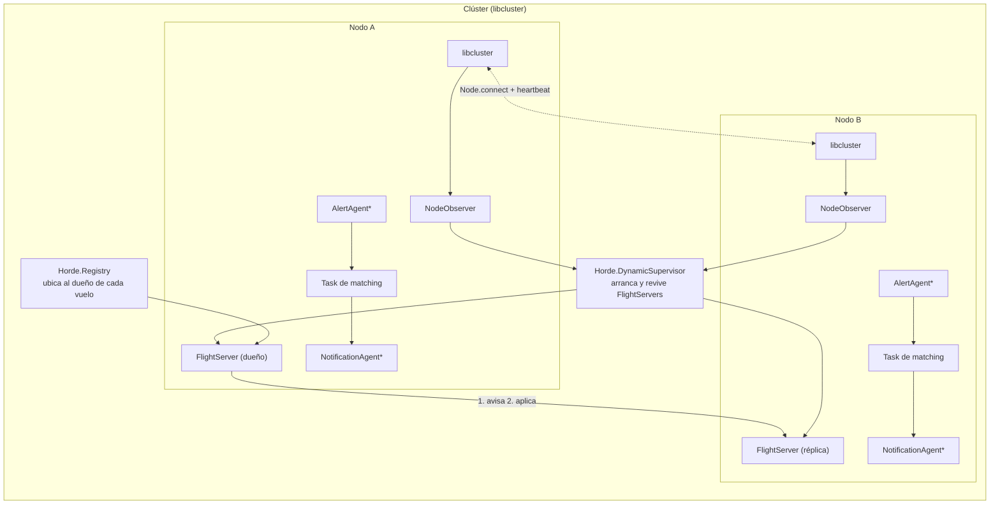

# Propuesta TP: sistema distribuido de vuelos, alertas y reservas en Elixir

## 1. Objetivo

Aplicación en Elixir, distribuida en varios nodos, donde:

- Un tipo de cliente **publica vuelos** de un origen a un destino, con horarios y una cantidad de asientos por cada tipo de asiento.
- Otro tipo de cliente **publica alertas de búsqueda**. Si una alerta coincide con un vuelo, se le **genera una notificación**.
- Ese cliente puede **reservar** un asiento de un tipo determinado en un vuelo.

**Restricciones de la materia:**

- No se usa base de datos ni nada que resuelva la concurrencia por nosotros. El estado vive en procesos y la concurrencia la resolvemos nosotros.
- **Horde está permitido.**

---

## 2. Modelo de datos

| Entidad | Campos |
|---|---|
| `Flight` | `type`, `seats_per_type: %{SeatType => Integer}`, `start`, `end`, `airline`, `from_iata`, `to_iata`, `open: Boolean`, `offer_ends` |
| `Alert` | `start`, `month`, `from_iata`, `to_iata`, `person` |
| `Booking` | `person`, `flight`, `canceled: Boolean`, `seat_type: %{SeatType => Integer}` |
| `Notification` | `message`, `person` |
| `Person` | `name`, `surname`, `passport` |
| `SeatType` (enum) | `WINDOW`, `CORRIDOR`, `MIDDLE` |

---

## 3. Endpoints

Cada nodo expone los mismos endpoints. Cualquier nodo puede atender cualquier request.

| Endpoint | Qué hace |
|---|---|
| `POST /vuelos` | Publica un vuelo: Horde levanta su `FlightServer` y se dispara la task de matching |
| `POST /reservas` | Reserva un asiento de un tipo en un vuelo: va al `FlightServer` dueño vía `Horde.Registry` |
| `POST /alertas` | Publica una alerta: se guarda en `AlertAgent`, se replica y se dispara la task de matching |
| `GET /notificaciones` | Devuelve las notificaciones de un usuario desde `NotificationAgent` |

---

## 4. Arquitectura final



`*` = se replica en todos los nodos avisándose entre sí, sin concepto de dueño.

### 4.1 Procesos y responsabilidades

| Proceso | Tipo OTP | Dónde vive | Responsabilidad |
|---|---|---|---|
| `FlightServer` (dueño) | `GenServer` | **Un único nodo** por vuelo, elegido por Horde | Es la única fuente de verdad de los asientos del vuelo. Procesa las reservas de a una por su mailbox, así que no hay carreras |
| `FlightServer` (réplica) | `GenServer` | Otro nodo | Guarda una copia del estado del vuelo, es de solo lectura y no recibe reservas. Si el dueño cae, su copia es la que permite seguir |
| `Horde.Registry` | Horde | Distribuido (todos los nodos) | Registro global que dice en qué nodo vive el dueño de cada vuelo. No guarda el dato del vuelo, solo la ubicación del proceso |
| `Horde.DynamicSupervisor` | Horde | Distribuido (todos los nodos) | Reparte los `FlightServer` entre nodos y, si un nodo cae, los vuelve a levantar en otro |
| `AlertAgent` | `Agent` | Copia en cada nodo | Alertas de búsqueda. Se replican avisando a los demás nodos |
| `NotificationAgent` | `Agent` | Copia en cada nodo | Notificaciones por usuario. Se replican igual que las alertas |
| Task de matching | `Task` (lanzar y olvidar) | El nodo donde ocurrió el evento | Cruza alertas con vuelos y, si hay match, crea la notificación |
| `NodeObserver` | `GenServer` propio (no es de Horde) | Uno por nodo | Se suscribe con `:net_kernel.monitor_nodes(true)`, recibe `{:nodeup, n}` / `{:nodedown, n}` y actualiza los miembros de Horde con `Horde.Cluster.set_members` |
| libcluster | Librería | Uno por nodo, en el árbol de supervisión | Descubre los demás nodos según la estrategia configurada y ejecuta `Node.connect` |

---

## 5. Decisiones de diseño y por qué

### 5.1 De "lock global sobre todos los agents" a "un dueño por vuelo"

**Idea original:** un agent con todos los vuelos, replicado en cada nodo. Para reservar se bloqueaban todos los agents de todos los nodos, se reservaba, se replicaba y se liberaba el lock.

**Problemas que encontramos:**

- Un `Agent` es solo estado con `get`/`update`: no sirve para coordinar un lock entre nodos ni para lógica como "si no hay asiento, rechazar".
- El lock distribuido hecho a mano es frágil: si un nodo se cae con el lock tomado, nadie lo libera y el vuelo queda bloqueado para siempre.
- No tiene sentido que sea el propio agent de datos quien coordine el bloqueo de los demás.

**Solución:**

1. **Un proceso por vuelo.** El dueño de los asientos de un vuelo es ese vuelo, así que cada vuelo es su propio `GenServer`.
2. **Un único dueño en todo el clúster.** Si hubiera una copia "activa" por nodo, volvería la carrera entre nodos. Por eso cada vuelo tiene un solo `FlightServer` dueño, y todos los nodos le mandan mensajes a él.
3. **El mailbox reemplaza al lock.** Un `GenServer` procesa los mensajes de a uno, así que dos reservas simultáneas quedan en cola y se atienden en orden, sin lock explícito.
4. **Registro global** (`Horde.Registry`) para que cualquier nodo sepa a dónde mandar el `GenServer.call`.

### 5.2 Tolerancia a fallos: el estado tiene que estar en otro lado antes de morir

- Si cae el nodo del dueño, el proceso muere de golpe y **no tiene chance de avisar su estado**. Por eso el estado se replica **antes**, en cada cambio.
- Hay dos problemas distintos:
  - **Disponibilidad**, o sea dónde vuelve a nacer el proceso: lo resuelve `Horde.DynamicSupervisor`. Un supervisor común no sirve, porque reinicia en el mismo nodo, que ya no existe.
  - **Estado**, o sea con qué datos vuelve a nacer: Horde revive el proceso, no el estado, así que el nuevo dueño arranca con la copia de la réplica.

### 5.3 Orden de una reserva: primero avisar, después aplicar

Criterio: **es preferible duplicar una reserva antes que perderla.** Un usuario con confirmación y sin reserva registrada es el peor caso.

| Orden | Si el dueño muere en el medio | Resultado |
|---|---|---|
| Aplicar en el dueño y después avisar a las réplicas | La réplica asume con el estado viejo, y el asiento vuelve a figurar libre | **Pérdida**, sin rastro de la reserva |
| **Avisar a las réplicas y después aplicar en el dueño** | La réplica tiene la reserva aunque el dueño no llegó a aplicarla | **Duplicado o inconsistente, pero recuperable** con una reconciliación |

**Elegido:** `1. Avisar a las réplicas → 2. Aplicar en el dueño → 3. Responder al usuario`.

### 5.4 Flujo de reserva

1. `POST /reservas` llega a cualquier nodo.
2. Se busca el dueño del vuelo en `Horde.Registry` y se hace `GenServer.call`.
3. El `FlightServer` dueño verifica si hay asiento del tipo pedido.
   - Si no hay, rechaza (por ejemplo con 409).
   - Si hay, avisa a la réplica, aplica el descuento en su estado y responde OK.

No hay lock: la exclusión la da el mailbox del dueño.

### 5.5 Matching por eventos en vez de una task programada

- **Problema de la task periódica:** comparar todas las alertas contra todos los vuelos es cuadrático. Con 10.000 × 10.000 son 100 millones de comparaciones, y si se duplican ambos lados, el trabajo se cuadruplica.
- **Solución:** el matching se dispara **por evento**.
  - Al publicar un vuelo, se compara ese vuelo contra las alertas existentes.
  - Al publicar una alerta, se compara esa alerta contra los vuelos existentes.
- **Asíncrono:** el controller responde enseguida ("publicado") y lanza la task aparte. No espera resultado, es un caso de lanzar y olvidar (`Task.start` o `Task.Supervisor.start_child`).
- **Dónde corre:** solo en el nodo donde ocurrió el evento. No hace falta correrla en todos los nodos, porque ese nodo ya tiene copia local de las alertas y puede consultar los vuelos. Si hay match, escribe en `NotificationAgent`, que se replica solo. No necesita ser el nodo dueño del vuelo.

### 5.6 Por qué alertas y notificaciones no necesitan dueño

- No hay un recurso escaso que se pelee: publicar una alerta no le quita nada a otra.
- Cualquier nodo la acepta, la guarda en su copia y avisa a los demás. Puede haber una ventanita de desacuerdo entre nodos, pero es aceptable.
- El `Horde.Registry` **sí** necesita una sola verdad compartida: si cada nodo tuviera su propia versión, dos nodos podrían creerse dueños del mismo vuelo.

### 5.7 CRDTs

- Son estructuras que cada nodo modifica localmente y que después se mezclan sin conflicto. Es lo que hacíamos a mano con las alertas.
- **Sirven** para `AlertAgent` y `NotificationAgent`, porque solo acumulan datos. Horde usa `DeltaCrdt` por dentro.
- **No sirven para los asientos:** garantizan que las copias converjan, pero no que se respete "no vender más asientos de los que hay". Si dos nodos venden el último asiento por separado, la mezcla queda con un asiento vendido dos veces. Por eso el vuelo sigue necesitando un dueño único.

---

## 6. Clúster

### 6.1 Levantar y conectar nodos

Cada nodo se levanta a mano, en su terminal, con nombre y **la misma cookie**:

```bash
iex --sname a --cookie secreto -S mix
iex --sname b --cookie secreto -S mix
```

Conexión manual: `Node.connect(:"b@mi-maquina")`. Para ver los nodos conectados: `Node.list()`.

En Erlang las conexiones son transitivas: si C se conecta a A, termina conectado también con los que conocía A.

### 6.2 libcluster

- **No levanta nodos**, solo conecta nodos que ya están corriendo.
- Corre dentro de cada nodo como un proceso más del árbol de supervisión, lee la topología configurada y ejecuta él mismo el `Node.connect`.

| Estrategia | Cómo descubre nodos |
|---|---|
| `Epmd` | Lista fija de nodos. Un nodo nuevo entra si conoce a alguno de la lista |
| `LocalEpmd` | Nodos en la misma máquina (ideal para probar) |
| `ErlangHosts` | Archivo `.hosts.erlang` |
| `Gossip` | Multicast en la red local: cada nodo se anuncia y escucha a los demás |
| `Kubernetes` / `DNSPoll` | API de Kubernetes o registro DNS |

Para el TP conviene usar `Gossip` o `LocalEpmd`. Para escalar libremente hace falta una estrategia dinámica, como `Gossip`, `DNSPoll` o `Kubernetes`.

### 6.3 Heartbeat y caída de nodos

- La distribución de Erlang ya trae el heartbeat: los nodos se mandan un *tick* periódico. Si uno no responde durante `net_ticktime` (60 s por defecto), se emite `nodedown`.
- **Nadie revive el nodo caído.** Eso es tarea de la infraestructura (systemd, Kubernetes).
- Lo que sí se revive son los **procesos** que vivían ahí: Horde levanta esos `FlightServer` en los nodos vivos, con el estado de las réplicas.
- `NodeObserver` actualiza los miembros de Horde con `Horde.Cluster.set_members`. La alternativa es configurar Horde con `members: :auto` y prescindir del `NodeObserver`, aunque igual sirve para emitir eventos a la interfaz.

---

## 7. Riesgos conocidos

- **Split brain:** si la red se parte, cada mitad cree que la otra murió y puede ascender su propia réplica, con lo que quedan dos dueños del mismo vuelo por un momento. Pasa tanto con Horde, que es eventualmente consistente, como con un diseño hecho a mano.
- **Reservas duplicadas:** son una consecuencia aceptada del orden "avisar y después aplicar". Requieren reconciliación.
- **Ventana de desacuerdo** en alertas y notificaciones mientras se replican.

---

## 8. Extra: interfaz de visualización en vivo

Idea: una interfaz que dibuje este mismo diagrama y muestre en vivo lo que hacen los actores, con un mapeo uno a uno entre cajas y procesos.

- **El frontend es solo un espectador.** Los actores emiten eventos estructurados (logs JSON, `:telemetry.execute`), un lector independiente los consume y el navegador los recibe por un canal de una sola dirección (Server-Sent Events, o LiveView con `Phoenix.PubSub`). La lógica de negocio no sabe que la interfaz existe: si se cae o nadie mira, el sistema sigue igual.
- Cada caja tiene una clave `{nodo, nombre}` que la une con el proceso real.
- Eventos de ejemplo: `reserva_aplicada`, `replica_avisada`, `alerta_publicada`, `match_encontrado`, `nodeup` / `nodedown`. El `NodeObserver` prende o apaga el recuadro de cada nodo.
- El estado (por ejemplo, los asientos libres) viaja dentro del evento. `:sys.get_state` y `:erlang.trace` quedan solo para depurar.
- **Limitación:** la interfaz solo muestra lo que los actores decidan emitir.
- Alternativas ya hechas, pero sin este diagrama: Phoenix LiveDashboard y `:observer`.

---

## 9. Pendientes

- [ ] **Traspaso de dueño:** cómo el `FlightServer` que Horde revive obtiene el estado de la réplica (por ejemplo, la consulta en su `init`) y cuántas réplicas tiene cada vuelo.
- [ ] **Reconciliación de reservas duplicadas** cuando el dueño muere entre avisar y aplicar.
- [ ] **Manejo del split brain:** qué hacer cuando se reconecta la red y hay dos dueños.
- [ ] **Cuándo confirmar al usuario:** ¿hay que esperar el ack de la réplica antes de responder OK?
- [ ] **Criterio de match** entre `Alert` y `Flight` (`from_iata`, `to_iata`, `month` o `start`) y cómo evitar notificar dos veces el mismo match.
- [ ] Uso de `open`, `offer_ends` y `canceled`: cierre de la oferta y cancelación de reservas.
- [ ] Lista definitiva de eventos que emite cada actor para la interfaz.
